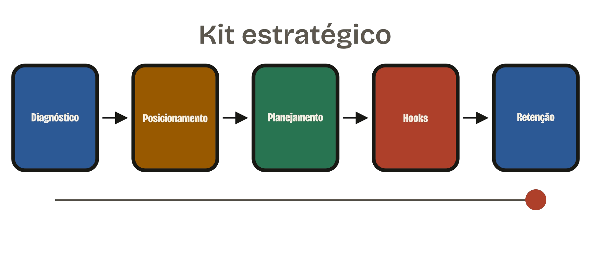
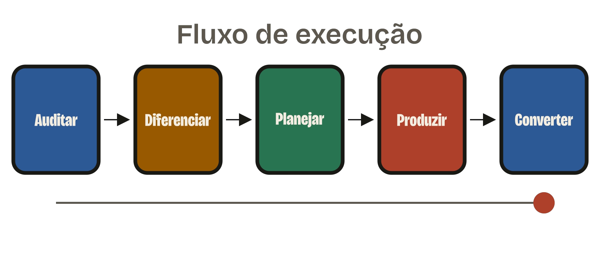

# 12 categorias de hooks para Reels e carrossel com o Claude

_2026-11-27 · tutorial_

A apostila reúne os três primeiros de sete prompts para usar o Claude como apoio na estratégia de um perfil de Instagram. Ela mostra como configurar o contexto uma vez e depois rodar a auditoria de performance, a construção do posicionamento e o planejamento de 30 dias de conteúdo. Cada prompt vem completo, com as informações a preencher, as etapas de análise e o critério de rigor.

## Kit estratégico: 7 prompts para dominar seu Instagram



_Cinco dos sete prompts do kit: diagnóstico, posicionamento, planejamento, hooks e retenção_

Diagnóstico, posicionamento, conteúdo, retenção, conversão e performance com apoio do Claude.

- 01 Diagnóstico
- 02 Posicionamento
- 03 Planejamento
- 04 Hooks
- 05 Retenção
- 06 Funil
- 07 Performance

## Prompts completos, aplicação prática e fluxo de execução

Claude / Instagram. 7 prompts estratégicos. Workbook de execução.

## Antes de começar: configure o contexto uma vez

O Claude consegue estruturar análises e recomendações, mas a qualidade das decisões depende dos dados que você fornecer. Use as informações abaixo como base para todos os prompts.

## 01 Perfil e negócio

- Perfil: [@USUÁRIO]; Nicho: [NICHO]; Público: [PÚBLICO]
- Oferta: [PRODUTO/SERVIÇO]; Preço: [TICKET]; Objetivo: [ALCANCE/SEGUIDORES/LEADS/VENDAS]

## 02 Produção e recursos

- Formatos: [REELS/CARROSSEL/STORIES]; Frequência viável: [POSTS/SEMANA]
- Tempo disponível: [HORAS/SEMANA]; Canal de venda: [DIRECT/WHATSAPP/SITE/REUNIÃO]

## 03 Dados que valem ouro

Últimos 30 dias: alcance, visualizações, visitas ao perfil, novos seguidores, interações, leads e vendas.

Amostras: links, capturas de tela ou transcrições de 3 posts fortes e 3 posts fracos; bio, destaques e conteúdos fixados.

## Como executar

1. Comece pelo diagnóstico e pelo posicionamento.
2. Gere o calendário e os hooks dos conteúdos prioritários.
3. Transforme os melhores hooks em roteiros.
4. Estruture o caminho de conversão.
5. Revise semanalmente os dados e ajuste o plano.

## Regra de qualidade

Sempre que faltar informação, peça ao Claude para declarar o que ele não pode verificar, separar fatos de hipóteses e usar exemplos apenas como exemplos. Não trate estimativas como resultados comprovados.

## Prompt 01 de 07: Auditoria de performance

Descubra o que está limitando alcance, crescimento e receita, com recomendações priorizadas.

Personalize antes de enviar: [@USUÁRIO], [NICHO], [PÚBLICO], [OFERTA], [TICKET] e os dados dos últimos 30 dias.

Copie o prompt a partir do bloco abaixo.

```
SEU PAPEL
Atue como diretor de growth e social media sênior. Sua missão é auditar meu Instagram para encontrar gargalos concretos, estimar impacto e propor correções que eu consiga executar.

INFORMAÇÕES DISPONÍVEIS
Perfil: [@USUÁRIO]. Nicho: [NICHO]. Público: [PÚBLICO]. Oferta e preço: [OFERTA / TICKET]. Seguidores: [NÚMERO]. Alcance e views: [NÚMEROS]. Frequência: [POSTS/SEMANA]. Formatos: [FORMATOS]. Visitas, seguidores conquistados, leads e vendas: [NÚMEROS]. Melhores 3 conteúdos: [LINKS OU RESUMOS]. Piores 3: [LINKS OU RESUMOS]. Bio e destaques: [TEXTOS OU IMAGENS]. Meta: [OBJETIVO].

SUA ANÁLISE
Avalie 10 áreas: posicionamento, nome e bio, proposta de valor, temas, hooks, retenção, formatos, consistência, distribuição, ofertas e caminho até a compra. Em cada área entregue: achado, evidência, efeito esperado, correção operacional e prioridade.

O FUNIL
Mapeie a jornada alcance → visita ao perfil → seguidor → lead → venda. Calcule as taxas possíveis com as informações fornecidas. Identifique os 5 principais pontos de perda e o que poderia explicar cada um, sem inventar métricas.

FORMATO DA RESPOSTA
Crie quatro listas: crítico, alto impacto, otimização e ignorar por enquanto. Depois monte uma tabela com problema, ação exata, esforço (baixo/médio/alto), impacto estimado e sinal de sucesso. Finalize com um plano dos próximos 7 dias contendo apenas 3 mudanças e uma ação prioritária número 1.

CRITÉRIO DE RIGOR
Não diga apenas “poste mais” ou “melhore a bio”. Mostre sugestões específicas, inclusive texto reescrito quando necessário. Diferencie fatos observados de hipóteses. Quando não tiver acesso ao perfil ou a um dado, solicite a evidência antes de afirmar que verificou algo.
```

## Prompt 02 de 07: Posicionamento impossível de confundir

Construa uma identidade clara, distinta e comercialmente relevante para o perfil.

Personalize antes de enviar: [NICHO], [PÚBLICO], [PROBLEMA], [RESULTADO], [MECANISMO] e o diagnóstico do prompt 1.

Copie o prompt a partir do bloco abaixo.

```
SEU PAPEL
Atue como estrategista de marca pessoal e diferenciação. Quero um posicionamento que faça as pessoas reconhecerem rapidamente para quem meu perfil existe, qual transformação ofereço e por que minha abordagem é diferente.

CONTEXTO
Nicho: [NICHO]. Público ideal: [PÚBLICO]. Problema prioritário: [PROBLEMA]. Resultado que ajudo a alcançar: [RESULTADO]. Método ou mecanismo: [MECANISMO]. Produtos e preços: [OFERTA / TICKET]. Experiência e provas verdadeiras: [PROVAS]. Personalidade e opinião: [TRAÇOS / PONTO DE VISTA]. Diagnóstico anterior: [COLE O RESUMO].

ETAPA 1 — IDENTIFICAR O GENÉRICO
Liste 10 mensagens, promessas e formatos repetidos no meu nicho. Diga quais deles devo evitar e quais oportunidades de diferenciação parecem pouco exploradas. Não afirme ter pesquisado concorrentes se eu não tiver fornecido referências.

ETAPA 2 — EXPLORAR TERRITÓRIOS
Crie 7 opções de posicionamento combinando público + problema + resultado + método + visão própria. Para cada opção, escreva uma frase de posicionamento, um ângulo editorial e o tipo de cliente atraído. Dê notas de 0 a 5 para clareza, diferenciação, credibilidade, lembrança e potencial de venda.

ETAPA 3 — DEFINIR A NOVA IDENTIDADE
Escolha o território mais forte e entregue: frase central, promessa verificável, nome de exibição, bio pronta, chamada da bio, estrutura de 3 publicações fixadas, 4 a 6 destaques e 5 editorias permanentes com exemplos de posts.

TESTE FINAL
Retire meu nome da proposta. Se ela poderia ser usada sem alterações por dezenas de perfis, refaça. Apresente 3 possíveis objeções ao posicionamento escolhido e como corrigi-las. Prefira um território específico e defensável a frases vagas ou promessas sem comprovação.
```

## Prompt 03 de 07: Central de conteúdo para 30 dias

Organize 30 ideias por função estratégica e transforme as melhores em um calendário realista.

Personalize antes de enviar: [NICHO], [PÚBLICO], [OFERTA], [OBJETIVO], [POSTS/SEMANA] e [HORAS/SEMANA].

Copie o prompt a partir do bloco abaixo.

```
SEU PAPEL
Você é meu head de conteúdo. Planeje publicações capazes de gerar atração, autoridade, relacionamento e conversão sem encher o calendário com assuntos repetidos.

MEU CONTEXTO
Nicho: [NICHO]. Público: [PÚBLICO]. Posicionamento: [POSICIONAMENTO]. Oferta: [OFERTA]. Objetivo principal: [OBJETIVO]. Formatos: [REELS/CARROSSEL/STORIES]. Frequência viável: [POSTS/SEMANA]. Tempo de produção: [HORAS/SEMANA]. Pilares que já funcionam: [LISTE]. Restrições: [LISTE].

DEFINA A ESTRATÉGIA
Sugira a distribuição percentual entre atração, autoridade, relacionamento e venda e justifique-a pelo estágio atual do perfil. Defina 4 a 6 pilares editoriais, o papel de cada formato e o tipo de chamada para ação mais coerente com cada objetivo.

MONTE O BANCO DE IDEIAS
Gere 30 ideias distintas. Cada uma deve conter: objetivo, tema, ângulo, hook, formato, promessa entregue, mecanismo de retenção, chamada para ação, dificuldade de produção e principal métrica. Use ângulos variados: erro, desejo, comparação, prova, bastidor, crença, transformação, oportunidade, dúvida e objeção.

CRIE O CALENDÁRIO EXECUTÁVEL
Distribua apenas a quantidade de conteúdos compatível com minha frequência e tempo de produção nos próximos 30 dias. Deixe as demais ideias como reserva priorizada, sem fingir que publicarei 30 posts se minha capacidade for menor. Evite repetir assunto e mecanismo em dias consecutivos.

SELEÇÃO E ENTREGA
Marque as 10 ideias mais promissoras para alcance, as 5 mais fortes para atrair seguidores e as 5 mais próximas da venda, explicando a razão. Entregue calendário em tabela com data relativa (dia 1, dia 2 etc.), formato, tema, objetivo, hook resumido e métrica. Inclua um plano de produção em lote para economizar tempo.

FILTRO
Descarte frases genéricas, temas redundantes e promessas sem entrega. Nenhuma publicação deve existir apenas para manter frequência.
```

## Prompt 04 de 07: Laboratório de hooks

Crie aberturas fortes, claras e coerentes com aquilo que o conteúdo realmente entrega.

Personalize antes de enviar: [TEMA], [PÚBLICO], [FORMATO], [OBJETIVO] e [PROVA DISPONÍVEL].

Início do prompt: copie a partir daqui.

```
SEU PAPEL
Atue como copywriter especializado em atenção, compreensão rápida e retenção para Instagram. Quero aberturas que despertem interesse sem depender de sensacionalismo enganoso.

ENTRADA
Tema central: [TEMA]. Público: [PÚBLICO]. Formato: [REELS/CARROSSEL]. Objetivo: [ALCANCE/SEGUIDORES/LEADS/VENDAS]. Dor ou desejo: [DESCREVA]. Informação concreta ou demonstração disponível: [PROVA]. Resultado que o conteúdo realmente entregará: [PAYOFF]. Tom de voz: [TOM].

GERAÇÃO
Crie 30 hooks diferentes, distribuídos entre curiosidade, medo de perda, erro comum, resultado específico, contraste, oportunidade, segredo verificável, prova, comparação, quebra de crença, novidade e pergunta provocativa. Evite variações quase idênticas com poucas palavras trocadas.

AVALIAÇÃO
Para cada hook, pontue de 0 a 10 em: clareza, curiosidade, relevância, quebra de padrão e força da promessa. Some o total de 50, ordene os resultados e descarte hooks abaixo de 38/50. Reconheça que as notas são avaliação editorial, não previsão exata de views.

APROFUNDAMENTO
Para os 5 melhores, entregue: versão curta, versão mais provocativa, texto de capa ou de tela, primeira frase após a abertura, lacuna de curiosidade e a resposta concreta que deverá ser entregue no conteúdo.

ESCOLHA FINAL
Eleja um vencedor com justificativa em uma frase. Reescreva-o para duas alternativas: perfil de público frio e perfil de seguidores recorrentes. Indique o risco de frustração do público caso o restante do conteúdo não cumpra a promessa.

LIMITES
Não invente números, pesquisas ou depoimentos. Não use “ninguém está falando disso” sem evidência. Se o gancho promete algo que a peça não comprova, ajuste a promessa ou sugira a prova necessária.
```

## Prompt 05 de 07: Roteirista de retenção

Transforme um bom hook em um Reel ou carrossel que vale a pena consumir até o final.

Personalize antes de enviar: [TEMA], [HOOK], [PÚBLICO], [FORMATO], [DURAÇÃO OU SLIDES] e [PROVA].

Início do prompt: copie a partir daqui.

```
SEU PAPEL
Atue como diretor criativo, roteirista e editor de conteúdo. Seu objetivo é diminuir trechos dispensáveis, aumentar clareza e construir continuidade entre os blocos sem esconder informações essenciais.

DADOS
Tema: [TEMA]. Hook escolhido: [HOOK]. Público: [PÚBLICO]. Formato: [REELS/CARROSSEL]. Duração aproximada ou quantidade de slides: [DEFINA]. Ideia central: [INSIGHT]. Demonstração ou evidência: [PROVA]. Próxima ação desejada: [AÇÃO]. Tom: [TOM].

ESTRUTURA NARRATIVA
Construa a sequência hook → tensão → primeira entrega → nova pergunta → demonstração → virada → conclusão → próxima ação. Em cada etapa mostre: nova informação, dúvida aberta, valor para o público e transição para a próxima parte.

SE FOR REEL
Entregue uma tabela por intervalos de tempo com: falas exatas, texto na tela, visual ou B-roll sugerido, mudança de enquadramento, pausa ou quebra de padrão e objetivo de retenção. Não proponha cortes frenéticos sem função. Preserve naturalidade e duração viável para as falas.

SE FOR CARROSSEL
Entregue slide a slide: título curto, texto final da lâmina, recurso visual recomendado, função narrativa e frase de passagem ao slide seguinte. Mantenha cada página legível e não dependa de parágrafos longos para explicar uma ideia.

EDIÇÃO CRÍTICA
Releia como alguém que desconhece o assunto. Corte abertura burocrática, repetição e jargão desnecessário. Aponte os 3 trechos em que a atenção provavelmente cairia e como corrigi-los.

ENTREGA
Apresente uma versão enxuta e outra com maior contraste e energia, sem modificar os fatos. Termine com uma checagem: o conteúdo realmente entrega tudo o que o hook prometeu? Caso não, corrija o roteiro.
```

## Prompt 06 de 07: Funil de conversão pelo Instagram

Conecte conteúdo, confiança e oferta em uma jornada de venda compreensível.

Personalize antes de enviar: [PÚBLICO], [OFERTA], [TICKET], [CANAL DE CONVERSÃO] e [OBJEÇÕES].

Início do prompt: copie a partir daqui.

```
SEU PAPEL
Atue como estrategista de aquisição e conversão no Instagram. Estruture um caminho que ajude uma pessoa desconhecida a entender a oferta, ganhar confiança e tomar uma decisão consciente, sem transformar o perfil em catálogo.

CONTEXTO
Público: [PÚBLICO]. Oferta: [OFERTA]. Ticket: [VALOR]. Principal transformação: [RESULTADO]. Canal de compra: [DIRECT/WHATSAPP/SITE/REUNIÃO]. Objeções: [LISTE]. Diferenciais verificáveis: [LISTE]. Provas reais disponíveis: [LISTE]. Tempo médio de decisão: [SE SOUBER].

MAPEIE A JORNADA
Construa cinco etapas: descoberta → interesse → confiança → desejo → ação. Para cada uma, especifique o pensamento atual do público, a crença necessária, o conteúdo ideal, a evidência que sustenta a mensagem, a objeção e a chamada para a próxima etapa.

CONTEÚDOS COMERCIAIS
Proponha 15 conteúdos distribuídos entre consciência do problema, método, autoridade, demonstração, prova, objeções e oferta. Traga título, hook, formato, argumento central, prova requerida e objetivo de cada peça.

MENSAGENS QUE CONVERTEM
Escreva 5 chamadas de conteúdo com palavra-chave, 3 convites naturais para conversa no Direct, uma mensagem inicial de resposta, 3 perguntas curtas de qualificação e uma sequência de 3 acompanhamentos educados para pessoas que demonstraram interesse. Inclua uma saída respeitosa caso não queiram continuar.

ARQUITETURA DO PERFIL
Recomende 3 posts fixados e até 6 destaques que respondam, em ordem, “para quem é?”, “como funciona?”, “por que confiar?” e “como comprar?”. Reescreva os títulos e resumos de cada um.

QUALIDADE E TRANSPARÊNCIA
Não fabrique depoimentos, resultados, urgência nem escassez. Não suponha que mensagens serão enviadas automaticamente: produza os textos e sinalize quais ações dependem de ferramentas ou configuração. Priorize comunicação útil, consentida e sem insistência excessiva.
```

## Prompt 07 de 07: Reunião semanal de performance

Use números reais para decidir o que parar, manter, ampliar e testar na próxima semana.

Antes de enviar, personalize estes campos: [MÉTRICAS], [MELHORES POSTS], [PIORES POSTS], [OBJETIVO] e o plano anterior.

Início do prompt: copie a partir daqui.

```
SEU PAPEL
Você é meu analista de performance e diretor editorial. Sua tarefa é traduzir métricas semanais em decisões de produção e distribuição, não apenas narrar resultados.

DADOS DA SEMANA
Período: [SEMANA]. Conteúdos publicados: [N]. Alcance: [N]. Views: [N]. Retenção ou tempo médio assistido, quando disponível: [N]. Compartilhamentos: [N]. Salvamentos: [N]. Comentários: [N]. Visitas ao perfil: [N]. Novos seguidores: [N]. Leads: [N]. Vendas atribuíveis: [N]. Top 3: [TEMA, FORMATO, HOOK, MÉTRICAS]. Últimos 3: [MESMOS DADOS]. Plano anterior: [RESUMO].

DIAGNÓSTICO
Compare com a semana anterior somente quando houver base comparável. Analise temas, formatos, hooks, retenção, distribuição e chamadas. Calcule taxas úteis quando houver numeradores e denominadores válidos. Indique o estágio mais fraco do funil e destaque a diferença entre correlação e causa comprovada.

DECISÕES OBRIGATÓRIAS
Organize em quatro grupos: PARAR (o que interromper), MANTER (o que preservar), AMPLIAR (o que merece mais recursos) e TESTAR (hipóteses para a próxima semana). Para cada decisão explique dado observado, hipótese e ação concreta.

APRENDIZADO REPLICÁVEL
Para cada conteúdo vencedor, crie 3 novas ideias usando o mecanismo de sucesso sem copiar o assunto inteiro. Para cada conteúdo fraco, escolha entre descartar, reformular ou testar de novo; diga exatamente qual variável mudar.

PLANO DE 7 DIAS
Crie um quadro com dia, conteúdo, hook, formato, objetivo, chamada para ação, hipótese a validar e métrica de sucesso. Respeite minha capacidade de produção. Termine com três apostas principais e uma condição que faria abandonar cada hipótese.

REGRA
Se os dados contradizerem uma escolha anterior, recomende corrigir a estratégia. Se a amostra for pequena ou os dados forem insuficientes, assuma a incerteza, evite conclusões categóricas e diga qual informação coletar.
```

## Referência rápida: transforme os prompts em rotina

Uma sequência simples para o trabalho não ficar só no planejamento.

## Fluxo de execução



_Sequência do fluxo de execução: auditar, diferenciar, planejar, produzir e converter._

1. Auditar: rode o prompt 1 com dados reais e escolha as três correções prioritárias.
2. Diferenciar: execute o prompt 2 e fixe uma mensagem central para o perfil.
3. Planejar: use o prompt 3 para organizar 30 ideias e publique apenas o que for viável.
4. Produzir: use o prompt 4 nos temas mais fortes e o prompt 5 nos hooks escolhidos.
5. Converter: aplique o prompt 6 para ligar conteúdo, perfil, conversa e oferta.
6. Aprender: no fim de cada semana, use o prompt 7 e reescreva o próximo ciclo.

## Quatro taxas para acompanhar

- Indicador: Taxa de visita; Fórmula: Visitas ao perfil ÷ alcance × 100; O que revela: Interesse gerado pelo conteúdo
- Indicador: Conversão em seguidor; Fórmula: Novos seguidores ÷ visitas × 100; O que revela: Força da proposta do perfil
- Indicador: Conversão em lead; Fórmula: Leads ÷ visitas × 100; O que revela: Eficiência da ponte para conversa
- Indicador: Conversão em venda; Fórmula: Vendas atribuíveis ÷ leads × 100; O que revela: Eficiência comercial dos leads

## Cuidados ao usar as taxas

Use as taxas apenas quando os dados forem do mesmo período e a atribuição de leads e vendas for confiável.

Quedas ou aumentos isolados não provam a causa de um resultado.
