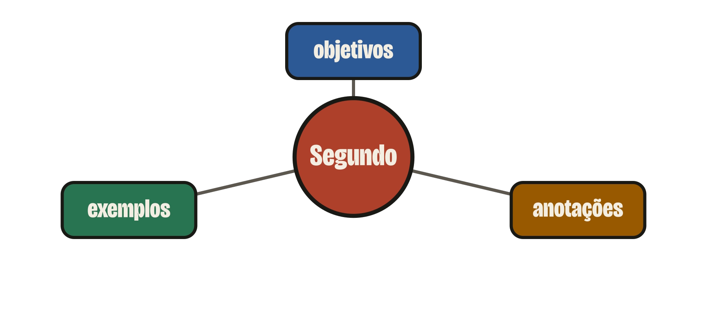
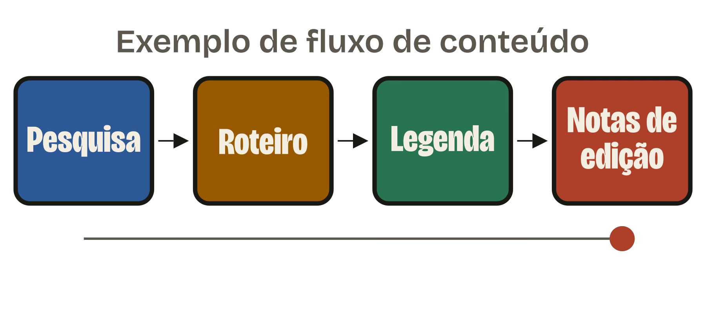
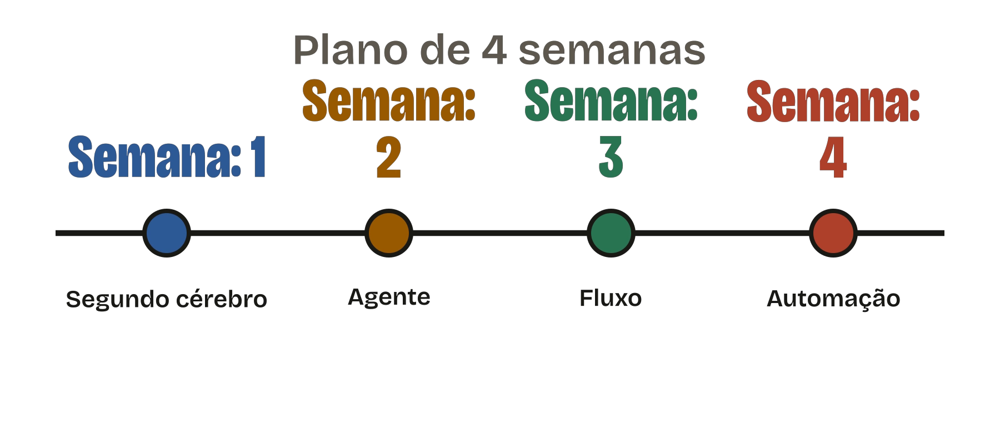

# Acabou o problema de explicar seu tom ao ChatGPT toda vez

_2026-11-27 · tutorial_

A apostila mostra como criar um segundo cérebro, um agente de tarefa única, um fluxo completo e uma automação com horário. Também traz os prompts, exemplos e cuidados para montar os sistemas nessa ordem.

## Guia SISTEMAS: 4 sistemas de IA para economizar horas, não minutos

## O que é este guia

Usar a IA para economizar cinco minutos aqui e ali é um começo. Quem quer economizar horas constrói sistemas. Este guia mostra os quatro sistemas na ordem certa, com um prompt para começar cada um.

Guia de Rogério Trani (@rogeriotrani.ia).

## 1. Segundo cérebro



_A IA encontra seus objetivos, anotações e exemplos no segundo cérebro._

O que é: um lugar onde a IA encontra seus objetivos, suas anotações e exemplos do seu trabalho. Assim, você não começa do zero toda vez.

Como começar: crie um documento com quem você é, o que vende, para quem vende, seu tom de voz e três exemplos do seu melhor trabalho. Use esse documento em um Projeto do Claude ou em uma pasta de notas, como o Obsidian.

```
Me entreviste, uma pergunta por vez, para montar o documento base do meu negócio: o que eu vendo, para quem, meu tom de voz, o que eu nunca digo e meus melhores exemplos. No fim, organize tudo em um documento.
```

## 1. Segundo cérebro (continuação)

Modelo do documento base:

```
SOBRE O NEGÓCIO
O que eu vendo: [produtos e serviços]
Para quem: [cliente ideal, com detalhes]
Problema que eu resolvo: [descreva]
Diferencial: [por que eu e não outro]

COMO EU FALO
Tom: [ex.: direto, próximo, sem jargão]
Palavras que eu uso: [liste]
Palavras que eu nunca uso: [liste]

REGRAS
Números e preços só com fonte: [onde estão]
O que nunca prometer: [liste]

EXEMPLOS
[cole 3 trabalhos seus que você considera os melhores]
```

## 1. Segundo cérebro (continuação)

Está pronto quando: você pede um texto e a IA acerta o seu tom sem você explicar de novo.

## 2. Um agente com uma função só

O que é: um assistente com uma tarefa e instruções para fazer só essa tarefa muito bem.

Ideias: editar Reels, revisar contratos, organizar o e-mail, responder dúvidas de clientes e planejar viagens.

```
Quero criar um assistente para [tarefa]. Me ajude a escrever as instruções dele: objetivo, o que ele recebe, o que entrega, regras, o que ele nunca faz e como confere o próprio trabalho.
```

## 2. Um agente com uma função só (continuação)

Exemplo preenchido: agente de respostas para clientes

```
OBJETIVO: responder dúvidas de clientes no tom da marca.
RECEBE: a mensagem do cliente.
ENTREGA: um rascunho de resposta, nunca a mensagem enviada.
REGRAS: usar só as informações da base de perguntas e respostas; frases curtas; um próximo passo claro.
NUNCA: prometer prazo, desconto ou reembolso; inventar informação.
CONFERE: antes de entregar, marca qualquer frase que não esteja na base.
```

## 2. Um agente com uma função só (continuação)

Está pronto quando: você revisa os rascunhos e muda pouca coisa.

## 3. Um fluxo completo

O que é: automatizar o processo inteiro. Por exemplo, uma ideia de conteúdo vira pesquisa, roteiro, legenda e notas de edição.

```
Vou te dar uma ideia de conteúdo: [ideia]. Faça a pesquisa, escreva o roteiro, a legenda e as notas de edição. Pare e me pergunte antes de usar qualquer número sem fonte.
```

## 3. Um fluxo completo (continuação)



_Pesquisa, roteiro, legenda e notas de edição formam o fluxo de conteúdo._

Exemplo de fluxo de conteúdo:

- Etapa: Pesquisa; O que a IA faz: Reúne fatos e fontes sobre a ideia; Quando você entra: Se faltar fonte
- Etapa: Roteiro; O que a IA faz: Escreve o roteiro no seu tom; Quando você entra: Revisa o gancho
- Etapa: Legenda; O que a IA faz: Escreve legenda e CTA; Quando você entra: Aprova
- Etapa: Notas de edição; O que a IA faz: Lista cortes, imagens e textos de tela; Quando você entra: Nunca

## 3. Um fluxo completo (continuação)

Está pronto quando: você rodou o fluxo três vezes e ele entregou o que você esperava.

## 4. Uma automação com horário

O que é: um fluxo que já funciona e roda sozinho em um horário. Por exemplo, um relatório toda manhã, sem você pedir.

Como começar: escolha um fluxo que você já roda toda semana e use uma ferramenta de agendamento, como as tarefas agendadas do Claude, o Make ou o n8n.

Checklist antes de colocar no horário:

- O fluxo já rodou à mão pelo menos três vezes
- Você sabe onde o resultado vai aparecer
- Nada é publicado, enviado ou apagado sem a sua aprovação
- Você sabe como pausar a automação

## Em que ordem montar

1. Segundo cérebro: os outros três dependem dele.
2. Um agente.
3. Um fluxo.
4. A automação, só quando o fluxo já funcionar à mão.

## Plano de 4 semanas



_Quatro semanas, uma entrega por sistema: segundo cérebro, agente, fluxo e automação._

- Semana: 1; Sistema: Segundo cérebro; Entrega da semana: Documento base pronto e testado em 3 pedidos
- Semana: 2; Sistema: Agente; Entrega da semana: Instruções do primeiro agente e 5 tarefas feitas por ele
- Semana: 3; Sistema: Fluxo; Entrega da semana: Um fluxo de 3 etapas rodado à mão
- Semana: 4; Sistema: Automação; Entrega da semana: O fluxo rodando em um horário, com resultado revisado

## Erros e limites

- Automatizar antes de funcionar. Primeiro à mão, depois no horário.
- Agente com função demais. Uma função por agente.
- Tirar você das decisões. Publicar, enviar e pagar sempre passam por você.
- Dados sensíveis. Não coloque senhas nem dados de clientes sem saber onde ficam guardados.

## Perguntas frequentes

Preciso de ferramentas pagas? Dá para começar com o plano que você já usa do Claude ou do ChatGPT. Ferramentas de automação e agendamento podem ter custo conforme o uso.

Posso pular o segundo cérebro? Pode, mas os outros três ficam piores. Sem contexto, cada agente e cada fluxo começa do zero.

Qual agente criar primeiro? O da tarefa que você mais repete e menos gosta de fazer. É onde você sente o ganho mais rápido.

## Sua próxima ação

1. Montar o documento base do segundo cérebro
2. Escolher a tarefa do seu primeiro agente
3. Desenhar um fluxo de três etapas

## Continue com o canal

IA na prática, direto ao ponto. Siga para mais resumos de IA: @rogeriotrani.ia.

- Inscreva-se no YouTube: https://www.youtube.com/@rogeriotrani_ia?sub_confirmation=1
