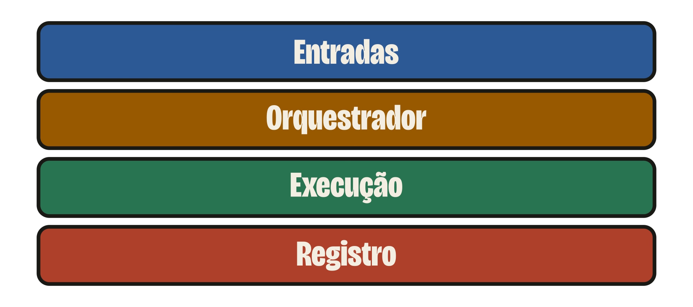
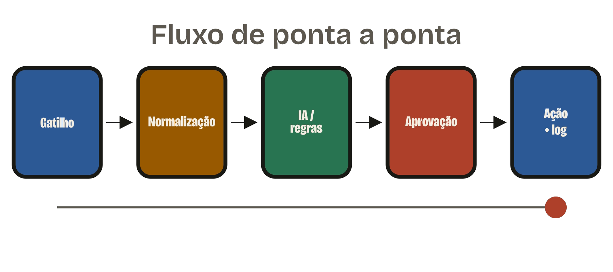
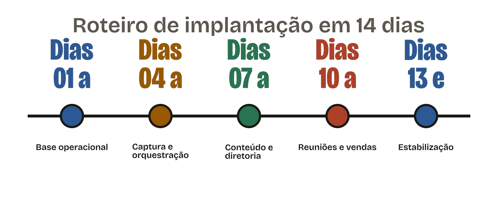

# Acabou o problema de tarefa perdida com a Fila_IA

_2026-11-27 · tutorial_

A apostila mostra como montar uma operação de trabalho com IA a partir de uma fila única de tarefas, regras claras e pontos de revisão humana. Ela apresenta os 8 módulos do sistema, ensina a preparar a base com n8n ou Make e uma planilha central, e detalha passo a passo os dois primeiros sistemas: ditado por voz que vira tarefas e agentes coordenados por tickets. Cada sistema traz fluxo, configuração em ordem, prompt pronto, itens de revisão obrigatória e teste de aceite.

## Playbook de automação: 8 sistemas de IA

O passo a passo para montar uma operação que capta tarefas, distribui trabalho, produz conteúdo, organiza vendas e acompanha resultados com IA.

Uma única estrutura operacional. Oito aplicações.

Manual prático. Autor: Rogério Trani (@rogeriotrani.ia).

- 8 fluxos práticos
- 8 prompts prontos
- Modelos de planilhas
- Roteiro de implementação
- Etapas da estrutura: Capturar, Distribuir, Executar, Revisar, Registrar

## O que você vai construir

Um sistema de trabalho com IA não começa com oito aplicativos. Começa com uma fila única de tarefas, regras claras e pontos de revisão.

## Estrutura central



_Os quatro blocos da estrutura central, na ordem: entradas, orquestrador, execução e regist_

A estrutura tem quatro blocos, nesta ordem:

- Entradas: voz, e-mail, notas
- Orquestrador: regras + tickets
- Execução: agentes + automações
- Registro: planilhas + alertas

## Os 8 módulos

- 01 Ditado por voz: transformar ideias faladas em tarefas claras; ferramentas: Wispr Flow + caixa de entrada
- 02 Agentes coordenados: encaminhar tarefas com status e responsáveis; ferramentas: n8n/Make + modelos de IA
- 03 E-mail operacional: classificar mensagens e preparar ações; ferramentas: Gmail/Outlook + automação
- 04 Reaproveitamento: multiplicar uma ideia em vários formatos; ferramentas: IA + biblioteca editorial
- 05 Funil semanal: equilibrar atração, comunidade e conversão; ferramentas: calendário + métricas
- 06 Diretoria virtual: criar pareceres de finanças, crescimento e operação; ferramentas: 3 agentes + relatório
- 07 Pós-reunião: converter notas em tarefas acompanháveis; ferramentas: Granola + tarefas
- 08 CRM automático: atualizar oportunidades a partir de interações; ferramentas: e-mail/Slack + CRM

## Ordem recomendada

Comece com os sistemas 02 e 03: a fila de tarefas e o e-mail operacional. Em seguida, conecte captura por voz, conteúdo, reuniões e vendas. Os demais agentes passam a usar a mesma infraestrutura.

## Monte a base antes dos agentes

Escolha uma ferramenta de automação e uma fonte central de dados. Você pode usar n8n ou Make para conectar serviços; planilhas funcionam como ponto de partida.

## Fluxo de ponta a ponta (preparação)



_Fluxo de ponta a ponta: gatilho, normalização, IA ou regras, aprovação e ação com log._

Gatilho → Normalização → IA / regras → Aprovação → Ação + log

## Configure em ordem (preparação)

1. Crie a sua central de tarefas. Abra uma planilha chamada Fila_IA. Campos: id, origem, área, tarefa, contexto, responsável, prioridade, status, prazo, link_saida, revisao_humana e ultima_atualizacao.
2. Separe os canais de entrada. Use uma etiqueta de e-mail para a IA, uma pasta de notas de reunião e uma tabela de ideias de conteúdo. Cada entrada nova deve virar um registro na Fila_IA.
3. Escolha um orquestrador. No n8n ou Make, crie o cenário padrão: nova entrada → limpar dados → classificar → roteá-la → executar → registrar resultado → notificar.
4. Conecte cada aplicativo com permissão mínima. Autorize somente o necessário para ler, criar rascunhos ou atualizar registros. Guarde credenciais nos gerenciadores de conexão da plataforma.
5. Imponha revisão às ações sensíveis. Pagamentos, exclusões, contratos, alteração de preços, mensagens externas e mudanças de acesso exigem confirmação explícita.
6. Crie um resumo de exceções. Agende um e-mail matinal com tarefas bloqueadas, prazos próximos, falhas de integração e decisões pendentes. Não envie um alerta para cada passo bem-sucedido.

## Regra mestra

Automatize a preparação e o acompanhamento; mantenha a decisão humana onde existe risco. Em cada fluxo, registre: quem solicitou, qual dado foi usado, o que a IA propôs, o que foi executado e como reverter.

## Definição de pronto

O teste está concluído quando uma entrada gera um ticket, recebe dono, muda de status e deixa um registro verificável.

## Limite de retrabalho

Uma tarefa que falhou duas vezes deve mudar para bloqueada e solicitar análise, em vez de reiniciar em ciclo.

## Sistema 01: Transforme voz em instruções

Fale uma vez. Deixe o sistema estruturar, encaminhar e acompanhar.

## Fluxo de ponta a ponta (sistema 01)

Áudio ditado → Texto revisado → Extrair tarefas → Fila_IA → Alerta se faltar dado

## Configure em ordem (sistema 01)

1. Instale e configure o Wispr Flow. Escolha o idioma de ditado, teste o atalho e cadastre no dicionário nomes de produtos, clientes e termos internos.
2. Abra uma caixa de entrada única. Use um documento, formulário ou nota chamado Capturas. Dite sempre no padrão: contexto, objetivo, entrega, prazo e responsável.
3. Crie o gatilho de processamento. Quando uma nova captura chegar à planilha ou formulário, envie o texto a uma IA para identificar tarefas, decisões e perguntas em aberto.
4. Grave cada tarefa separadamente. Crie uma linha por ação na Fila_IA; preserve a transcrição original em um link. Sem prazo ou responsável explícitos, deixe o campo vazio.
5. Configure a confirmação. Receba uma lista resumida para conferir nomes, números, promessas e prioridades antes de iniciar ações externas.

## Prompt para copiar e adaptar (sistema 01)

```
Organize a transcrição abaixo em tarefas executáveis. Para cada tarefa, devolva: titulo, contexto, proximo_passo, responsavel, prazo e duvidas. Não invente nomes, prazos ou fatos; use "não informado" quando faltar dado. Separe decisões de ideias. TRANSCRIÇÃO: [cole o texto].
```

## Revisão obrigatória (sistema 01)

Dados de clientes, valores, prazos, acesso a contas e mensagens que serão enviadas a terceiros.

## Teste de aceite (sistema 01)

Dite três instruções misturadas. O resultado deve ser três tickets claros, com dúvidas marcadas quando houver lacunas.

## Sistema 02: Faça as IAs trabalharem em fila

Os modelos não precisam conversar livremente: um orquestrador passa tarefas e resultados entre eles.

## Fluxo de ponta a ponta (sistema 02)

Ticket novo → Classificar papel → Executar etapa → Validar saída → Próximo ticket

## Configure em ordem (sistema 02)

1. Defina papéis por tipo de entrega. Exemplo: Claude = texto e raciocínio; ChatGPT = briefing e geração visual quando houver integração; Gemini = pesquisa; agente de operações = organização e registros.
2. Padronize o ticket. Campos mínimos: id, objetivo, insumos, papel_designado, formato_saida, criterios_de_aceite, prazo, status e proxima_etapa.
3. Monte o roteamento. No n8n ou Make, use gatilho de nova tarefa; um classificador decide o papel; o conector correspondente executa e salva a resposta.
4. Valide antes do repasse. Confira se existe saída, se ela está no formato pedido e se faltam fontes ou anexos. Ao falhar, direcione para revisão; limite tentativas.
5. Envie um único relatório diário. Agrupe tarefas concluídas, bloqueios, itens esperando aprovação e custo/volume de execuções, se estiver disponível.

## Prompt para copiar e adaptar (sistema 02)

```
Você é o COORDENADOR DE TICKETS. Leia o pedido e retorne apenas os campos: area (conteudo, pesquisa, design, operacoes ou vendas), objetivo, insumos_necessarios, formato_saida, prioridade (baixa, media, alta), precisa_aprovacao (sim/nao), criterio_de_aceite. Não execute a tarefa; apenas encaminhe. Se faltarem dados, sinalize-os.
```

## Revisão obrigatória (sistema 02)

Publicação, envio ao cliente, compras, mudanças de configuração e uso de informações não verificadas.

## Teste de aceite (sistema 02)

Envie um pedido que exige pesquisa → roteiro → arte. Cada etapa deve receber o resultado anterior, sem perder o ID da tarefa.

## Sistema 03: Dê uma caixa de e-mail ao agente

Converta mensagens em rascunhos, tarefas e resumos, com ações externas sob controle.

## Fluxo de ponta a ponta (Sistema 03)

- Novo e-mail
- Classificar
- Rascunho / ticket
- Aprovação
- Registro

## Configure em ordem (Sistema 03)

1. Crie um endereço dedicado. Use, por exemplo, assistente@seudominio.com ou uma caixa separada para encaminhamentos. Configure recuperação de acesso e autenticação forte.
2. Defina quais mensagens entram. Crie uma etiqueta ou pasta de triagem. Encaminhe apenas solicitações operacionais. Deixe de fora e-mails bancários, de autenticação e com dados muito sensíveis.
3. Conecte a caixa ao fluxo. O gatilho é uma mensagem nova na etiqueta. Extraia remetente, assunto, corpo, thread_id, anexos autorizados e horário.
4. Classifique e prepare o próximo passo. As categorias são: responder, criar tarefa, arquivar, pedir dados e urgência. Para respostas, gere o rascunho na conversa original.
5. Ative a confirmação antes de enviar. O responsável revisa o rascunho ou aprova a ação no Slack ou por e-mail. Depois da aprovação, o fluxo atualiza o ticket e registra o resultado.

## Prompt para copiar e adaptar (Sistema 03)

```
Analise este e-mail e responda em formato estruturado: categoria, prioridade, resumo_em_1_frase, acao_sugerida, dados_faltantes, resposta_rascunho e risco. Use somente o contexto fornecido. Não prometa reembolsos, prazos, preços nem decisões não autorizadas. E-MAIL: [mensagem]. POLÍTICAS: [regras internas].
```

## Revisão obrigatória (Sistema 03)

Envio a terceiros, arquivos anexados, compromissos financeiros e decisões sobre suporte ou reembolso.

## Teste de aceite (Sistema 03)

Encaminhe um pedido simples e um pedido ambíguo. O primeiro deve gerar um rascunho. O segundo deve gerar uma pergunta de esclarecimento.

## Sistema 04: Crie seu ciclo de conteúdo

Uma ideia-fonte alimenta novos formatos, canais e republicações futuras.

## Fluxo de ponta a ponta (Sistema 04)

- Conteúdo-fonte
- Extrair tese
- Criar variações
- Revisar
- Agendar

## Configure em ordem (Sistema 04)

1. Monte a biblioteca de ideias. Na planilha Conteudos, salve: id, tema, tese, público, link_original, data_publicacao, formato, canal, status e metricas.
2. Registre a essência de cada peça. Ao aprovar um conteúdo, extraia o gancho, o argumento principal, os exemplos, a prova utilizada e o próximo passo esperado.
3. Gere variações com propósito. Peça uma versão curta, um carrossel, um e-mail e outra abordagem para o mesmo tema. Adapte cada peça ao canal e não publique cópias idênticas.
4. Crie uma fila de reaproveitamento. Programe lembretes ou tarefas para revisar a ideia após 6, 12 e 18 meses. Revalide dados e contexto antes de republicar.
5. Meça e aprenda. Registre alcance, salvamentos, respostas, cliques e conversões por canal. Use os melhores sinais para decidir o próximo formato.

## Prompt para copiar e adaptar (Sistema 04)

```
Transforme o CONTEÚDO-FONTE em: (1) roteiro de vídeo curto com gancho, (2) carrossel de 7 slides, (3) e-mail objetivo, (4) nova abordagem para republicação futura. Preserve a tese, mude a estrutura, adapte a linguagem ao canal e indique o que precisa de atualização factual. PÚBLICO: [perfil]. TOM: [estilo]. FONTE: [texto].
```

## Revisão obrigatória (Sistema 04)

Dados que podem envelhecer, resultados financeiros, direitos de imagem, promessas e peças com links de compra.

## Teste de aceite (Sistema 04)

Uma ideia deve virar quatro peças distintas. Elas mantêm o mesmo posicionamento, mas cada uma tem gancho e estrutura próprios.

## Sistema 05: Organize conteúdo em três funções

Conecte crescimento, relacionamento e vendas em um calendário com objetivo claro.

## Fluxo de ponta a ponta (Sistema 05)

- Ideias
- Classificar função
- Planejar semana
- Publicar
- Medir função

## Configure em ordem (Sistema 05)

1. Crie três etiquetas editoriais. Atração amplia o alcance. Comunidade estimula respostas e confiança. Conversão convida à ação ou à compra.
2. Use uma distribuição inicial. Para começar, teste 60% de atração, 25% de comunidade e 15% de conversão. Ajuste toda semana conforme o seu negócio e o seu volume.
3. Organize uma pauta por tema. Para cada assunto, crie uma peça de atração, uma de comunidade e uma de conversão. Evite repetir a mesma mensagem.
4. Gere o calendário automaticamente. Agende uma revisão semanal: a IA consulta o backlog, escolhe as ideias com prioridade e propõe os horários, os formatos, os ganchos e o objetivo de cada publicação.
5. Avalie a métrica correspondente. Atração é alcance qualificado. Comunidade são respostas e interações. Conversão são cliques, leads ou compras atribuídas.

## Prompt para copiar e adaptar (Sistema 05)

```
Você é meu EDITOR DE FUNIL. A partir destas ideias [cole], monte um calendário de 7 dias com: dia, tema, etapa (atração/comunidade/conversão), canal, formato, gancho, objetivo e métrica. Use como hipótese inicial a distribuição 60/25/15. Não repita ganchos nem invente depoimentos ou resultados.
```

## Revisão obrigatória (Sistema 05)

Promessas de resultado, condições comerciais, uso de depoimentos e campanhas sensíveis.

## Teste de aceite (Sistema 05)

Cada publicação deve ter só uma função principal, e a métrica dela deve corresponder a essa função.

## Sistema 06: Monte uma diretoria de agentes

Peça perspectivas diferentes sobre a mesma operação e consolide as decisões em um plano.

## Fluxo de ponta a ponta (Sistema 06)

- Dados da semana
- Financeiro
- Crescimento
- Operações
- Ata + decisões

## Configure em ordem (Sistema 06)

1. Defina três cadeiras. Financeiro cuida de caixa, custos e tendências. Negócios cuida de aquisição, receita e oportunidades. Operações cuida de gargalos, capacidade e entregas.
2. Crie uma ficha de dados comum. Inclua vendas, receitas, despesas, custos de ferramentas, leads, conversões, tarefas atrasadas e as principais ocorrências.
3. Configure pareceres independentes. Cada papel recebe os mesmos dados e produz: observações, riscos, oportunidades, números que faltam e uma ação prioritária.
4. Faça a reunião de síntese. Um agente coordenador combina os três pareceres, identifica conflitos e propõe até cinco decisões, com responsáveis e prazos.
5. Aprove e desdobre em execução. Só depois da revisão humana transforme as recomendações em tickets. Arquive a ata e compare as decisões com os resultados na semana seguinte.

## Prompt para copiar e adaptar (Sistema 06)

```
Atue como DIRETOR DE [FINANÇAS / NEGÓCIOS / OPERAÇÕES]. Analise apenas os DADOS fornecidos. Produza: 3 achados com evidências, 2 riscos, 2 oportunidades, 1 recomendação prioritária, indicador de acompanhamento e dados ausentes. Diferencie fato de hipótese. DADOS: [tabela da semana].
```

## Revisão obrigatória (Sistema 06)

Decisões financeiras, contratação, alterações de preço, investimento, acesso a dados pessoais e compromissos comerciais.

## Teste de aceite (Sistema 06)

Os três pareceres devem divergir quando os indicadores pedirem. A síntese deve registrar os trade-offs, e não apenas a concordância.

## Sistema 07: Execute o pós-reunião automaticamente

Uma ata deve sair da conversa e entrar na fila de trabalho sem se perder.

## Fluxo de ponta a ponta (Sistema 07)

- Nota do Granola
- Extrair ações
- Identificar dono
- Criar tickets
- Cobrar andamento

## Configure em ordem (Sistema 07)

1. Padronize as anotações. Em toda reunião, registre participantes, decisões, ações, responsáveis, prazo, dependências e questões pendentes.
2. Escolha como enviar notas ao fluxo. Se o seu plano permitir, conecte o Granola ao Zapier por pasta ou compartilhamento. Se não, envie o resumo manualmente para a mesma caixa de entrada.
3. Extraia tarefas por IA. Para cada item, capture descrição objetiva, responsável citado, prazo explícito, referência da reunião e dependências.
4. Grave tarefas e confirme. Crie os tickets no gerenciador que você adotou. Se o dono ou o prazo não estiverem claros, envie o item para esclarecimento, não para execução.
5. Faça o acompanhamento. O fluxo envia um resumo no dia seguinte e sinaliza as tarefas vencidas. As alterações aparecem na Fila_IA e na ata vinculada.

## Prompt para copiar e adaptar (Sistema 07)

```
Leia esta ATA e extraia apenas compromissos explícitos. Retorne: descricao, responsavel, prazo, dependencia, trecho_de_evidencia, status_inicial e duvida. Não transforme sugestões vagas em tarefas confirmadas. Destaque decisões que exigem validação. ATA: [notas].
```

## Revisão obrigatória (Sistema 07)

Passe por revisão humana: compromissos assumidos com clientes, tarefas sem responsável e qualquer promessa de prazo ou custo.

## Teste de aceite (Sistema 07)

Use uma ata com cinco ações e duas ideias soltas. O fluxo deve registrar as cinco ações e manter as duas ideias separadas.

## Sistema 08: Atualize o CRM a partir das conversas

O histórico comercial continua organizado, mesmo quando a equipe opera em diferentes canais.

## Fluxo de ponta a ponta (Sistema 08)

- E-mail / Slack
- Detectar evento
- Localizar contato
- Atualizar CRM
- Resumo comercial

## Configure em ordem (Sistema 08)

1. Defina o seu funil comercial. Exemplo de etapas: novo, contato iniciado, qualificado, proposta enviada, negociação, ganho, perdido. Estabeleça um critério para entrar em cada etapa.
2. Padronize o registro mínimo. Contato, empresa, fonte, responsável, etapa, valor estimado, última interação, próximo passo, data do próximo passo e link da conversa.
3. Conecte somente canais autorizados. Em e-mail ou Slack, monitore etiquetas e canais específicos. Extraia os eventos relevantes: propostas, respostas, objeções e agendamentos.
4. Evite duplicados e mudanças falsas. Localize o contato pelo identificador e atualize a oportunidade que já existe. Uma mudança de etapa exige evidência na mensagem, não uma inferência baseada no tom.
5. Crie um radar de negociação. Envie à equipe uma lista diária com propostas sem retorno, tarefas atrasadas e negócios sem próximo passo.

## Prompt para copiar e adaptar (Sistema 08)

```
Leia a interação comercial e extraia: contato, empresa, evento, etapa_sugerida, valor_citado, proximo_passo, prazo, evidencia_textual e confianca. Nunca marque "ganho" sem confirmação explícita e não invente valores. Se a mensagem não tiver sinal comercial suficiente, retorne "sem atualização". INTERAÇÃO: [mensagem].
```

## Revisão obrigatória (Sistema 08)

Passe por revisão humana: troca de etapa para ganho ou perdido, alteração de valor, mensagens ao lead e informações de pagamento ou contrato.

## Teste de aceite (Sistema 08)

Duas mensagens do mesmo lead devem atualizar um único registro. Uma proposta enviada não pode ser confundida com venda fechada.

## Modelos prontos: o agente coordenador

Este é o texto-base do agente que distribui o trabalho. Use nas instruções do modelo conectado ao seu orquestrador.

## Instrução de sistema

```
Você é um coordenador operacional. Sua função é TRANSFORMAR pedidos em tickets claros, não agir fora das ferramentas e permissões disponíveis.
Entrada: objetivo, contexto, materiais, área, solicitante e prazo.
Saída: id, resumo, categoria, prioridade, dados_necessarios, papel_destino, formato_saida, criterio_aceite, requer_aprovacao, proximo_passo e observacoes.
Regras: (1) nunca invente dados, fontes, clientes ou prazos; (2) use "não informado" quando faltar algo; (3) sinalize decisões que envolvam dinheiro, acesso, contratos e comunicação pública; (4) não encaminhe tarefas sem contexto suficiente; (5) nunca repita a mesma ação indefinidamente; (6) preserve o ID entre etapas; (7) explique como a saída será verificada.
Classificação: pesquisa, redação, visual, operações, vendas, financeiro ou revisão.
Se ocorrer erro: classifique como "bloqueado", descreva a causa e indique a pessoa que precisa decidir.
```

## Exemplo de ticket concluído

```
ID: T-024    Área: conteúdo    Prioridade: média
Objetivo: escrever um e-mail explicando um recurso do produto
Entrada: ficha do recurso + público + tom de voz
Responsável: agente de redação    Status: revisão
Critério de aceite: texto com assunto, prévia e até 180 palavras
Próximo passo: responsável aprova antes do disparo
```

## O que deve passar de um agente para o outro

Passe o ticket, o material original, a saída gerada, o motivo da decisão, as fontes usadas e o formato esperado. Evite passar apenas "continue a conversa": isso gera perda de contexto e dificulta auditar a execução.

## Modelos prontos: planilhas para copiar

Três tabelas bastam para começar. Crie uma aba para cada finalidade e mantenha identificadores únicos.

## 01 / FILA_IA

Colunas: id | origem | area | tarefa | dono | prazo | status | link_saida | aprovacao | atualizado_em

Use os status novo → em execução → revisão → concluído. Os status bloqueado e erro devem gerar alertas. Os campos id e origem ajudam a evitar registros duplicados.

Exemplo de registro:

T-024 · email · suporte · preparar resposta ao cliente · agente de texto · não informado · revisão · link do rascunho · sim

## 02 / CONTEUDOS

Colunas: id | tema | tese | formato | canal | etapa_funil | link_original | publicar_em | status | metricas

Salve sempre o original e marque se a peça é de atração, comunidade ou conversão. Os ciclos de 6, 12 e 18 meses são tarefas futuras de revisão, não republicações automáticas e cegas.

Exemplo de registro:

C-012 · dúvidas frequentes · remover objeção · carrossel · Instagram · comunidade · link original · agendado · revisão

## 03 / CRM

Colunas: id | contato | empresa | etapa | responsavel | valor | ultima_interacao | proxima_acao | data_proxima_acao | evidencia

Não atualize valor ou etapa só porque a IA deduziu interesse. Registre a passagem de fase com uma evidência da conversa.

Exemplo de registro:

L-031 · contato@empresa.com · Empresa Exemplo · proposta enviada · comercial · não informado · e-mail recebido · confirmar recebimento · sem data

## Receitas de fluxos para reproduzir

Use estes modelos como ponto de partida no n8n e no Zapier. Troque os serviços conforme o seu ambiente e preserve a lógica.

## Receita A: e-mail → triagem → rascunho

Fluxo: Gmail Trigger → Edit Fields → AI Information Extractor → Switch → Gmail (criar rascunho) → Google Sheets (append row).

Mapeie message_id, thread_id, from, subject e body. Na saída da IA, use categoria, resumo, prioridade, rascunho e requer_aprovacao. Na ramificação "sem resposta", apenas registre. Teste com dois e-mails antes de ativar.

## Receita B: reunião → tarefas

Fluxo: Granola (nota em pasta ou nota compartilhada) → Zapier → extração estruturada → Google Sheets / gerenciador de tarefas.

Escolha uma pasta de notas, extraia somente as ações explícitas e crie um registro por item. Salve o link da nota. A conexão entre Granola e Zapier depende de um plano elegível e do aplicativo desktop.

## Receita C: conversa → atualização de CRM

Fluxo: gatilho de e-mail ou Slack → filtro por canal/etiqueta → IA extratora → busca de contato → update ou create → log.

Exija e-mail ou ID do contato. Use o ID do evento como chave antirrepetição. Se não houver correspondência confiável, crie uma pendência para a equipe, sem duplicar contatos.

## Receita D: resumo executivo matinal

Fluxo: Schedule Trigger → ler Fila_IA e CRM → filtrar bloqueios e prazos → IA sumarizadora → Gmail (rascunho/aviso).

Agrupe em: pendências críticas, falhas, aprovações e próximos passos. Inclua links diretos para os registros. Confirme o fuso horário do agendamento e remova do texto os dados desnecessários.

## Checklist essencial antes de ativar

Em todas as receitas, acrescente: validação de campos, controle de duplicidade, no máximo duas tentativas em caso de erro, registro de execução e desvio para revisão humana.

## Roteiro de implantação em 14 dias

Uma sequência para colocar os sistemas em operação sem multiplicar integrações frágeis.

## Dias 01 a 03: base operacional

1. Dia 01: Crie Fila_IA, Conteudos e CRM. Defina os campos obrigatórios.
2. Dia 02: Configure n8n ou Make, com acesso restrito e registro de erros.
3. Dia 03: Monte e teste um fluxo: entrada → classificação → ticket → resumo.

## Dias 04 a 06: captura e orquestração

1. Dia 04: Configure o ditado por voz e a entrada padronizada de solicitações.
2. Dia 05: Crie os papéis de IA e o roteador de tickets.
3. Dia 06: Adicione validação, aprovações e bloqueio após falhas.

## Dias 07 a 09: conteúdo e diretoria

1. Dia 07: Monte a biblioteca e o fluxo de variações de conteúdo.
2. Dia 08: Configure o calendário de atração, comunidade e conversão.
3. Dia 09: Defina os três agentes de gestão e gere o primeiro relatório.

## Dias 10 a 12: reuniões e vendas

1. Dia 10: Conecte as notas de reunião e teste a extração de tarefas.
2. Dia 11: Conecte os canais autorizados ao CRM e implemente a identificação de duplicatas.
3. Dia 12: Crie lembretes de follow-up e uma rotina diária de exceções.

## Dias 13 e 14: estabilização



_As cinco fases do roteiro de implantação em 14 dias, da base operacional à estabilização._

1. Dia 13: Teste casos ambíguos, falha de API, dados ausentes e duplicatas.
2. Dia 14: Revise custos, permissões e taxa de acerto, e autorize a operação regular.

## Ativação progressiva

Primeiro, deixe os fluxos em modo rascunho ou simulação. Passe para a execução automática apenas nas tarefas repetitivas, reversíveis e comprovadamente estáveis.

## Mantenha a operação confiável

Uma automação útil tem resultado que pode ser conferido, corrigido e repetido.

## Cinco testes que todo fluxo precisa passar

- Entrada incompleta: falta dono, prazo ou contexto → abrir pendência, sem inventar dados.
- Entrada duplicada: o mesmo e-mail ou evento chegou duas vezes → gerar apenas uma tarefa ou atualização.
- Falha de integração: serviço indisponível → registrar o erro, tentar de novo com limite e sinalizar o bloqueio.
- Ação irreversível: envio, pagamento, exclusão ou publicação → pedir aprovação antes de executar.
- Saída incorreta: texto fora do formato ou sem evidência → enviar à revisão e não prosseguir.

## Painel semanal de controle

- Concluídas / recebidas: mostra a capacidade real de execução
- Aguardando aprovação: mostra os pontos de dependência humana
- Erros + retrabalho: mostra a fragilidade das integrações
- Tempo até a conclusão: mostra a velocidade por tipo de tarefa

## Referências de configuração

- n8n: fluxos e revisão humana
- Granola: integração com Zapier
- Wispr Flow: ditado e funcionalidades
- n8n: Gmail e operações
