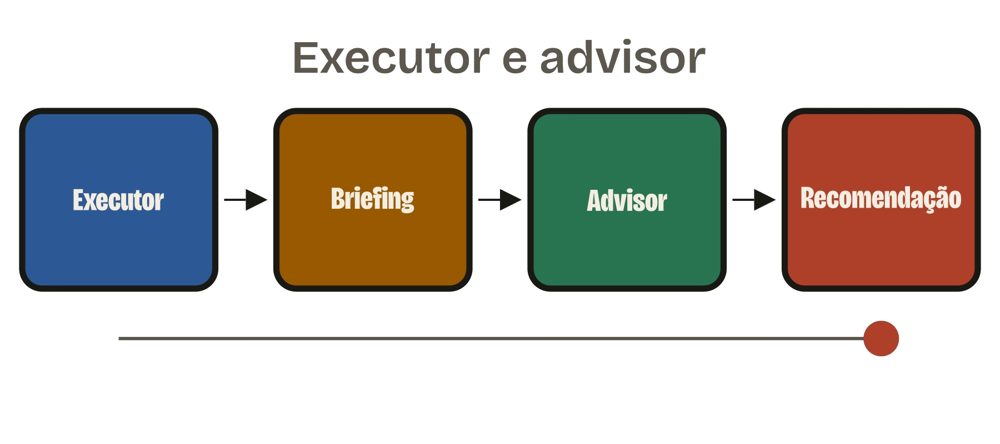

# Advisor: segunda leitura com contexto novo antes de concluir

_2026-11-27 · tutorial_

Em tarefas longas, o agente de código se vicia no próprio raciocínio e deixa passar erros que um segundo leitor veria. Esta apostila ensina a instalar a skill Advisor no Claude Code e a usá-la em cinco passos: instalar, abrir o projeto, pedir a primeira leitura, rodar testes e pedir a revisão final. Depois de ler, você sabe instalar a skill, acionar as duas consultas ao revisor com contexto novo, conferir no histórico que elas aconteceram e entender os limites do que foi testado.

## O que você terá no fim

Ao terminar, o seu Claude Code terá uma skill chamada Advisor instalada globalmente. Ela ensina o agente a consultar um segundo leitor, um subagente com contexto novo, em dois momentos: antes de decidir como fazer a tarefa e antes de declarar a tarefa concluída.

O agente continua sendo quem escreve e edita o código. O revisor lê um briefing curto, examina os arquivos e responde com um plano ou uma correção. No fim, o agente conta em uma linha o que o Advisor mudou.

A skill não exige chave de API e não usa script. Ela aproveita os subagentes que o agente já possui, e o repositório descreve a ideia como uma versão, dentro do agente, do padrão executor e advisor da ferramenta advisor da API do Claude, da Anthropic.

Fonte: <https://github.com/RogerioTrani/coding-agent-advisor-skill>

## Como isso funciona



_O executor consulta o advisor em pontos de decisão e aplica a recomendação._

Uma skill é uma pasta com um único arquivo de instruções, o SKILL.md, que ensina o agente a seguir um hábito de trabalho. No caso do Advisor, o hábito é pedir uma segunda leitura em pontos de decisão: antes de se comprometer com uma abordagem, quando o agente empaca e antes de dizer que terminou.

O padrão por trás se chama executor e advisor. Um modelo executor faz a tarefa inteira e consulta um modelo mais capaz, o advisor, em poucos pontos de decisão. A maior parte dos turnos de uma tarefa de código é mecânica, então o modelo mais forte só entra onde a abordagem é decidida. Neste tutorial, o revisor é um subagente do mesmo modelo que você já usa, aberto com contexto novo.

Mesmo quando o seu agente já roda o modelo mais forte, a segunda leitura continua útil. Quem esteve dentro do raciocínio para de enxergar o que ele deixou de fora, e um leitor que não participou dele ainda pega esses pontos. O revisor não vê a sessão: recebe só o briefing. Por isso a qualidade do briefing define a qualidade da resposta.

O fluxo que o agente segue é este: primeiro se orienta, achando os arquivos, lendo o código e conferindo o que existe. Antes de escrever, abre o subagente e envia um briefing com a tarefa, o que encontrou, o que pretende fazer, o que descartou e uma pergunta. Depois faz o trabalho, salva e roda os testes. Antes de concluir, consulta de novo com o que mudou e a saída dos testes. Por fim, diz em uma linha o que o Advisor mudou. Cada consulta pede respostas de cerca de 100 palavras, para manter o custo baixo.

Fonte: <https://github.com/RogerioTrani/coding-agent-advisor-skill/blob/main/README.md>

## Antes de começar

São quatro requisitos. A skill não pede chave de API nem script extra.

- Claude Code instalado e com conta ativa.
- Node.js instalado, porque o comando de instalação roda por ele.
- Um projeto seu, de preferência com suíte de testes, porque a revisão final usa a saída dos testes como evidência.
- Um terminal aberto na pasta desse projeto.

Fonte: <https://github.com/RogerioTrani/coding-agent-advisor-skill/blob/main/README.md>

## Passo 1: instale a skill globalmente

Com o Claude Code e o Node.js instalados, rode o comando abaixo no terminal. A skills CLI encontra os agentes de código instalados na sua máquina e coloca a skill na pasta global de skills de cada um. Assim, o agente ganha esse fluxo de revisão em todos os seus projetos.

O resultado esperado é a skill advisor aparecer instalada na pasta de skills do seu usuário. O Claude Code a carrega na próxima sessão.

```
npx skills add RogerioTrani/coding-agent-advisor-skill -g
```

Fonte: <https://github.com/RogerioTrani/coding-agent-advisor-skill>

## Passo 2: abra o Claude Code no projeto

Entre na pasta do projeto e rode o comando abaixo. O diretório importa porque é dali que o agente e o revisor vão ler os arquivos, com a diferença de que o revisor não vê o histórico da sessão, o que garante uma leitura sem vícios.

Abra a sessão numa pasta que tenha os testes do projeto, porque a revisão final vai precisar da saída deles. Resultado esperado: a sessão do Claude Code abre no terminal, dentro da pasta do projeto.

```
claude
```

Fonte: <https://github.com/anthropics/claude-code>

## Passo 3: peça a primeira leitura antes de editar

Descreva ao agente uma tarefa de vários passos e peça a consulta com o texto abaixo. O agente primeiro se orienta: acha os arquivos, lê o código e confere o que já existe. Depois monta um briefing curto com a tarefa, o que encontrou, o plano, o que descartou e uma pergunta.

Esse briefing é toda a memória do revisor. O subagente, com contexto novo, devolve uma recomendação de cerca de 100 palavras antes de qualquer edição.

Armadilha: em uma edição de uma linha, uma troca de nome ou uma consulta de fato, o agente pula o Advisor, de propósito. Se ele não consultar, a tarefa provavelmente é pequena demais; use uma tarefa com vários passos.

```
Use a skill advisor antes de escrever código.
```

Fonte: <https://github.com/RogerioTrani/coding-agent-advisor-skill/blob/main/skills/advisor/SKILL.md>

## Passo 4: rode os testes e salve o trabalho

Com a recomendação na mão, o agente principal aplica os ajustes. Quem edita é sempre ele, nunca o revisor. Depois peça a rodada de testes e a gravação das alterações com o texto abaixo.

A ordem importa: a segunda consulta só vale com evidência real, e evidência é a saída dos testes sobre arquivos salvos. Resultado esperado: a saída da suíte aparece na sessão e as alterações ficam gravadas no disco. Guarde essa saída, porque ela vai inteira para o próximo briefing.

```
Rode a suíte de testes do projeto e salve as alterações.
```

Fonte: <https://github.com/RogerioTrani/coding-agent-advisor-skill/blob/main/skills/advisor/SKILL.md>

## Passo 5: peça a revisão final com evidências

Peça ao agente que consulte o Advisor de novo, com o que mudou e a saída dos testes, usando o texto abaixo. Dessa vez o briefing leva o que mudou, as tentativas descartadas e a saída real dos testes. O revisor, que nunca viu a sessão, compara o resultado com a intenção original.

Resultado esperado: o agente aplica as correções do revisor e encerra com uma linha dizendo o que o Advisor mudou. Nos testes do repositório, a segunda consulta pegou um bug sério: o objeto de resultado de um limitador de taxa era sempre verdadeiro, então a condição `if limiter.allow(key):` deixava tudo passar.

```
Consulte o Advisor antes de declarar a tarefa concluída.
```

Fonte: <https://github.com/RogerioTrani/coding-agent-advisor-skill/blob/main/skills/advisor/SKILL.md>

## Exemplo completo: o limitador de taxa

O repositório da skill registra uma tarefa de teste: criar um limitador de taxa de janela deslizante, seguro para várias threads, para uma API de pagamentos, com pytest. A tarefa rodou com a skill e sem ela. O executor foi o Claude Sonnet com esforço médio dentro do Claude Code, e o advisor foi um subagente Claude Opus.

Com a skill, houve duas consultas. A primeira trocou travas por chave por uma trava única, porque a remoção de chaves podia sofrer uma corrida e admitir até o dobro do limite. A segunda notou que o objeto de resultado era sempre verdadeiro, então `if limiter.allow(key):` deixava tudo passar. No fim, 44 testes passaram. Sem a skill, não houve consulta: o agente escolheu uma trava única por conta própria, devolveu um booleano simples e 17 testes passaram.

Duas outras tarefas completam o quadro. Na troca de um valor de timeout em `config.py`, a edição foi feita sem consulta, nos dois casos. Na recomendação entre sessões por cookie ou por Redis em um app Flask, houve uma consulta antes de responder, e a recomendação final foi a mesma, com menos detalhes na versão sem a skill.

Fonte: <https://github.com/RogerioTrani/coding-agent-advisor-skill/blob/main/README.md>

## Teste de pronto

Para provar que funcionou, role o histórico da sessão e procure os sinais abaixo.

- [ ] Há duas chamadas de subagente Advisor no histórico: uma antes da primeira edição e outra depois dos testes.
- [ ] As duas rodaram com contexto novo, o que as torna uma segunda leitura de verdade.
- [ ] No fim da resposta, o agente trouxe uma linha única dizendo o que o Advisor mudou.
- [ ] Se não houve nenhuma consulta, a tarefa foi curta demais ou o seu ambiente não abre subagente; nesse caso a skill manda o agente avisar e seguir sozinho, e a mensagem dele explica o que aconteceu.

Fonte: <https://github.com/RogerioTrani/coding-agent-advisor-skill/blob/main/README.md>

## Erros comuns e cuidados

Os resultados do repositório são pequenos e precisam ser lidos com cuidado.

- Tarefa curta demais: edição de uma linha, renomeação ou consulta de fato não acionam o Advisor.
- Ambiente sem subagente: a skill só ajuda onde o agente consegue abrir um subagente ou uma segunda sessão de modelo. Onde não consegue, ela manda avisar e continuar sozinho.
- Briefing fraco: o revisor não vê a sessão, então a resposta dele depende do que o briefing contém.
- Testes pequenos: cada configuração rodou uma vez, então não há medida de variação. O limitador sem a skill não tinha nenhum dos dois bugs apontados, porque fez escolhas mais simples desde o início.
- Custo: as contagens de tokens das consultas não foram registradas. A skill pede respostas de cerca de 100 palavras para manter o custo baixo.
- Só o Claude Code foi testado com esta skill, embora o formato dela seja documentado como compatível com outros agentes.
- Telemetria: a skills CLI envia dados anônimos de uso, a menos que você defina DISABLE_TELEMETRY=1.

Fonte: <https://github.com/RogerioTrani/coding-agent-advisor-skill/blob/main/README.md>

## Outras formas de instalar

Se você não tem Node.js, a skill é uma pasta, `skills/advisor`, e instalar significa copiá-la para o diretório de skills do agente. O script `install.py` faz a cópia. Para o Claude Code, use `--host claude`, porque ele lê `~/.claude/skills`. Acrescente `--project` para instalar no repositório atual.

No Claude Code também há a instalação pelo marketplace de plugins, cujo manifesto passa em `claude plugin validate`. Os dois comandos abaixo seguem a documentação do agente.

Para atualizar ou remover a skill instalada com npx, o repositório indica `npx skills update -g` e `npx skills remove advisor -g`.

```
git clone https://github.com/RogerioTrani/coding-agent-advisor-skill
```

Fonte: <https://github.com/RogerioTrani/coding-agent-advisor-skill>

## Instalação pelo marketplace do Claude Code

Dentro de uma sessão do Claude Code, rode os dois comandos abaixo, um de cada vez.

```
/plugin marketplace add RogerioTrani/coding-agent-advisor-skill
/plugin install advisor@coding-agent-advisor-skill
```

Fonte: <https://github.com/RogerioTrani/coding-agent-advisor-skill>

## Glossário

- Skill: pasta com um arquivo de instruções (SKILL.md) que ensina o agente a seguir um hábito de trabalho.
- Agente de código: programa que lê o projeto, edita arquivos e roda comandos a partir de pedidos em linguagem natural, como o Claude Code.
- Subagente: segunda sessão de modelo aberta pelo agente principal para uma tarefa específica, aqui a revisão.
- Executor: o agente que faz o trabalho e escreve o código.
- Advisor: o revisor consultado em pontos de decisão; só critica e recomenda, não edita.
- Briefing: resumo curto que o agente envia ao revisor, com a tarefa, o que achou, o plano, o que descartou e uma pergunta.
- Contexto novo: situação do revisor, que não viu a conversa nem o raciocínio do agente principal.
- Suíte de testes: conjunto de testes automáticos do projeto, cuja saída serve de evidência na revisão final.
- Skills CLI: ferramenta chamada pelo npx que instala skills nos agentes de código da sua máquina.

Fonte: <https://github.com/RogerioTrani/coding-agent-advisor-skill>

## Plano de 7 dias

- Dia 1: confira os requisitos e rode o comando de instalação global da skill.
- Dia 2: abra o Claude Code na pasta de um projeto com testes.
- Dia 3: descreva uma tarefa de vários passos e peça a primeira leitura com a skill advisor, antes de qualquer edição.
- Dia 4: deixe o agente aplicar a recomendação, rode a suíte de testes e salve as alterações.
- Dia 5: peça a consulta final ao Advisor, com o que mudou e a saída dos testes.
- Dia 6: role o histórico e confira as duas consultas e a linha final de resumo.
- Dia 7: repita o fluxo em outra tarefa de vários passos e compare com uma tarefa curta, em que o Advisor não deve entrar.

## Para onde ir depois

- Leia o README da skill, que traz as perguntas frequentes, os resultados completos e a lista de agentes compatíveis.
- Pratique escrever briefings melhores: tarefa, o que achou, plano, o que descartou e uma pergunta única.
- Consulte a documentação do Claude Code em https://code.claude.com/docs/en/overview.
- Se usa outro agente de código, veja no README o diretório de skills de cada um e lembre que só o Claude Code foi testado com esta skill.
- Os casos de teste da skill estão em skills/advisor/evals e rodam com `claude plugin eval`.

Fonte: <https://github.com/RogerioTrani/coding-agent-advisor-skill>

## Além do vídeo

- Instalação sem Node.js com install.py e cópia manual da pasta skills/advisor.
- Tabela de diretórios de skills por agente (Codex, Cursor, GitHub Copilot, Gemini CLI, Kimi Code, Qwen Code, opencode e outros).
- Instalação direta do GitHub para Kimi Code, GitHub Copilot, Amp e Kiro.
- Instalação no Manus pelo arquivo advisor.skill.
- Uso em agentes que só leem arquivo de regras, como Aider e Continue, via AGENTS.md.
- Opções do npx skills: fixar versão com @tag, escolher agentes com -a e instalar cópias com --copy.
- Diferença entre esta skill e a ferramenta advisor da API do Claude, que passa a transcrição completa ao advisor.
- Arquivo agents/openai.yaml, lido apenas pelo Codex.
