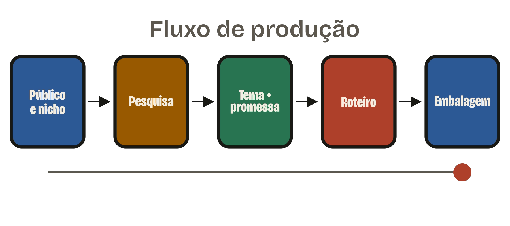
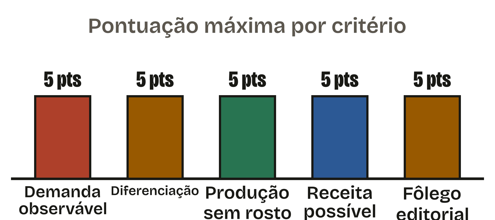
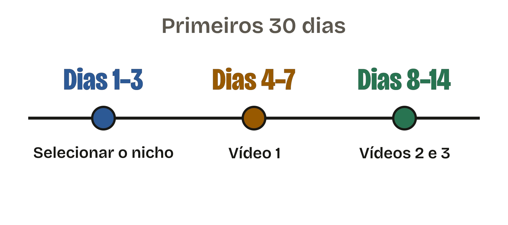

# Canal sem rosto no YouTube em 7 decisões e 30 dias

_2026-11-27 · tutorial_

A apostila mostra como montar um canal no YouTube sem aparecer, usando o Claude para acelerar decisões e textos. Ela apresenta o fluxo de produção em 7 decisões, um método para validar o nicho com matriz de pontuação e dois prompts prontos: um para descobrir subnichos e outro para gerar ideias de vídeos clicáveis. No fim, o leitor sai com uma frase de posicionamento, uma lista de vídeos possíveis e um filtro para aceitar ou recusar temas.

## Guia prático: do zero à publicação

Claude + YouTube: como criar um canal sem aparecer, produzir vídeos com inteligência artificial e construir caminhos reais de monetização.

O guia segue três passos: 01 escolher o nicho, 02 criar conteúdo, 03 monetizar.

Dentro dele você encontra 5 prompts completos, o processo de produção e um plano de 30 dias.

## Visão geral: o modelo de um canal sem rosto

O modelo é um sistema simples. O Claude acelera decisões e textos. Você valida as informações, define a linha editorial e entrega um vídeo original.

## O fluxo de produção em 7 decisões



_Etapas 01 a 05 do fluxo de produção: público e nicho, pesquisa, tema, roteiro e embalagem._

- Etapa: 01; Decisão: Público e nicho; Resultado esperado: Escolher um problema ou interesse recorrente.
- Etapa: 02; Decisão: Pesquisa; Resultado esperado: Investigar vídeos existentes, comentários e lacunas.
- Etapa: 03; Decisão: Tema + promessa; Resultado esperado: Transformar a dúvida em um vídeo específico.
- Etapa: 04; Decisão: Roteiro; Resultado esperado: Criar a narrativa, validar fatos e planejar cenas.
- Etapa: 05; Decisão: Embalagem; Resultado esperado: Desenvolver título e miniatura coerentes.
- Etapa: 06; Decisão: Produção + publicação; Resultado esperado: Narrar, editar, revisar direitos e publicar.
- Etapa: 07; Decisão: Medição; Resultado esperado: Comparar alcance, cliques e retenção para iterar.

## O que automatizar e o que precisa de revisão

Com IA: brainstorm, pesquisa preliminar, estruturas, roteiros, versões de título, storyboard e descrição.

Com validação humana: fatos, direitos de uso, proposta única, seleção de imagens, tom da narração, edição final e análise de desempenho.

## Meta operacional

Publique uma primeira sequência de vídeos no mesmo nicho. O objetivo inicial é encontrar temas e formatos que gerem interesse consistente, aprendendo com os dados do próprio canal. Acertar um vídeo viral fica para depois.

- Uma audiência: para quem você fala e qual problema resolve.
- Uma promessa: o que cada vídeo entrega de forma concreta.
- Um formato replicável: tutoriais de tela, narração com imagens licenciadas, animações originais ou explicações visuais.

## Etapa 01 / Nicho: encontre um tema viável antes de produzir

Não escolha só porque o nicho parece ter pouca concorrência. Procure uma combinação de demanda, diferencial e capacidade de produzir bons vídeos.

## Validação em 20 a 30 minutos

1. Pesquise no YouTube: busque 5 termos centrais do nicho e anote os vídeos publicados, os formatos e as dúvidas frequentes.
2. Leia os comentários: identifique perguntas sem resposta, objeções e pedidos por tutoriais.
3. Teste a recorrência: liste 15 vídeos úteis que não dependam de uma única notícia ou tendência.
4. Cheque a execução: confirme que você consegue demonstrar, ilustrar ou narrar o assunto com material original ou licenciado.

## Matriz de pontuação (1 a 5)



_Cinco critérios pontuados de 1 a 5, somando no máximo 25._

- Critério: Demanda observável; 1 ponto: Poucas buscas e perguntas; 5 pontos: Dúvidas recorrentes e interesse visível
- Critério: Diferenciação; 1 ponto: Sem ângulo próprio; 5 pontos: Abordagem útil ainda pouco explorada
- Critério: Produção sem rosto; 1 ponto: Dependente de sua imagem; 5 pontos: Demonstrável com tela, gráficos ou narração
- Critério: Receita possível; 1 ponto: Sem oferta relevante aparente; 5 pontos: Produtos, afiliados ou anunciantes aderentes
- Critério: Fôlego editorial; 1 ponto: Ideias acabam rápido; 5 pontos: Série de 20+ temas viáveis

## Regra de decisão

Some os cinco critérios (máximo: 25). Priorize o nicho mais promissor entre os que você consegue produzir com qualidade. A nota serve para organizar a escolha e não prevê sucesso.

## Exemplos para investigar

- Tutoriais de aplicativos e ferramentas
- Produtividade e estudos
- História explicada com fontes
- Ciência do cotidiano
- Organização financeira básica
- Softwares para pequenos negócios

## Prompt 01 / Nichos: descubra oportunidades com critérios claros

Cole no Claude. Depois confronte as hipóteses com buscas reais no YouTube.

Prompt pronto para copiar:

```
Você é estrategista de canais de YouTube sem rosto, especialista em demanda de audiência, formatos e receita.
Meu contexto:
- Idioma e país: [IDIOMA / PAÍS]
- Assuntos que conheço: [ASSUNTOS]
- Horas disponíveis por semana: [HORAS]
- Orçamento inicial: [ORÇAMENTO]
- Formatos possíveis: narração, captura de tela, animação e imagens licenciadas.
Tarefa:
1. Gere 25 oportunidades de subnicho (específicas, não categorias genéricas).
2. Para cada uma, apresente: público-alvo, problema, 3 ideias de vídeo, formato sem rosto, caminhos de monetização e
possíveis dificuldades.
3. Avalie, de 1 a 5, demanda potencial, diferencial editorial, facilidade de produção e coerência comercial.
4. Escolha 5 para teste e explique o raciocínio. Trate todas as notas como hipóteses, sem inventar métricas do YouTube.
5. Para as 3 melhores, entregue frases de busca e sinais concretos que devo validar manualmente.
No final, faça uma recomendação principal e um plano de validação de 30 minutos.
```

## Exemplo de escolha bem delimitada

Do nicho amplo ao subnicho útil.

Amplo: tecnologia.

Melhor definido: ferramentas digitais para estudantes universitários que precisam estudar e organizar tarefas usando aplicativos gratuitos.

Formato: captura de tela, demonstração real, narração e comparativos.

- Saída desta etapa: uma frase de posicionamento, uma lista de 15 possíveis vídeos e uma explicação clara do benefício para a audiência.

## Etapa 02 / Temas: transforme o nicho em vídeos clicáveis

Assuntos vagos dificultam a decisão de assistir. Um bom tema combina uma dúvida real, uma promessa específica e um motivo para assistir agora.

## Três famílias de temas para alternar

- Tipo: Tutorial; Fórmula: Como [resultado] sem [obstáculo]; Exemplo: Como organizar um semestre sem planilhas complexas
- Tipo: Comparativo; Fórmula: [Opção A] ou [B] para [uso]?; Exemplo: Notion ou Google Agenda para organizar provas?
- Tipo: Diagnóstico; Fórmula: Por que [problema] acontece?; Exemplo: Por que sua lista de tarefas nunca termina?

## Prompt 02 / Temas: ideias de vídeos para o nicho

Prompt pronto para copiar:

```
Atue como editor-chefe de um canal sobre [NICHO], voltado para [PÚBLICO].
Minha promessa editorial: [BENEFÍCIO CENTRAL].
Gere 20 ideias de vídeos de 6 a 12 minutos. Para cada ideia, forneça:
- Dúvida real que o vídeo resolve
- Ângulo específico e promessa verificável
- Título provisório com linguagem natural
- Gancho inicial de uma frase
- 3 tópicos que sustentam o vídeo
- Elemento visual possível sem aparecer
Classifique cada tema por intenção (aprender, comparar, resolver problema ou curiosidade) e facilidade de produção.
Selecione os 5 mais úteis para um canal novo e organize-os numa sequência de publicação. Não invente números, histórias
ou fatos para aumentar o impacto.
```

## Filtro de publicação

Antes de aceitar um tema, responda: "Quem procura isso?", "Qual transformação o vídeo entrega?" e "Tenho imagens ou demonstrações para sustentar a promessa?".

## Etapa 03 / Roteiro: escreva para retenção, não para encher tempo

A primeira frase do vídeo precisa mostrar qual é a dificuldade. Depois dela, o roteiro cumpre a promessa com provas, exemplos e uma progressão clara.

## Arquitetura de um vídeo de cerca de 10 minutos

- Momento: 0:00–0:05; Objetivo: apresentar o problema ou o resultado; O que mostrar: uma tela ou evidência visual forte
- Momento: 0:05–0:30; Objetivo: explicar o ganho e o percurso; O que mostrar: antes e depois, checklist ou demonstração
- Momento: 0:30–2:00; Objetivo: dar o contexto necessário; O que mostrar: um exemplo simples, sem introdução longa
- Momento: 2:00–8:30; Objetivo: entregar as etapas com ritmo; O que mostrar: telas, esquemas, exemplos e testes
- Momento: 8:30–10:00; Objetivo: amarrar e indicar o próximo passo; O que mostrar: resumo aplicado e conclusão útil

## Prompt pronto para copiar: roteiro

```
Você é roteirista de vídeos educacionais de YouTube sem rosto.
Tema: [TEMA]. Público: [PÚBLICO]. Promessa: [RESULTADO REAL].
Tom: [TOM]. Duração-alvo: 8 a 10 minutos.
Escreva um roteiro original adequado à narração, com:
1. Abertura de até 5 segundos, direta, sem saudação genérica.
2. Primeiros 30 segundos que deixem claro o valor do vídeo.
3. Blocos organizados por tempo: narração, imagem na tela, texto curto e transição.
4. Demonstrações, exemplos práticos e momentos de mudança visual.
5. Encerramento que entregue a conclusão prometida.
Use linguagem falada, elimine repetição e marque claramente todo fato que precisa ser conferido ou receber fonte.
Não crie estatísticas, depoimentos, citações ou resultados fictícios. Se faltar informação, coloque [VERIFICAR].
```

## Revisão indispensável

- Leia o roteiro em voz alta e troque as frases formais por explicações naturais.
- Confirme cada dado, imagem, citação e promessa antes de gravar.
- Cada bloco deve trazer uma informação ou demonstração nova.

## Exemplo aplicado: do roteiro ao storyboard de verdade

Exemplo: o vídeo tutorial "Como organizar provas e trabalhos em um calendário gratuito", com narração e gravação de tela.

- Tempo: 0:00–0:05; Narração / intenção: "Esquece entregar trabalho atrasado por não anotar a data."; Visual sem aparecer: agenda vazia vs. semana organizada
- Tempo: 0:05–0:30; Narração / intenção: "Em poucos passos, você vai montar um calendário único para tudo."; Visual sem aparecer: prévia da agenda pronta
- Tempo: 0:30–2:00; Narração / intenção: mostrar onde capturar prazos e tarefas; Visual sem aparecer: tela criando calendário e categorias
- Tempo: 2:00–4:00; Narração / intenção: separar avaliações, entregas e revisões; Visual sem aparecer: gravação de tela com cores e etiquetas
- Tempo: 4:00–6:30; Narração / intenção: criar lembretes e tarefas repetidas; Visual sem aparecer: zoom nos campos de configuração
- Tempo: 6:30–8:30; Narração / intenção: simular uma semana com três compromissos; Visual sem aparecer: exemplo preenchido e comparação
- Tempo: 8:30–10:00; Narração / intenção: revisar o sistema e evitar erros comuns; Visual sem aparecer: checklist de 4 passos na tela

## Como produzir as imagens sem filmar seu rosto

- Captura de tela: execute o processo no aplicativo e grave apenas as etapas úteis.
- Elementos próprios: crie setas, etiquetas, mapas mentais, planilhas e animações simples.
- Imagens de apoio: use arquivos próprios ou materiais com licença compatível, verificando as condições de uso.
- Narração: grave a sua voz ou use uma solução de áudio cuja licença permita publicação comercial.

## Regra de ouro da edição

Se uma cena não ajuda a entender a ideia seguinte, ela pode ser encurtada ou removida. A troca visual deve apoiar a explicação e não funcionar como um efeito aleatório.

## Etapa 04 / Títulos: faça a promessa ser entendida em segundos

O título atrai o público certo e traduz a utilidade do vídeo, sem prometer algo que o vídeo não entrega.

## Prompt pronto para copiar: títulos

```
Você é especialista em títulos de YouTube para o público [PÚBLICO].
Tema: [TEMA]. Resultado demonstrado no vídeo: [RESULTADO].
Crie 15 títulos com até 9 palavras, divididos em:
- 5 diretos e orientados a benefício
- 5 baseados em problema ou erro
- 5 comparativos ou com curiosidade legítima
Para cada título, explique em uma frase por que alguém teria interesse.
Elimine exageros, promessas irreais e clickbait que o vídeo não sustenta.
Selecione os 3 mais claros e proponha uma combinação de título + miniatura para cada um, evitando repetir as mesmas palavras.
```

## Três abordagens para o mesmo tutorial

- Enfoque: benefício; Exemplo de título: Organize todas as suas provas em 15 minutos
- Enfoque: erro; Exemplo de título: O erro que faz você esquecer prazos
- Enfoque: comparação; Exemplo de título: Google Agenda ou Notion: qual é mais simples?

## Verificação de coerência

Se o título menciona "15 minutos", a demonstração precisa sustentar esse tempo de execução. Se promete uma comparação, apresente critérios justos e uma conclusão clara.

## Checklist do título

- teste: O título comunica o resultado ou a dúvida principal?
- teste: Alguém que nunca viu o canal consegue entendê-lo?
- teste: Dá para entender o título sem depender da miniatura?
- teste: O título é fiel ao que será mostrado?

## Etapa 05 / Miniaturas: crie uma identidade visual que pare o olhar

A miniatura precisa funcionar em tamanho pequeno, comunicar uma única ideia e complementar o título.

## Prompt pronto para copiar: miniaturas

```
Atue como diretor de arte especializado em miniaturas de YouTube.
Público: [PÚBLICO]. Tema: [TEMA]. Título escolhido: [TÍTULO].
Conceba 3 miniaturas para um canal sem rosto. Para cada uma, descreva:
1. Uma ideia visual principal;
2. Composição e hierarquia (objeto, contraste, foco);
3. Texto opcional de 0 a 4 palavras;
4. Cores e elementos que funcionem em tela pequena;
5. Como a imagem complementa o título sem repeti-lo.
Não use rostos de pessoas reais, capturas inventadas, logos sem autorização, números falsos ou resultados não demonstrados.
No final, recomende a versão mais fácil de executar e detalhe um passo a passo de montagem em um editor de imagens.
```

## Briefing visual preenchido

- Vídeo: organizar provas e trabalhos
- Objeto central: uma agenda simples com a semana desorganizada à esquerda e organizada à direita.
- Texto: "TUDO EM ORDEM".
- Composição: calendário ocupando a maior parte da peça, com poucos elementos e contraste forte.
- Evitar: excesso de ícones, texto miúdo e elementos que não aparecem no vídeo.

## Teste rápido em três telas

- Veja a miniatura reduzida ao tamanho aproximado de um celular.
- Confira se o assunto pode ser identificado sem ler descrições.
- Compare a imagem com o título: juntos, eles devem formar uma mensagem só.

## Produção: ferramentas e sequência de montagem

Você não precisa de câmera. Precisa entregar um vídeo claro, bem narrado e com visual consistente.

## Pipeline recomendado

- Passo: 1. Pesquisa; O que fazer: conferir fatos, coletar fontes e preparar demonstrações; Saída: pasta de referência
- Passo: 2. Roteiro; O que fazer: organizar a narração, os blocos e as marcações visuais; Saída: texto revisado
- Passo: 3. Voz; O que fazer: gravar ou gerar o áudio com licença adequada; Saída: faixa de narração
- Passo: 4. Imagens; O que fazer: capturar tela, criar gráficos e selecionar material de apoio licenciado; Saída: biblioteca de cenas
- Passo: 5. Edição; O que fazer: sincronizar o visual com a voz e ajustar ritmo e som; Saída: vídeo final
- Passo: 6. Revisão; O que fazer: conferir fontes, direitos, legibilidade e som; Saída: arquivo pronto

## Stack enxuta: escolha uma opção por função

- Função: Planejamento e roteiro; Opções / critério: Claude + anotações ou documentos
- Função: Captura de tela; Opções / critério: OBS Studio ou gravador nativo do sistema
- Função: Edição; Opções / critério: CapCut, DaVinci Resolve ou outro editor que você domine
- Função: Design de miniatura; Opções / critério: Canva, Photopea ou editor de imagens equivalente
- Função: Música e vídeos de apoio; Opções / critério: bibliotecas com termos de licença claros; acervo próprio

## Padrão técnico de referência

Em vídeos horizontais, trabalhe em 16:9 e prefira 1920 × 1080 quando o material permitir. Antes de publicar, verifique os níveis de áudio, a legibilidade no celular e as legendas.

## Uso responsável de IA e imagens

Roteiros e planejamento feitos com IA não exigem, por si só, uma declaração de conteúdo sintético. Cenas realistas geradas ou alteradas de forma significativa podem exigir identificação na configuração de publicação. Além disso, slides genéricos e vídeos feitos em massa, sem contribuição original, podem ficar inelegíveis para monetização.

## Publicação: configure o canal e publique com método

A aparência do canal deve deixar claro o que o público encontra. Cada publicação precisa trazer uma promessa real e facilitar a descoberta dos próximos vídeos.

## Configuração inicial do canal

- Nome: curto, memorável e coerente com o nicho.
- Descrição: público, benefício central e tipo de conteúdo publicado.
- Identidade visual: avatar, banner e paleta consistentes.
- Organização: uma playlist para cada série ou dor relevante.

## Modelo de descrição para vídeos

Prompt pronto para copiar:

```
Neste vídeo você vai aprender [RESULTADO] usando [MÉTODO / FERRAMENTA].
O que você verá:
00:00 [Problema]
00:30 [Primeiro passo]
02:00 [Segundo passo]
05:00 [Exemplo]
08:30 [Resumo]
Recursos citados: [LINKS E FONTES RELEVANTES]
Próximo vídeo recomendado: [LINK]
[IDENTIFICAÇÃO DE PARCERIA OU LINK DE AFILIADO, SE HOUVER]
```

## Checklist antes de clicar em Publicar

- teste: Título e miniatura refletem o conteúdo real.
- teste: Os primeiros 30 segundos vão direto ao valor do vídeo.
- teste: O áudio está claro, as imagens legíveis e as fontes conferidas.
- teste: Músicas, capturas e arquivos têm direitos de uso adequados.
- teste: Descrição, capítulos, legendas e playlist foram revisados.
- teste: A sinalização de conteúdo sintético foi avaliada, quando aplicável.

## Monetização: como o canal pode começar a gerar receita

Há receitas dentro e fora do Programa de Parcerias do YouTube. A melhor combinação depende do conteúdo, da audiência e da elegibilidade do canal.

## Marcos do Programa de Parcerias

- Acesso: Primeiro patamar; Requisitos principais: 500 inscritos, 3 uploads públicos válidos em 90 dias e 3.000 horas qualificadas em 365 dias ou 3 milhões de views qualificadas de Shorts em 90 dias; Recursos: alguns recursos de apoio de fãs e Shopping, conforme requisitos e disponibilidade
- Acesso: Receita de anúncios; Requisitos principais: 1.000 inscritos e 4.000 horas qualificadas em 365 dias ou 10 milhões de views qualificadas de Shorts em 90 dias; Recursos: anúncios em vídeos, anúncios de Shorts e YouTube Premium, após aprovação

## Atenção aos critérios

As horas de Shorts assistidos no feed não entram nas 4.000 horas de vídeos longos. Atingir os números não garante aprovação: o YouTube analisa políticas, autenticidade e outros requisitos de elegibilidade.

## Outros caminhos de receita

- Afiliados: recomendar ferramentas relevantes e receber comissão por venda qualificada.
- Produto próprio: vender templates, materiais, cursos ou serviços que resolvam a mesma dor do canal.
- Patrocínios: integrar marcas com transparência e pertinência editorial.
- Comunidade: recursos de apoio e benefícios, quando disponíveis e elegíveis.

## Transparência comercial

Produtos e links com relação comercial devem ser apresentados com transparência. Nem todos os recursos estão disponíveis em todos os países e canais.

## Monetização e modelagem: entenda a matemática antes de projetar renda

Monte cenários e acompanhe os números reais. As estimativas ajudam a planejar, mas não representam expectativa de resultado.

## Cenário ilustrativo: receita publicitária

Exemplo de cálculo, não previsão: 100.000 visualizações em vídeos longos × RPM hipotético de R$ 4,00 / 1.000 views = R$ 400.

O RPM efetivo varia por país, público, formato, sazonalidade e conteúdo. Ele mede a receita por mil visualizações e não é um valor fixo do YouTube.

## Cenário ilustrativo: afiliados

Exemplo de cálculo, não previsão: 20 vendas qualificadas × R$ 30 de comissão = R$ 600.

Para fazer sentido, o produto deve resolver uma necessidade do público, e a recomendação precisa ter confiança e contexto.

## Quando buscar cada fonte de receita?

- Momento: antes de atingir os critérios do programa; Foco mais prático: construir audiência e testar ofertas realmente relacionadas ao conteúdo
- Momento: com audiência recorrente; Foco mais prático: consolidar tutoriais, reviews e parcerias coerentes
- Momento: com o programa de parcerias habilitado; Foco mais prático: somar a receita de anúncios aos demais canais de monetização

## Critério para escolher uma oferta

- É útil para a audiência do canal?
- Você consegue explicar e demonstrar o benefício?
- A comissão ou a margem compensa o esforço de atendimento e de conteúdo?
- A indicação preserva a confiança do público?

## Plano de execução: seu roteiro de ação para os primeiros 30 dias



_Plano dos primeiros 30 dias: nicho, primeiro vídeo e vídeos 2 e 3._

O objetivo é fechar um ciclo de produção, publicar uma pequena biblioteca de vídeos e aprender com o comportamento da audiência.

- Período: Dias 1–3; Entregas: selecionar o nicho, pesquisar 10 canais e mapear 20 dúvidas; Decisão principal: que audiência vou servir?
- Período: Dias 4–7; Entregas: criar a identidade visual e publicar o vídeo 1; Decisão principal: o processo é viável?
- Período: Dias 8–14; Entregas: publicar os vídeos 2 e 3 e salvar os dados iniciais; Decisão principal: quais temas geram clique?
- Período: Dias 15–21; Entregas: publicar os vídeos 4 e 5 e rever as aberturas; Decisão principal: quais vídeos sustentam a atenção?
- Período: Dias 22–28; Entregas: publicar os vídeos 6 e 7 e refinar as miniaturas; Decisão principal: quais formatos posso repetir com qualidade?
- Período: Dias 29–30; Entregas: revisar as métricas e planejar os próximos 8 vídeos; Decisão principal: qual hipótese merece novo teste?

## Seu calendário mínimo de produção

- Bloco: Pesquisa (1 sessão); Atividade: escolher as dúvidas e comprovar as fontes de 2 vídeos
- Bloco: Roteiros (1 sessão); Atividade: criar e revisar duas narrativas independentes
- Bloco: Produção (2 sessões); Atividade: gravar tela e áudio, editar e revisar
- Bloco: Publicação (1 sessão); Atividade: preparar a embalagem e agendar ou publicar

## Métrica de sucesso do primeiro ciclo

O primeiro resultado concreto é ter um processo sustentável, um acervo de vídeos originais e dados suficientes para melhorar a próxima leva. Crescimento e renda dependem da resposta real do público.

## Análise: interprete os sinais sem cair em achismos

Use o YouTube Studio para comparar vídeos com tempo de publicação, origem de tráfego e tamanho de público parecidos.

## As quatro métricas mais úteis no início

- Impressões: mostram quantas vezes a miniatura foi exibida em superfícies contabilizadas
- CTR de impressões: mostra a proporção de impressões que resultaram em visualizações
- Retenção e duração média: mostram quanto tempo as pessoas assistiram e em que ponto saíram
- Origem do tráfego: mostra como as pessoas encontraram o vídeo (busca, recomendação etc.)

## Diagnóstico rápido para a próxima edição

- Sinal observado: CTR baixo + boa retenção; Hipótese de teste: experimentar título ou miniatura mais claros para o mesmo público
- Sinal observado: CTR alto + queda rápida; Hipótese de teste: alinhar melhor a promessa e a introdução, e cortar a demora
- Sinal observado: interesse pela busca, pouco retorno; Hipótese de teste: transformar a dúvida em série e conectar vídeos relacionados
- Sinal observado: queda em um bloco específico; Hipótese de teste: rever a explicação, a duração ou a demonstração desse trecho

## Compare com contexto

Não existe uma CTR universal que defina sucesso. A métrica muda conforme a origem de tráfego, o alcance e o público.

Tire conclusões de tendências e de vídeos comparáveis, não de uma amostra pequena.

## Ritual semanal de 20 minutos

- Anote as três principais dúvidas que apareceram nos comentários.
- Escolha o melhor vídeo em retenção e estude a estrutura dele.
- Ajuste uma variável prioritária por nova publicação: tema, abertura ou embalagem.

## Folha de trabalho: seu quadro de execução

Copie e preencha. Use esta página como briefing da próxima sequência de vídeos.

- Campo: Público que quero atender; Preenchimento: ________________________________________________
- Campo: Nicho e subnicho; Preenchimento: ________________________________________________
- Campo: Principal problema desse público; Preenchimento: ________________________________________________
- Campo: Promessa central do canal; Preenchimento: ________________________________________________
- Campo: Formato visual predominante; Preenchimento: ________________________________________________
- Campo: Ferramentas que vou usar; Preenchimento: ________________________________________________
- Campo: Primeira oferta ou receita em teste; Preenchimento: ________________________________________________

## Planejamento de uma sequência de quatro vídeos

- Vídeo: 01; Pergunta / promessa: ________________________; Visual principal: ____________________
- Vídeo: 02; Pergunta / promessa: ________________________; Visual principal: ____________________
- Vídeo: 03; Pergunta / promessa: ________________________; Visual principal: ____________________
- Vídeo: 04; Pergunta / promessa: ________________________; Visual principal: ____________________

## Fontes para conferir requisitos e boas práticas

- YouTube: formas de monetização e critérios de acesso
- YouTube: políticas de monetização e conteúdo original
- YouTube: declaração de conteúdo gerado ou alterado por IA
- YouTube: impressões, CTR e tempo de exibição
