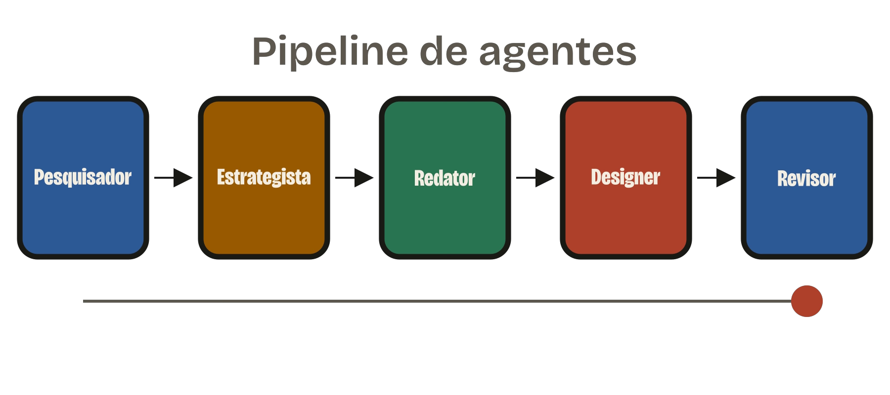
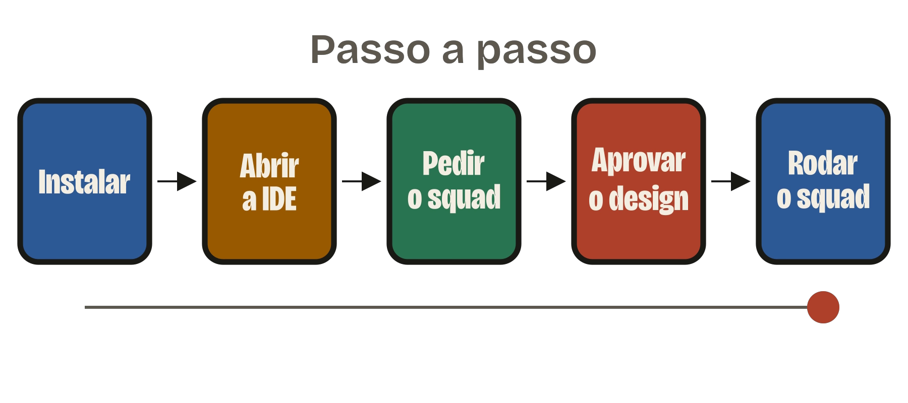

# Como criar um squad de IA grátis com OpenSquad

_2026-11-27 · tutorial_

Esta apostila ensina a instalar o OpenSquad, ferramenta gratuita e open source que cria times de agentes de IA a partir de uma descrição em linguagem natural. Você instala a ferramenta na pasta do projeto, abre a IDE nessa mesma pasta, pede um squad ao Arquiteto, aprova o desenho da equipe e roda o squad pelo nome. Por fim, abre o painel do squad no navegador para conferir se a criação deu certo. O exemplo do guia é um squad que transforma uma notícia em carrossel para o Instagram, mas o mesmo caminho serve a qualquer tarefa que você descreva. Ao terminar, você consegue repetir o processo do zero e reconhecer os erros mais comuns.

## O que você terá no fim

Ao final deste tutorial você terá um squad funcionando no seu computador. Um squad é um time de agentes de IA que trabalha em conjunto numa tarefa. O exemplo deste guia é um squad que recebe uma notícia e entrega um carrossel pronto para o Instagram.

Você vai instalar o OpenSquad, pedir o squad ao Arquiteto, aprovar o desenho da equipe, rodar o squad e conferir o resultado no painel. Cada etapa é curta e tem um resultado que você consegue verificar antes de seguir para a próxima.

O OpenSquad é gratuito e open source. As IDEs e os provedores de IA que você usa, porém, podem cobrar pelo consumo de tokens. A seção de cuidados explica como acompanhar esse custo.

## Como isso funciona



_O trabalho passa de agente em agente, do Pesquisador ao Revisor, em pipeline._

Um squad é formado por agentes, e cada agente tem um papel específico. Um exemplo de squad de conteúdo tem um Pesquisador, que coleta informações e tendências do setor; um Estrategista, que gera ideias e define a abordagem; um Redator, que produz o conteúdo final; um Designer, que cria as imagens para redes sociais; e um Revisor, que garante a qualidade antes da entrega.

Os agentes executam em pipeline, que é a sequência de etapas pela qual o trabalho passa de um agente para o outro. Em alguns pontos, o pipeline tem checkpoints: o agente pausa e pede a sua aprovação antes de continuar. Os checkpoints são instruções escritas no pipeline do agente. O controle real de permissões depende da IDE onde você está trabalhando, como Claude Code ou Cursor.

O Arquiteto é o agente que cria squads. Ele faz algumas perguntas sobre o que você quer, desenha a equipe e configura tudo automaticamente. Nenhuma execução começa antes de você aprovar esse desenho. Isso quer dizer que você decide a equipe antes de ela trabalhar.

Fonte: <https://github.com/renatoasse/opensquad>

## Antes de começar

Antes de instalar, confira os três itens abaixo. Se algum faltar, resolva antes de seguir, porque os passos seguintes dependem dele.

- Node.js 20 ou superior instalado no computador. Baixe no site oficial, nodejs.org.
- Uma IDE suportada pelo OpenSquad: Claude Code, Cursor, VS Code com Copilot, Codex (OpenAI), Open Code, Antigravity, Gemini CLI, Qwen Code ou Trae.
- Uma pasta de projeto no computador. É dentro dela que o OpenSquad é instalado e onde cada squad ganha sua própria pasta.

Fonte: <https://github.com/renatoasse/opensquad>

## Passo a passo



_Os cinco passos, da instalação à execução do squad, cada um com resultado para conferir._

1. Instale o OpenSquad dentro da pasta do projeto, com o terminal aberto nessa pasta. Resultado esperado: a instalação fica na pasta do projeto, pronta para ser usada pela IDE.
2. Abra a IDE dentro da mesma pasta onde você rodou a instalação. Resultado esperado: o comando do OpenSquad passa a aparecer nessa pasta.
3. Peça o squad ao Arquiteto, digitando o comando do OpenSquad seguido de uma frase que descreva o conteúdo que você quer. Resultado esperado: o Arquiteto começa a fazer perguntas sobre o squad.
4. Aprove o design do squad quando o Arquiteto mostrar a equipe. Resultado esperado: o squad fica desenhado, e nada executa antes da sua aprovação.
5. Rode o squad pelo nome. Resultado esperado: o squad começa a trabalhar e pausa nos checkpoints, pedindo a sua aprovação.

Fonte: <https://github.com/renatoasse/opensquad>

## Instalar o OpenSquad no projeto

O comando de instalação coloca o OpenSquad na pasta onde você o executa. Pense nessa etapa como a preparação de uma fábrica: a ferramenta fica pronta, mas ainda não produz nada até você pedir um squad.

A pasta importa. Cada squad que você criar depois ganha a sua própria pasta dentro de squads, e tudo fica organizado no mesmo lugar. Por isso, execute o comando dentro da pasta do projeto, e não numa pasta solta do computador.

Para atualizar uma instalação que já existe, a documentação oficial do projeto traz o comando de update.

```
npx opensquad init
```

Fonte: <https://github.com/renatoasse/opensquad>

## Abrir a IDE na pasta certa

Abra a sua IDE dentro da mesma pasta onde você rodou a instalação. O comando principal do OpenSquad só responde nesse diretório. Se a IDE estiver aberta uma pasta acima, a ferramenta não encontra a instalação e parece que nada aconteceu.

Quando o comando não aparecer no menu, confira primeiro o caminho que a IDE abriu. Quase sempre é a pasta o problema, e não a instalação.

Fonte: <https://github.com/renatoasse/opensquad>

## Pedir o squad ao Arquiteto

Peça o squad em linguagem natural, do mesmo jeito que pediria a um colega. O Arquiteto lê o seu pedido, faz algumas perguntas e desenha a equipe. Você não precisa acertar todos os detalhes de primeira, porque o desenho aparece para revisão antes de qualquer execução.

Responda com o que você realmente quer produzir. Quanto mais claro for o pedido, menos ajustes você terá de fazer depois.

```
/opensquad crie um Squad que escreve tutoriais completos com prints de tela para treinamento de colaboradores
```

Fonte: <https://github.com/renatoasse/opensquad>

## Aprovar o design do squad

Quando o Arquiteto termina o desenho, ele mostra os agentes e a tarefa de cada um. Leia com calma, porque é nessa etapa que você corrige o que não serve. Confira se cada agente tem uma tarefa clara. Um agente que pesquisa notícias, por exemplo, deve ficar separado do agente que escreve os textos. Assim, quando algo sair estranho, fica mais fácil descobrir em qual etapa o problema começou.

Se algum agente parecer acumular tarefas demais, peça para simplificar o desenho antes de aprovar. Depois da sua aprovação, o OpenSquad configura tudo automaticamente, e o squad fica pronto para rodar.

Fonte: <https://github.com/renatoasse/opensquad>

## Rodar o squad pelo nome

Para executar o squad, use o comando de execução e troque o nome pelo nome do seu squad. O squad roda sozinho e pausa nos checkpoints, onde o agente pede a sua aprovação. Esse é o ponto de controle que muda a rotina: você confere a pesquisa, o texto e os slides em etapas, sem deixar a ferramenta rodar até o fim com um erro lá no começo.

Quando o squad pausar, leia o que foi produzido e só então libere o próximo passo. Com o tempo, e com o squad mais ajustado ao seu jeito de trabalhar, você pode decidir quais checkpoints manter.

```
/opensquad rode o squad <nome-do-squad>
```

Fonte: <https://github.com/renatoasse/opensquad>

## Gerar o painel do squad

O Escritório Virtual é uma interface visual 2D que mostra os seus agentes trabalhando em tempo real. Para criá-lo, gere o dashboard do squad diretamente na IDE, com o comando abaixo.

```
/opensquad dashboard
```

Fonte: <https://github.com/renatoasse/opensquad>

## Servir o painel no navegador

O painel gerado é uma pasta de arquivos que precisa ser servida para aparecer no navegador. Para isso, use o pacote serve, criado pela Vercel, que sobe um servidor local para pastas estáticas. Rode o comando abaixo no terminal, dentro da pasta do projeto, trocando o nome pelo do seu squad.

Depois que o comando subir o servidor, abra no navegador o endereço http://localhost:3000. A página mostra o painel do squad.

```
npx serve squads/<nome-do-squad>/dashboard
```

Fonte: <https://github.com/vercel/serve>

## Teste de pronto

- [ ] A pasta do squad existe dentro do projeto, na pasta squads, com o nome que o Arquiteto deu a ele.
- [ ] O squad roda pelo nome e pausa nos checkpoints, pedindo a sua aprovação antes de seguir.
- [ ] O painel abre em http://localhost:3000 no navegador e mostra o seu squad com os agentes criados.
- [ ] A IDE mostra o comando do OpenSquad porque está aberta na mesma pasta da instalação.

Fonte: <https://github.com/renatoasse/opensquad>

## Erros comuns e cuidados

Os problemas mais comuns têm causas simples. Confira estes pontos antes de culpar a ferramenta.

- IDE aberta na pasta errada: o comando do OpenSquad não aparece. Abra a IDE dentro da pasta onde rodou a instalação.
- Checkpoints dependem da IDE: eles são instruções do pipeline, e o controle real de permissões depende da IDE host, como Claude Code ou Cursor.
- Consumo de tokens: cada execução consome tokens, e a quantidade depende do número de agentes, da complexidade do pipeline e do modelo escolhido. Em stacks pagas, monitore o consumo na sua IDE ou no painel do provedor de IA.
- Custo zero é possível: o OpenSquad pode ser usado de forma gratuita com stacks como Google Antigravity (free tier com Gemini) ou OpenCode com LLMs locais, como Ollama e LM Studio.
- Sessões de navegador: quando você fornece URLs de referência, o OpenSquad usa um navegador headless (Playwright) para visitar as páginas. Na primeira vez que uma plataforma exige login, ele pede que você entre manualmente e pergunta se deseja salvar a sessão. Se você autorizar, os cookies ficam em _opensquad/_browser_profile/, pasta que nunca é commitada no git. Para revogar, apague essa pasta. O navegador pode acessar qualquer URL, e as ações dele são controladas pelo agente investigador.

Fonte: <https://github.com/renatoasse/opensquad>

## Glossário

- Squad: equipe de agentes de IA que colaboram numa mesma tarefa, com um papel definido para cada agente.
- Agente: membro do squad com uma função própria, como pesquisar, escrever ou revisar.
- Arquiteto: agente que faz perguntas, desenha o squad e configura tudo.
- Pipeline: sequência de etapas pela qual o trabalho passa de um agente para o outro.
- Checkpoint: ponto em que o agente pausa e pede a sua aprovação antes de continuar.
- IDE: ambiente de programação onde você digita os comandos, como Claude Code ou Cursor.
- Node.js: ambiente que executa JavaScript fora do navegador. O OpenSquad pede a versão 20 ou superior.
- Escritório Virtual: interface visual 2D que mostra os agentes trabalhando em tempo real.
- Token: unidade de texto que os modelos de IA processam. Em stacks pagas, o consumo de tokens é cobrado.
- Playwright: biblioteca que controla um navegador sem interface gráfica, usada para visitar páginas.

## Plano de 7 dias

- Dia 1: instalar o OpenSquad dentro da pasta do projeto.
- Dia 2: abrir a IDE na mesma pasta e confirmar que o comando do OpenSquad aparece.
- Dia 3: pedir o squad ao Arquiteto e responder às perguntas dele.
- Dia 4: ler o desenho dos agentes e aprovar o design do squad.
- Dia 5: rodar o squad pelo nome e aprovar os checkpoints, um por um.
- Dia 6: gerar o painel do squad e servi-lo no navegador em http://localhost:3000.
- Dia 7: refazer os passos de 1 a 6 do zero, conferindo a pasta antes de cada etapa.

## Para onde ir depois

Para ver todos os comandos disponíveis, peça a ajuda do OpenSquad dentro da IDE com o comando abaixo.

Um squad rende mais quando cada agente tem uma tarefa clara. Desenhe o time pensando em quem faz o quê, antes de pensar em quantos agentes ele terá. Essa regra vale para qualquer tarefa, do carrossel ao relatório, e você pode levá-la para os próximos squads.

- Repita o tutorial com outro pedido, como um squad de tutoriais com prints de tela.
- Depois de cada execução, ajuste o squad até o resultado ficar do seu jeito.

```
/opensquad help
```

Fonte: <https://github.com/renatoasse/opensquad>

## Além do vídeo

- Lista completa de comandos do OpenSquad: list, edit, skills, install e uninstall, cada um com sua função.
- Exemplos de squads para criar: carrosséis de Instagram a partir de notícias, materiais de lançamento de infoproduto, tutoriais com prints de tela e cortes de vídeos do YouTube.
- Radar de tendências, que monitora notícias e alimenta outros squads, como o de produção de conteúdo.
- Refatoração de conteúdo: transformar um vídeo em carrossel, artigo, thread ou outro formato.
- Uso em times de marketing, RH e gestão, com automação de triagem, comunicações internas, relatórios e dashboards.
- Licença MIT. Contribuições da comunidade são bem-vindas e seguem o arquivo CONTRIBUTING.md do repositório.
