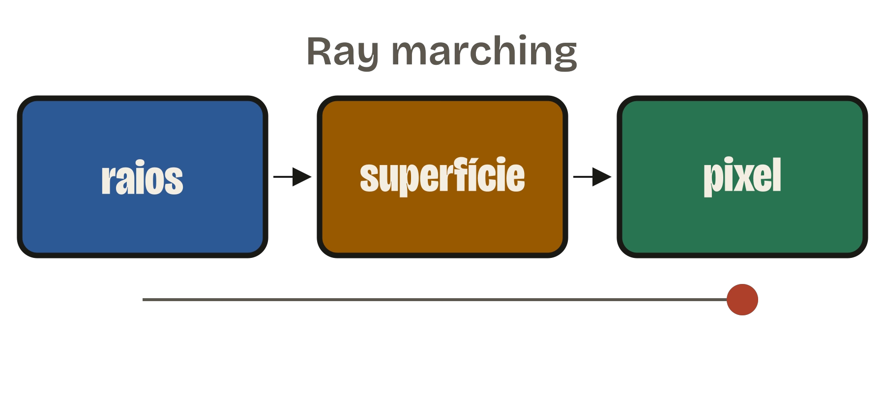
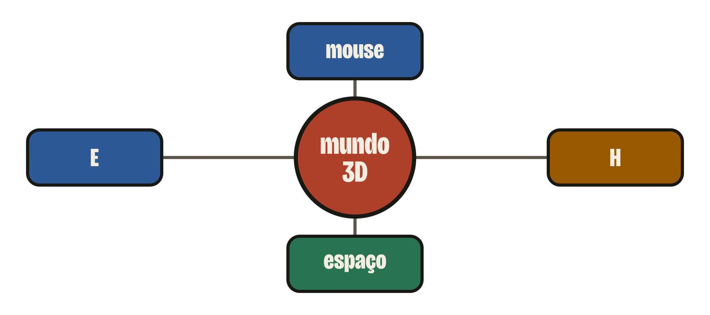
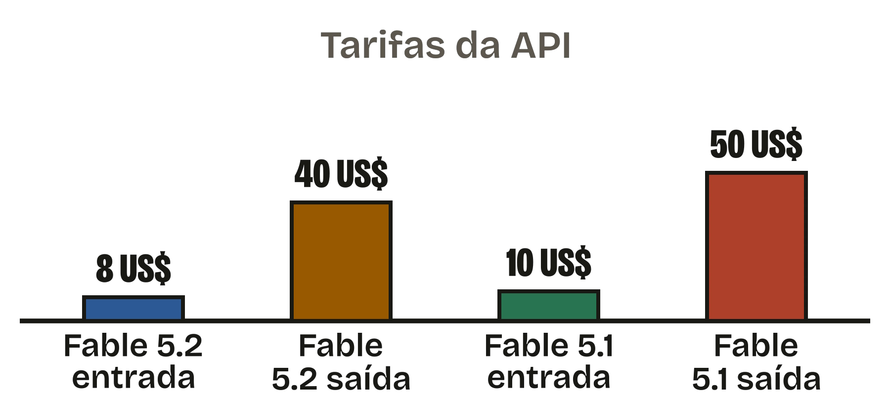

# Fable 5.2 gera mundo 3D por shader ray marching

_2026-11-27 · tutorial_

Você vai gerar e abrir um mundo 3D interativo no navegador com o Claude Fable 5.2, usando um único arquivo HTML. A apostila explica o ray marching, a escolha do modelo e do esforço, o prompt exato e os controles da demonstração. Também mostra como interpretar preços, benchmarks e as outras visualizações sem confundir capacidade anunciada com resultado garantido. Ao final, você saberá repetir o processo, testar se funcionou e evitar os problemas mais comuns.

## O que você terá no fim

Você terá um mundo 3D interativo rodando no navegador, gerado pelo Claude Fable 5.2 em um único arquivo HTML. A cena será calculada por um shader ray marching e responderá ao mouse e às teclas H, espaço e E.

O arquivo abre localmente e funciona offline. Você não precisa montar um servidor nem escrever o shader. Seu trabalho é escolher o modelo, dar o objetivo, aguardar o código completo, salvar o HTML e testar a demonstração.

Esse exercício mostra a capacidade de geração de código do modelo em uma tarefa visual. Também dá um critério prático: a demonstração precisa renderizar, responder aos controles e continuar funcionando quando o arquivo é aberto no navegador.

## O fato: a Anthropic anunciou o Fable 5.2

Em 9 de novembro de 2026, a Anthropic anunciou o Claude Fable 5.2. A empresa apresenta o modelo como o mais capaz para trabalho técnico e cita programação, agentes, pesquisa científica, análise de dados e design entre os usos.

Para pessoas e organizações, a página oficial lista acesso nos planos Pro, Max, Ultra, Team e Enterprise. A disponibilidade depende do plano e do acesso da conta.

Na parte de design, a Anthropic diz que o modelo cria mundos 3D interativos, simulações, animações e vídeos educacionais com som em código. A demonstração do mundo 3D usa essa capacidade para gerar a cena e sua interação.

Fonte: <https://www.anthropic.com/claude/fable>

## Como funciona: shader, ray marching e arquivo único



_Raios avançam em busca de uma superfície; o resultado define o pixel._

Um shader é um programa que roda na GPU e calcula a aparência da cena. No ray marching, o cálculo começa em raios que atravessam a imagem. Cada raio avança pelo espaço em busca de uma superfície, e o resultado define o que aparece naquele pixel.

A cada quadro, a demonstração recalcula a imagem. Quando você move o mouse, muda a direção do olhar. Quando troca a paleta ou a textura, o shader passa a calcular a cena com outra aparência. Por isso a resposta parece imediata.

Uma cena 3D comum pode usar uma malha de polígonos. Aqui, o mundo é obtido pelo cálculo dos raios, sem depender de um modelo 3D pronto. O Fable 5.2 escreve o código desse cálculo; o navegador e a GPU executam o arquivo.

Deixar interface, shader e controles no mesmo HTML permite abrir a demonstração sem servidor local. O custo dessa liberdade é o processamento: cada pixel é recalculado a cada quadro, então a GPU precisa estar disponível.

Fonte: <https://www.anthropic.com/claude/fable>

## Antes de começar

Confira os requisitos antes de gerar o arquivo. Eles evitam que você precise interromper a demonstração para resolver acesso, navegador ou armazenamento.

- Uma conta Claude Pro, Max, Ultra, Team ou Enterprise, com o Fable 5.2 visível no seletor de modelo. A conta gratuita não inclui o modelo neste fluxo.
- Um navegador atualizado, como Chrome, Edge ou Firefox.
- GPU e aceleração de hardware disponíveis para executar o shader.
- Alguns megabytes livres para salvar o arquivo HTML.
- Tempo para aguardar a geração sem interromper o modelo.

## Passo a passo

A sequência abaixo vai do login ao mundo 3D. O resultado esperado de cada etapa ajuda a identificar onde parar e o que corrigir.

1. 1. Acesse claude.ai e faça login com uma conta Claude Pro, Max, Ultra, Team ou Enterprise. O resultado esperado é o painel aberto com o seletor de modelo visível; se aparecer uma tela de upgrade, troque de conta ou faça a atualização do plano.
2. 2. No seletor de modelo, escolha Claude Fable 5.2. O resultado esperado é o nome do modelo selecionado; se ele não aparecer, confira o plano ou tente outra conta com acesso.
3. 3. No controle de esforço, escolha Extra. O resultado esperado é o controle mostrar Extra; se a opção não existir, use o nível mais alto disponível.
4. 4. Cole o prompt da próxima seção no campo de texto do Claude. O resultado esperado é ver a instrução completa no campo antes de enviar.
5. 5. Envie o prompt e aguarde a resposta terminar. O resultado esperado é um arquivo HTML completo com as visualizações; se a resposta for genérica, peça foco em 3D e ray marching, e se travar, reenvie o pedido com menos demos e foco em 3D.
6. 6. Salve o arquivo HTML e abra-o no navegador atualizado. O resultado esperado é a demonstração carregar com o menu de visualizações; se a página ficar em branco, abra o console do navegador e procure erros de script.
7. 7. No menu da demonstração, selecione a visualização mundo 3D. O resultado esperado é a cena ser renderizada e responder ao movimento do mouse; se não renderizar, troque de navegador ou verifique a aceleração de hardware.

## Prompt pronto

Use o texto abaixo sem alterar a estrutura. O pedido de uma demo interativa define o comportamento; a exigência de um único arquivo HTML define a arquitetura; a referência à documentação de lançamento orienta a busca; e o plural demos pede mais de uma visualização.

Se quiser concentrar a resposta no mundo 3D, faça um novo pedido depois da primeira geração. Peça foco em 3D e ray marching e, se necessário, reduza a quantidade de demos. Esses ajustes são orientações em texto; o bloco copiável abaixo preserva o prompt original.

```
crie uma demo interativa em um único arquivo HTML para demonstrar o poder do novo Fable 5.2. busque a documentação de lançamento e gere demos que demonstram o poder de forma interativa dessa novidade.
```

## Exemplo completo: o mundo 3D



_O mundo 3D responde ao mouse e às teclas H, espaço e E._

Exemplo: depois de abrir o HTML, o menu mostra as visualizações geradas. Ao entrar em mundo 3D, a cena aparece e o movimento do mouse muda o olhar. O menu faz parte de uma demonstração interativa, com a cena respondendo às ações do usuário.

Pressione H para esconder a interface e deixar a experiência mais imersiva. Pressione espaço para mudar a paleta de cores do céu. Pressione E para variar a textura da cena. Cada controle altera o que o shader calcula no quadro seguinte.

Se os três controles responderem, o arquivo está executando o mundo 3D. Se apenas alguns funcionarem, o arquivo pode estar incompleto e precisa ser gerado novamente. Se nenhum responder, recarregue a página e confira se o HTML foi salvo por inteiro.

## As outras visualizações: enxame, física e contexto

A demonstração também transforma partes do anúncio em experiências visuais. O enxame usa 100 agentes que respondem ao cursor. Você pode digitar ao pressionar Tab e ajustar a velocidade da animação, inclusive para 3x. A cena ilustra a coordenação de agentes; a quantidade de agentes desenhada não é uma medição de quantos subagentes o modelo usou naquela geração.

A visualização de física mostra ondas se espalhando a partir de dois pontos. O texto da demonstração explica que a equação da onda é resolvida ao vivo por diferenças finitas e inclui o experimento da dupla fenda. Diferenças finitas são uma forma de aproximar um cálculo contínuo por etapas discretas, o que permite atualizar a simulação quadro a quadro.

A visualização de contexto usa 1 milhão de tokens. Cada pixel do painel representa um token; a lupa ajuda a percorrer a escala e o scanner encontra um pixel diferente. A janela de contexto indica quanto texto o modelo pode receber e processar em uma mesma interação. Ela não mede, sozinha, a precisão das respostas.

## Os números: preço, capacidade e benchmarks



_Tarifas da API por milhão de tokens de entrada e saída no Fable 5.2 e no Fable 5.1._

Os preços citados são tarifas da API, não valores da assinatura do Claude. Os benchmarks são resultados de testes específicos e devem ser lidos com a configuração indicada.

A página oficial informa que os resultados do Fable 5.2 e do Fable 5.1 usam as proteções ativadas, salvo indicação contrária, e o maior esforço disponível quando não especificado.

- US$ 8 por milhão de tokens de entrada e US$ 40 por milhão de tokens de saída no Fable 5.2. O Fable 5.1 custava US$ 10 e US$ 50 nos mesmos critérios, o que representa redução de 20% em cada tarifa; o custo total de um projeto depende do uso.
- US$ 0,20 por milhão de tokens em leituras de cache. Esse valor descreve as leituras de cache na API e não é o preço de tokens novos.
- No FrontierCode 2.0, o Fable 5.2 marcou 49,1% com esforço Xhigh, contra 32,4% do Fable 5.1 com o mesmo esforço. O percentual se refere ao benchmark de codificação agêntica e não é um índice de acerto em qualquer tarefa de programação.
- No FrontierSWE v2, o Fable 5.2 marcou 69,9%, contra 56,3% do Fable 5.1. O resultado é específico desse teste de tarefas de engenharia e não cobre todo trabalho de desenvolvimento.
- No RoboDojo Sim, o Fable 5.2 marcou 64,9%, contra 27,6% do Fable 5.1. A página informa que a avaliação foi executada internamente e usou o maior esforço disponível; o resultado não representa toda robótica.
- Em testes com agentes, a Anthropic relata que o Fable 5.2 coordenou centenas ou mais de mil subagentes. O número descreve o relato da empresa sobre aqueles testes e não define quantos subagentes serão usados em cada pedido.

Fonte: <https://www.anthropic.com/claude/fable>

## O que muda na sua prática

Você pode avaliar a capacidade de 3D do modelo com uma tarefa concreta: gerar um arquivo, abrir no navegador, mover a cena e testar os controles. O resultado interativo dá mais informação do que uma imagem bonita, porque mostra o código em execução.

O exercício também separa três coisas que costumam aparecer juntas: a capacidade anunciada pela Anthropic, a visualização criada pela demonstração e o desempenho medido em benchmarks. Cada uma responde a uma pergunta diferente. Para decidir se o modelo serve ao seu trabalho, repita o teste com um problema real e observe se ele conclui a tarefa.

O mundo 3D é um bom começo para quem está vendo o assunto pela primeira vez. Depois de entender o fluxo, você pode testar outros objetivos e comparar os arquivos gerados, mantendo o mesmo critério de prontidão.

## Teste de pronto

Use esta lista depois de abrir o HTML. Cada item pode ser conferido diretamente na demonstração.

- [ ] O arquivo HTML abre no navegador e mostra o menu de visualizações.
- [ ] A visualização mundo 3D renderiza uma cena 3D.
- [ ] O movimento do mouse muda o olhar dentro da cena.
- [ ] A tecla H esconde a interface e deixa a experiência imersiva.
- [ ] A tecla espaço muda a paleta de cores do céu.
- [ ] A tecla E muda a textura da cena.
- [ ] Os três controles continuam respondendo depois de recarregar o arquivo salvo.

## Erros comuns e cuidados

Se algum teste falhar, identifique a etapa antes de gerar tudo novamente. A maior parte dos problemas aparece no acesso ao modelo, na integridade do arquivo ou na execução gráfica do navegador.

- Conta sem acesso: o Fable 5.2 não aparece no seletor. Confira se o plano é Pro, Max, Ultra, Team ou Enterprise e, se necessário, troque de conta ou atualize o plano.
- Esforço insuficiente: use Extra ou o nível mais alto disponível. Esforço alto dá mais espaço de raciocínio ao modelo, mas não elimina a necessidade de testar o código.
- Resposta genérica: peça foco em 3D e ray marching. Se a geração travar, reenvie o prompt com menos demos.
- Arquivo incompleto: aguarde a resposta terminar antes de salvar. Se apenas alguns controles funcionarem, gere o arquivo novamente.
- Página em branco: abra o console do navegador e verifique erros de script. Recarregue a página e confira se o HTML foi salvo por completo.
- Cena lenta: feche outras abas pesadas. O ray marching recalcula cada pixel a cada quadro e depende da GPU.
- Cena sem renderização: troque de navegador ou verifique a aceleração de hardware.
- Preço e benchmark sem contexto: não trate a tarifa da API como valor da assinatura nem o resultado de um benchmark como garantia para qualquer tarefa.
- Privacidade: a página oficial informa retenção de dados por 30 dias por padrão para monitoramento de segurança ao usar modelos Fable. Considere essa política antes de incluir informações sensíveis no prompt.

## Glossário

- HTML: linguagem de marcação usada para estruturar a página que o navegador abre.
- Arquivo único: demonstração cuja interface, código e controles ficam no mesmo HTML.
- Shader: programa executado pela GPU para calcular a aparência da cena.
- Ray marching: técnica que avança raios pelo espaço em busca de superfícies para desenhar a imagem.
- Raio: direção de cálculo que parte da câmera e atravessa um ponto da imagem.
- Pixel: menor unidade visual de uma imagem digital.
- Quadro: uma imagem calculada e exibida em um instante da animação.
- GPU: processador especializado em cálculos gráficos usado para executar o shader.
- Aceleração de hardware: uso da GPU para executar parte do trabalho gráfico.
- Malha poligonal: representação de objetos 3D por vértices, arestas e polígonos.
- Subagente: processo delegado pelo modelo para executar uma parte do trabalho.
- Token: unidade de texto processada pelo modelo.
- Janela de contexto: quantidade de tokens que o modelo pode considerar em uma mesma interação.
- Benchmark: teste com tarefas e critérios definidos para comparar desempenho.
- Esforço: controle que define quanto trabalho de raciocínio o modelo pode usar.
- API: interface que permite integrar o modelo a outros programas.

## Plano de 7 dias

- Dia 1: confira a conta, o plano, o navegador, a GPU e o espaço livre para salvar o HTML.
- Dia 2: acesse o Claude, selecione o Fable 5.2 e defina o esforço Extra ou o nível mais alto disponível.
- Dia 3: cole o prompt da demonstração, envie e aguarde a geração terminar.
- Dia 4: salve o HTML completo e abra o arquivo no navegador para conferir o menu.
- Dia 5: entre na visualização mundo 3D e mova o mouse para olhar ao redor.
- Dia 6: teste H, espaço e E e use a lista de erros comuns se algum controle falhar.
- Dia 7: repita o fluxo com o arquivo salvo e teste outro prompt, comparando o resultado com a primeira demonstração.

## Para onde ir depois

Guarde o arquivo HTML para repetir a demonstração offline. A partir daí, use o mesmo teste de pronto em cada arquivo novo e amplie o objetivo aos poucos.

- Repita a demonstração offline e use o teste de pronto sempre que gerar um arquivo novo.
- Explore as visualizações de enxame, física e contexto para relacionar cada uma ao anúncio do modelo.
- Teste outros prompts e compare os resultados, mantendo o mesmo objetivo e o mesmo critério de avaliação.
- Se quiser acompanhar os usos técnicos e a disponibilidade do modelo, use a página oficial da Anthropic.

Fonte: <https://www.anthropic.com/claude/fable>

## Além do vídeo

- O acesso ao Fable 5.2 também é oferecido no Claude Platform, em marketplaces, na Amazon Web Services, no Google Cloud e no Microsoft Foundry.
- O modo rápido entrega até 2,5 vezes mais velocidade e custa US$ 16 por milhão de tokens de entrada e US$ 80 por milhão de tokens de saída.
- A inferência restrita aos Estados Unidos é oferecida com preço de 1,1 vez as tarifas de entrada e saída.
- Consultas sinalizadas pelas proteções de cibersegurança e biologia podem ser encaminhadas para modelos menos capazes; a Anthropic oferece programas de verificação para trabalhos legítimos afetados.
- O Enterprise Frontier Safeguards permite executar o monitoramento de segurança na infraestrutura do cliente e ser compatível com retenção zero de dados.
- A Unity relata melhora na criação de cenas 3D do zero e em tarefas mais difíceis de desenvolvimento de jogos.
- A iGent relata uma sessão em que o modelo construiu um hipervisor com mais de 3.500 provas verificadas por máquina.
- A tabela oficial também traz resultados em design de proteínas, trabalho do conhecimento, análise de gráficos e outras categorias.
