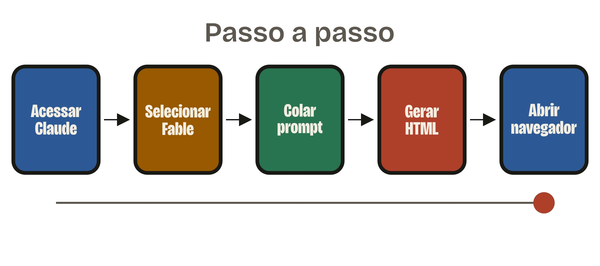
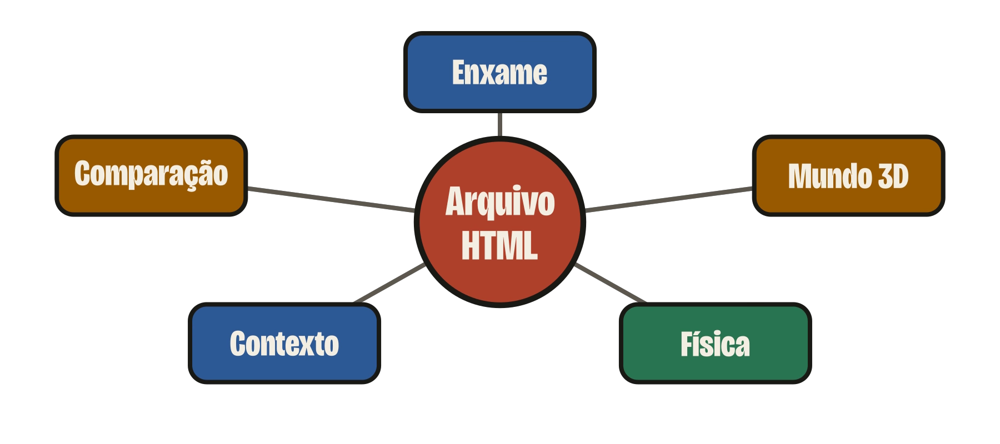
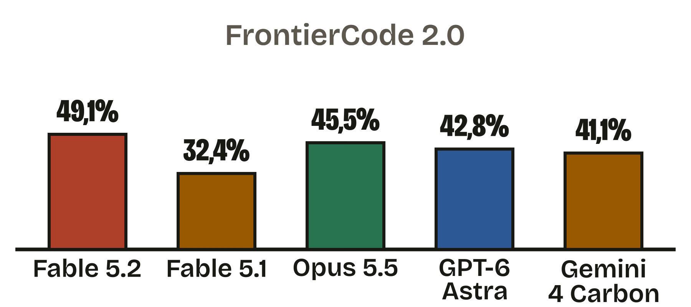

# Fable 5.2 gera mundo 3D por shader ray marching

_2026-11-27 · tutorial_

O Fable 5.2 é o modelo mais capaz da Anthropic para trabalho técnico, e este tutorial mostra como usá-lo para gerar um único arquivo HTML com cinco demos interativas, incluindo um mundo 3D renderizado por ray marching. Você vai configurar a conta, selecionar o modelo, definir o esforço em Extra, colar um prompt e abrir o resultado no navegador. Ao fim, saberá explorar as demos, testar os controles do mundo 3D e repetir o fluxo com seu próprio pedido.

## O que você terá no fim

Um arquivo HTML único com cinco demos interativas, gerado pelo Fable 5.2, o modelo mais capaz da Anthropic para trabalho técnico. Entre as demos está um mundo 3D renderizado por ray marching: cada pixel é calculado a cada quadro, sem modelos prontos nem estruturas. O arquivo roda direto no navegador, sem servidor, sem build e sem dependências externas.

O resultado é um artefato completo que você pode abrir, explorar e compartilhar. As outras quatro demos cobrem enxame de agentes, física de ondas, janela de contexto de um milhão de tokens e comparação entre o Fable 5.2 e o Fable 5.1.

Fonte: <https://www.anthropic.com/claude/fable>

## Como isso funciona

O Fable 5.2 é o modelo mais capaz da Anthropic para trabalho técnico. Ele toma problemas ambíguos, questiona e verifica o próprio trabalho e coordena subagentes para melhorar o resultado em loop. Para este tutorial, ele lê a documentação de lançamento da Anthropic e gera código que demonstra as capacidades anunciadas.

Ray marching é uma técnica de desenho 3D: em vez de usar modelos prontos, o shader calcula cada pixel a cada quadro. É isso que faz o mundo 3D ser gerado do zero pela matemática do shader, sem estruturas pré-existentes.

O prompt define o escopo do que o modelo constrói. Ele instrui o Fable 5.2 a buscar a documentação de lançamento e gerar demos interativas. É essa instrução que faz o modelo ler a página oficial e montar o mundo 3D por ray marching. Um prompt vago gera uma demo genérica sem o mundo 3D.

A arquitetura de um único arquivo HTML existe para rodar direto no navegador: você clica e vê. Nenhuma instalação nem build.

Fonte: <https://www.anthropic.com/claude/fable>

## As novidades do Fable 5.2

O Fable 5.2 e o Mythos 5.2 mostram melhorias em programação, raciocínio e visão. Durante testes pré-lançamento, ajudaram engenheiros a completar migrações de software de outra forma inviáveis, projetaram três dispositivos eletrônicos funcionais do zero, resolveram dois problemas abertos na física de buracos negros, avançaram em avaliações de robótica e formalizaram a prova do Último Teorema de Fermat em 30 horas.

Os testes mostraram que o Fable 5.2 e o Mythos 5.2 se comunicam com mais clareza do que os modelos anteriores e geram resultados até 30% mais rápido do que o Fable 5.1 e o Mythos 5.1.

O Fable 5.2 constrói mundos 3D interativos, lê imagens e PDFs detalhados, projeta componentes de hardware, cria simulações, animações e vídeos educacionais com som em código e pode manipular ambientes em robótica. A Anthropic descreve essa capacidade na seção de design para 3D, hardware e motion.

O modelo coordena centenas ou até mais de mil subagentes em tarefas longas e roda trabalho de engenharia ambíguo por dias, questionando e verificando o próprio trabalho. Mais de 90% das mudanças integradas ao código-base central da Anthropic são agora escritas pelo Claude, com orientação humana.

Fonte: <https://www.anthropic.com/claude-fable-and-mythos-5-2>

## Antes de começar

Confirme o acesso antes de colar o prompt. Sem plano pago, o seletor não mostra o Fable 5.2 e o tutorial para aqui.

- Conta Claude com plano pago: o Fable 5.2 está disponível para usuários Pro, Max, Ultra, Team e Enterprise. Contas gratuitas não veem o modelo no seletor.
- Navegador moderno instalado: Chrome ou Edge recomendados para abrir o HTML gerado.
- Conexão com a internet: o modelo busca a documentação de lançamento durante a geração.
- Acesso ao modelo Fable 5.2: confirme que o seletor exibe o Fable 5.2 antes de colar o prompt.

Fonte: <https://www.anthropic.com/claude/fable>

## Passo a passo



_Cinco passos do prompt ao HTML no navegador._

1. Passo 1 — Acessar o Claude e entrar na conta. Abra a aplicação web do Claude e entre com sua conta. O Fable 5.2 não roda local: ele vive na nuvem da Anthropic e o navegador é só a porta de entrada. Resultado esperado: página inicial do Claude com o campo de prompt vazio.
2. Passo 2 — Selecionar o modelo Fable 5.2. No seletor de modelos, na parte de baixo da tela, escolha o Fable 5.2. O modelo define o teto de capacidade do que vem depois. É ele quem vai gerar o mundo 3D por ray marching. Modelos anteriores não sustentam a mesma complexidade de shader e código. Resultado esperado: Fable 5.2 destacado no seletor de modelos.
3. Passo 3 — Definir o esforço em Extra. No seletor de esforço, ao lado do modelo, escolha Extra. O esforço controla quanto o modelo pensa antes de responder. Extra libera mais passos de raciocínio e a coordenação de subagentes. Essa margem permite gerar um shader de ray marching completo num único arquivo. Resultado esperado: esforço definido como Extra.
4. Passo 4 — Colar o prompt de demo interativa. Cole o prompt que pede a demo em um único HTML. O prompt define o escopo do que o modelo vai construir e é a única especificação que ele recebe. Ele instrui o Fable 5.2 a buscar a documentação de lançamento e gerar demos interativas. Resultado esperado: prompt colado no campo.
5. Passo 5 — Gerar o arquivo HTML. Envie o prompt e aguarde a geração. O modelo busca a documentação de lançamento, entende as capacidades anunciadas e monta um único arquivo HTML com cinco demos interativas, coordenando subagentes para pesquisar e escrever o código em paralelo. Resultado esperado: arquivo HTML único com as cinco demos.
6. Passo 6 — Abrir o HTML no navegador. Abra o arquivo HTML gerado no navegador. O arquivo é autocontido e roda local, sem servidor. O HTML contém o shader de ray marching embutido, então a renderização acontece no navegador. Resultado esperado: página com as demos carregada.
7. Passo 7 — Explorar o mundo 3D por ray marching. Abra a aba do mundo 3D gerado pelo shader de ray marching. Essa é a capacidade que a página da Anthropic anuncia. O ray marching calcula cada pixel a cada quadro, sem modelos prontos nem estruturas. Resultado esperado: mundo 3D renderizado e você pode olhar para os lados.
8. Passo 8 — Testar os controles do mundo 3D. Pressione H, Espaço e E no mundo 3D. H esconde a interface e deixa a experiência imersiva. Espaço troca a paleta de cores do céu. E altera a textura do cenário. Cada mudança acontece sem recarregar a página. Resultado esperado: cada tecla muda a cena em tempo real.
9. Passo 9 — Explorar as outras quatro demos. Abra as abas do enxame, física, contexto e comparação. O enxame simula cem agentes respondendo ao cursor. A física resolve a equação da onda ao vivo por diferenças finitas. O contexto exibe um milhão de tokens como pixels. A comparação coloca o Fable 5.2 ao lado do 5.1. Resultado esperado: quatro demos adicionais visíveis e funcionais.

Fonte: <https://www.anthropic.com/claude/fable>

## Exemplo completo



_Cinco demos interativas num único arquivo HTML._

O arquivo gerado contém cinco demos, cada uma usando uma técnica diferente de renderização. Juntas, elas mostram o alcance do Fable 5.2 além do mundo 3D.

Enxame: simula cem agentes respondendo ao cursor. Você pode digitar em tempo real e os agentes reagem. Há controle de velocidade, de 1x a 3x.

Mundo 3D: renderizado por ray marching, cada pixel calculado a cada quadro, sem modelos prontos nem estruturas. Controles: H esconde o menu, Espaço troca a paleta de cores do céu, E altera a textura do cenário.

Física: equação da onda resolvida ao vivo por diferenças finitas, incluindo um experimento de dupla fenda.

Contexto: a janela de contexto do Fable 5.2 comporta um milhão de tokens. Cada pixel do painel é um token e há um pixel diferente dos demais, identificado por um scanner.

Comparação: coloca o Fable 5.2 ao lado do Fable 5.1, mostrando o novo modelo ganhando em todos os critérios.

Fonte: <https://www.anthropic.com/claude/fable>

## Prompt pronto

O prompt define o escopo do que o modelo constrói e é a única especificação que ele recebe. Ele instrui o Fable 5.2 a buscar a documentação de lançamento e gerar demos interativas. É essa instrução que faz o modelo ler a página oficial e montar o mundo 3D por ray marching.

Revise se o prompt completo entrou antes de enviar. Um prompt vago gera uma demo genérica sem o mundo 3D.

```
crie uma demo interativa em um único arquivo HTML para demonstrar o poder do novo Fable 5.2. busque a documentação de lançamento e gere demos que demonstram o poder de forma interativa dessa novidade.
```

Fonte: <https://www.anthropic.com/claude/fable>

## Teste de pronto

- [ ] Volte ao mundo 3D e repita os três controles: H deve esconder a interface, Espaço deve trocar o céu, E deve mudar a textura.
- [ ] Se os três responderem, o ray marching está rodando e o Fable 5.2 cumpriu a tarefa.
- [ ] Se algum falhar, recarregue o arquivo e teste de novo.
- [ ] O sucesso é ver o mundo renderizado e reagindo, não só o arquivo aberto.
- [ ] Se nada responder, clique na janela do navegador para dar foco e tente de novo.

Fonte: <https://www.anthropic.com/claude/fable>

## Erros comuns e cuidados

- Conta sem plano pago não exibe o Fable 5.2 no seletor. Resolva isso antes de seguir.
- Se deixar o esforço no padrão, o resultado sai mais curto e pode faltar parte do mundo 3D. Use Extra.
- Prompt vago gera demo genérica sem o mundo 3D. Use o prompt completo.
- O navegador pode bloquear o arquivo local. Permita a execução ou use um servidor simples.
- Se as teclas não responderem, clique na janela do navegador para dar foco.
- Use Chrome ou Edge se o arquivo não abrir.
- Cache reads custam 0,20 dólar por milhão de tokens. US-only inference: 1,1 vezes o preço.
- Retenção de dados: usar modelos Fable exige retenção de 30 dias por padrão para monitoramento de segurança. Com Enterprise Frontier Safeguards, compatível com zero data retention.
- Safeguards: consultas de cibersegurança e biologia podem ser roteadas automaticamente para modelos menos capazes. Fable 5.2 tem safeguards tão robustos quanto o Fable 5.1, mas com menos bloqueios desnecessários.
- O Mythos 5.2 é o mesmo modelo subjacente, com safeguards diferentes, e está disponível apenas para organizações via programas de verificação de cibersegurança e ciências da vida.
- Os benchmarks são avaliações da Anthropic. Números mais altos não significam necessariamente diferença perceptível no dia a dia.

Fonte: <https://www.anthropic.com/claude/fable>

## Preço e disponibilidade

O Fable 5.2 está disponível para usuários Pro, Max, Ultra, Team e Enterprise. Para desenvolvedores, está no Claude Platform nativamente, em marketplaces disponíveis e na Amazon Web Services, Google Cloud e Microsoft Foundry.

Cache reads custam 0,20 dólar por milhão de tokens.

Está disponível no Claude Platform, nos Claude Models no Google Cloud e no Microsoft Foundry, além do Claude Code.

Para cargas que precisam rodar nos Estados Unidos, a inferência US-only está disponível a 1,1 vezes o preço de entrada e saída.

Fonte: <https://www.anthropic.com/claude/fable>

## Benchmark



_Fable 5.2 lidera o FrontierCode 2.0 com 49,1%._

A tabela de benchmark compara o Fable 5.2 com o Fable 5.1, o Opus 5.5, o GPT-6 Astra e o Gemini 4 Carbon em várias categorias. Os números são da Anthropic.

- FrontierCode 2.0 (codificação agentiva): Fable 5.2 com 49,1% em esforço Xhigh, o maior de qualquer modelo lançado testado. Fable 5.1: 32,4%. Opus 5.5: 45,5%. GPT-6 Astra: 42,8%. Gemini 4 Carbon: 41,1%.
- FrontierSWE v2: Fable 5.2 com 69,9% contra 56,3% do Fable 5.1, 62,3% do Opus 5.5, 65,5% do GPT-6 Astra e 61,2% do Gemini 4 Carbon.
- AutomationBench (fluxos de negócio): 51,4% contra 31,4%, 42,5%, 41,4% e 53,9%.
- Terminal-Bench-Science 0.1: 74,6% para o Fable 5.2, 75,3% para o Mythos 5.2, 52,6% para o Opus 5.5, 58,7% para o GPT-6 Astra e 68,1% para o Gemini 4 Carbon.
- WANDR (busca agentiva, relaxado): 82,1% contra 68,7% e 72,3%.
- OSWorld 2.1 (uso de computador): 89,3% contra 83,5%, 87,2%, 79,5% e 81,5%.
- Humanity's Last Exam (com ferramentas): 74,2% contra 65,6% e 67,7%.
- Chartography (leitura de gráficos, sem ferramentas): 73,4% contra 44,8%, 64,4%, 71,0% e 72,5%.
- Em esforço Medium, o Fable 5.2 pode realizar tarefas desafiadoras com menos tokens que o Fable 5.1. Em esforço High, pontuou cerca de igual ao Opus 5.5 em esforço Max, por cerca de metade do custo por tarefa.

Fonte: <https://www.anthropic.com/claude-fable-and-mythos-5-2>

## Glossário

- Fable 5.2: modelo mais capaz da Anthropic para trabalho técnico, disponível para usuários Pro, Max, Ultra, Team e Enterprise.
- Mythos 5.2: mesmo modelo subjacente do Fable 5.2, com safeguards diferentes, disponível apenas para organizações via programas de verificação.
- Ray marching: técnica de desenho 3D que calcula cada pixel a cada quadro, sem modelos prontos nem estruturas.
- Shader: programa que roda na GPU para renderizar gráficos.
- Subagente: agente auxiliar que o modelo coordena em tarefas longas.
- Token: unidade de texto processada pelo modelo.
- Esforço (effort): quanto o modelo pensa antes de responder. Extra libera mais passos de raciocínio e coordenação de subagentes.
- HTML autocontido: arquivo único sem dependências externas, que roda direto no navegador.
- Safeguard: proteção de segurança que pode rotear consultas sensíveis para modelos menos capazes.
- Fast mode: modo opcional que acelera a geração de tokens em até 2,5 vezes.
- Data retention: retenção de dados por 30 dias por padrão para monitoramento de segurança.

Fonte: <https://www.anthropic.com/claude/fable>

## Plano de 7 dias

- Dia 1: acessar a aplicação web do Claude, entrar na conta e confirmar o plano pago.
- Dia 2: selecionar o modelo Fable 5.2 e definir o esforço em Extra.
- Dia 3: colar o prompt completo e gerar o arquivo HTML.
- Dia 4: abrir o HTML no navegador e explorar o mundo 3D por ray marching.
- Dia 5: testar os controles H, Espaço e E e explorar as outras quatro demos.
- Dia 6: repetir o fluxo com um prompt próprio, mudando o escopo da demo.
- Dia 7: revisar o resultado, comparar com o Fable 5.1 e anotar o que funcionou.

## Para onde ir depois

- Teste o fluxo com seu próprio pedido e veja o que o modelo entrega.
- Leia a página oficial do Fable 5.2 para ver os casos de uso e os benchmarks completos.
- Consulte a página de preços para detalhes de custo por milhão de tokens.
- Experimente o fast mode para tarefas que exigem mais velocidade.
- Use o Claude Code para integrar o Fable 5.2 em projetos de desenvolvimento.

Fonte: <https://www.anthropic.com/claude/fable>

## Além do vídeo

- Detalhes dos benchmarks por categoria (FrontierCode 2.0, FrontierSWE v2, AutomationBench, Terminal-Bench-Science, OSWorld, WANDR, HLE, Chartography).
- Casos de uso detalhados: codificação, agentes, pesquisa científica, análise de dados e ML, análise financeira, design 3D.
- Depoimentos de clientes (Vercel, Shopify, Datadog, Unity, Uber, Oracle, iGent, Snowflake, Cognition).
- Mythos 5.2 e programas de verificação de cibersegurança e ciências da vida.
- Safeguards, retenção de dados de 30 dias e Enterprise Frontier Safeguards.
- Fast mode e inferência US-only.
- Disponibilidade em AWS, Google Cloud e Microsoft Foundry.
- Migração de serviço de Python para Rust, 26 vezes mais rápido no início.
- Protótipo de sistema operacional feito pelo Claude em 8 dias com mais de 1.000 subagentes.
- Auditoria de segurança de 10 a 12 horas com cerca de 170 agentes revisores.
- Hypervisor com mais de 3.500 provas verificadas por máquina.
