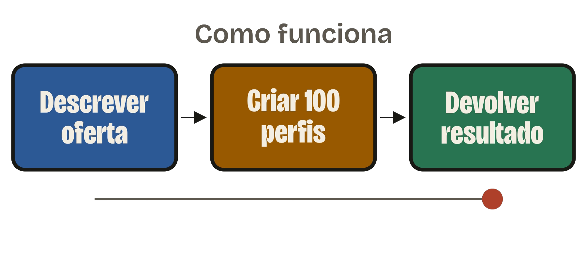
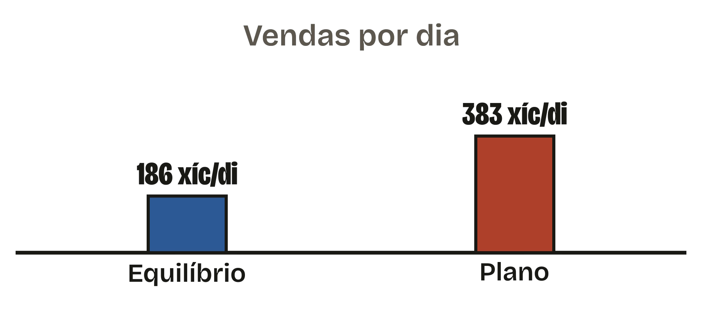
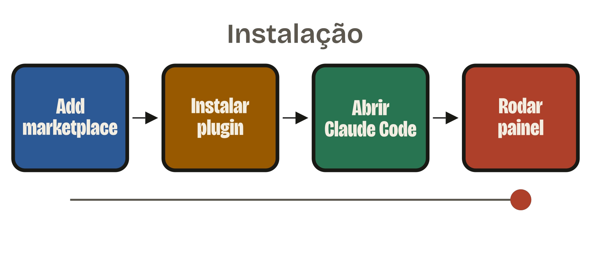

# Founder Skill cria 100 compradores simulados no Claude

_2026-11-27 · tutorial_

Você aprende a instalar e usar o Founder Skill, um conjunto de onze habilidades gratuitas para o Claude que testam um negócio antes do lançamento, e a rodar o painel de cem compradores simulados que devolve quem compraria sua oferta, quem passaria e os motivos. A apostila cobre a instalação pelo plugin ou manualmente, a descrição da oferta e do cliente, a leitura do relatório e as ferramentas de linha de comando. Também explica as onze habilidades, a ordem de uso, os números de um exemplo real e os cuidados ao interpretar uma simulação. Depois de ler, você consegue testar uma oferta antes de gastar com anúncios e ajustá-la com base nos furos encontrados.

## O que você terá no fim

No fim você terá um relatório em founder/panel/results.md que lista quem compraria sua oferta, quem passaria e os motivos nas palavras dos compradores, além do que fliparia a decisão de quem disse não. Esse relatório mostra os furos da oferta antes de você gastar com anúncios.

Você também terá instalado o Founder Skill, um conjunto de onze habilidades gratuitas para o Claude que testam um negócio antes do lançamento: um conselho, um diretor de marketing, um financeiro e um painel de cem compradores simulados.

Fonte: <https://github.com/Jakeschincariol/founder-skill>

## Como isso funciona



_Do descritivo da oferta ao relatório de quem compra e quem passa._

O Founder Skill é um conjunto de onze habilidades gratuitas, de código aberto e licença MIT, para o Claude. Elas testam um negócio antes do lançamento. Você descreve a oferta e quem é o cliente. A habilidade de painel de consumidores cria cem perfis de comprador simulado, cada um com renda, hábitos e uma dúvida diferente, coloca a mesma proposta na frente de cada um e devolve quem compra, quem não compra e os motivos.

Não para aí: uma das habilidades é um conselho que aplica os métodos de Alex Hormozi, Peter Thiel e Steve Jobs; outra é um diretor de marketing; outra é um financeiro que calcula a margem de verdade. O código é aberto e de graça; o uso do Claude tem custo.

A simulação não prevê venda. Ela serve para achar os furos da oferta antes do teste com gente de verdade. Leia a taxa de compra como teto, porque modelos de linguagem tendem a ser complacentes, e confirme as decisões grandes com pessoas reais.

Fonte: <https://github.com/Jakeschincariol/founder-skill>

## As onze habilidades

Cada habilidade é um comando que você roda no Claude Code. Elas leem o que as outras escreveram, em uma pasta founder/ no projeto.

- founder-board: conselho de três membros, cada um aplicando um framework publicado (ofertas, monopólio, produto), que pontua a ideia, nomeia o que a mataria e vota.
- founder-competitors: mapeia concorrentes diretos, indiretos e substitutos a partir de fontes públicas, com preços, posicionamento e reclamações de clientes, cada fato com link.
- founder-consumer: cria cem compradores simulados a partir do cliente-alvo, cada um com renda, hábitos e objeção próprios, e totaliza quem compra, quem não compra e por quê.
- founder-pricing: transforma as respostas de preço do painel em uma faixa de preço aceitável, compara com concorrentes e margem, e escolhe o que testar.
- founder-offer: monta a pilha da oferta (bônus, garantia, urgência real, nome) que responde às objeções do painel e roda o painel de novo para ver se a taxa de compra muda.
- founder-cfo: economia unitária: contribuição por venda, margem real, ponto de equilíbrio por dia, ano 1 mês a mês, caixa necessário, payback e cenários.
- founder-marketing: posicionamento, canais que os compradores usam, campanha de lançamento de trinta dias datada, dez ganchos e o máximo que se pode pagar por cliente.
- founder-brand: candidatos a nome com checagens de marca, domínio e arroba, voz, promessa e briefing visual.
- founder-ops: fornecedores, equipe, rotinas do dia um, ferramentas, licenças a verificar e registro de riscos, devolvendo custos reais ao financeiro.
- founder-launch: um teste barato no mundo real primeiro, depois contagem regressiva datada, roteiro do dia do lançamento e os primeiros trinta dias.
- founder-plan: compila tudo em um plano de negócio com veredicto calculado a partir dos números: Lucrativo, Ainda não ou Incompleto.

Fonte: <https://github.com/Jakeschincariol/founder-skill>

## A ordem de uso

As habilidades leem o que as outras escreveram, em uma pasta founder/ no projeto. A ordem recomendada é:

- board -> competitors -> consumer -> pricing -> offer -> cfo -> marketing -> brand -> ops -> launch -> plan
- Você também pode rodar qualquer uma sozinha. Rodar só o painel de consumidores em uma ideia que você só está pensando é um bom jeito de saber se vale seguir.

Fonte: <https://github.com/Jakeschincariol/founder-skill>

## Os números do exemplo



_Ponto de equilíbrio e plano de vendas em xícaras por dia._

Com os números do exemplo:

- O ponto de equilíbrio é 186 xícaras por dia.
- A margem de lucro no plano de 383 xícaras por dia é 38%.

Fonte: <https://github.com/Jakeschincariol/founder-skill>

## Antes de começar

Requisitos para instalar e rodar o Founder Skill:

- Claude Code instalado: code.claude.com. Vem com o plano Pro ou superior do Claude.
- Python 3.8 ou mais novo: python.org. Nada para instalar via pip.
- Conta no Claude: claude.ai. O uso tem custo.
- Uma pasta de projeto vazia, onde a skill vai gravar os arquivos da análise. Nada além do uso do Claude precisa ser pago.
- Se preferir instalar copiando pastas em vez do plugin, use git clone e copie as pastas de skills.

Fonte: <https://github.com/Jakeschincariol/founder-skill>

## Passo a passo: do zero ao relatório



_Quatro passos da instalação até o painel de compradores._

1. Passo 1 — Instalar o marketplace no Claude Code. Rode o comando de adicionar o marketplace. Resultado esperado: mensagem de sucesso do marketplace adicionado.
2. Passo 2 — Instalar o plugin founder-skill. Rode o comando de instalação. Resultado esperado: skills disponíveis com prefixo, como o painel de consumidores.
3. Passo 3 — Abrir o Claude Code na pasta do projeto. Abra o Claude Code na pasta onde a skill vai gravar os arquivos. Resultado esperado: prompt do Claude Code aberto na pasta do projeto.
4. Passo 4 — Rodar o painel de consumidores. Rode o comando do painel. Resultado esperado: perguntas sobre a oferta e o cliente ideal.
5. Passo 5 — Descrever a oferta ao skill. Responda com produto, preço, promessa principal e diferenciais. Resultado esperado: skill pede o próximo bloco de informações.
6. Passo 6 — Descrever o cliente ideal. Responda com idade, renda, hábitos e objeções. Resultado esperado: skill confirma o perfil base do comprador.
7. Passo 7 — Gerar os cem perfis de comprador. Aguarde a criação dos cem compradores simulados e a execução do cenário. Resultado esperado: cem respostas gravadas em founder/panel/answers/.
8. Passo 8 — Ler o relatório de compra. Abra founder/panel/results.md na pasta do projeto. Resultado esperado: arquivo com quem compra, quem não compra e o que fliparia a decisão.

Fonte: <https://github.com/Jakeschincariol/founder-skill>

## Comando: adicionar o marketplace

Esse comando registra o repositório oficial como fonte de plugins do Claude Code. Ele não instala as habilidades ainda, só prepara o catálogo. Por isso o próximo passo é obrigatório. Se a tela mostrar erro de conexão, verifique a internet e rode o mesmo comando de novo.

```
/plugin marketplace add Jakeschincariol/founder-skill
```

Fonte: <https://github.com/Jakeschincariol/founder-skill>

## Comando: instalar o plugin

Ele baixa as onze habilidades e registra os comandos no Claude Code. Depois da instalação, as skills aparecem com o prefixo do plugin. Esse prefixo evita conflito com outras skills já instaladas. A instalação é local na sua máquina, então a skill funciona offline depois de baixada, exceto pelas chamadas ao modelo.

```
/plugin install founder-skill@founder-skill
```

Fonte: <https://github.com/Jakeschincariol/founder-skill>

## Comando: rodar o painel

O painel é a habilidade que cria os compradores simulados. Ele lê a oferta, monta o cliente e gera um perfil por comprador. Mantenha a pasta do projeto aberta, porque os arquivos serão gravados ali.

Fonte: <https://github.com/Jakeschincariol/founder-skill>

## Instalação manual (copiar pastas)

Alternativa ao plugin: copie as pastas de skills. Copie para ~/.claude/skills/ para uso global, ou para .claude/skills/ no repositório para uso local no projeto. Sem Claude Code, cole qualquer SKILL.md no topo de um chat: perde os sub-agentes e as ferramentas Python, mas o método funciona.

```
git clone https://github.com/Jakeschincariol/founder-skill.git
cp -r founder-skill/skills/founder-* ~/.claude/skills/
```

Fonte: <https://github.com/Jakeschincariol/founder-skill>

## Prompt pronto: instalar pelo chat

Cole no chat do Claude e diga para instalar a skill. Alternativa ao plugin.

```
https://github.com/Jakeschincariol/founder-skill

install skill
```

Fonte: <https://github.com/Jakeschincariol/founder-skill>

## Ferramentas de linha de comando

Quatro ferramentas em Python da biblioteca padrão, nenhuma toca a rede. unit_economics.py lê um JSON e devolve contribuição, ponto de equilíbrio, margem no plano, ano 1 mês a mês, caixa necessário, payback e três cenários. panel.py monta as cartas de persona a partir do cliente, escreve um briefing por comprador, checa as respostas e totaliza, sem responder por nenhum comprador. van_westendorp.py lê quatro respostas de preço por comprador e acha os pontos de barateza e careza marginais, o ótimo e o preço de indiferença. compile.py monta o plano e calcula o veredicto. Todos precisam de Python 3.8 ou mais novo; nada para instalar via pip.

```
python3 skills/founder-cfo/unit_economics.py founder/numbers.json --out founder/cfo.md
python3 skills/founder-consumer/panel.py init --customer founder/customer.json --pitch founder/pitch.md
python3 skills/founder-pricing/van_westendorp.py founder/panel/answers --price 6.50
python3 skills/founder-plan/compile.py --dir founder
python3 -m unittest discover -s tests -v
```

Fonte: <https://github.com/Jakeschincariol/founder-skill>

## Exemplo completo

O painel constrói o cliente-alvo (profissionais urbanos, 24 a 38 anos, que compram café quase todo dia), distribui cem cartas de comprador entre renda, hábitos e objeções e roda um sub-agente por comprador. Volta quem compra, quem passa, os motivos nas palavras deles ("meu café é mais perto", "6,50 é caro para uma bebida") e o que fliparia um não.

Depois: o financeiro roda a economia unitária com os números acima; o estrategista de preço checa 6,50 contra a faixa aceitável e os concorrentes; o arquiteto de oferta responde às objeções com uma oferta (preço de semana de lançamento, cartão fidelidade) e roda um painel rápido para ver se a taxa de compra muda; marketing, marca, operações e lançamento viram campanha de trinta dias, nome e visual, fornecedores e rotinas, e um lançamento datado que começa com um pop-up para testar compradores reais; o planejador compila o plano com veredicto calculado.

Fonte: <https://github.com/Jakeschincariol/founder-skill>

## Teste de pronto

- [ ] Abra founder/panel/results.md e confira se existem compradores que não compram com motivos específicos.
- [ ] Um relatório bom tem objeções variadas, não só elogios.
- [ ] Se aparecer só elogio, a descrição do cliente foi genérica: refine os detalhes e rode o painel de novo.
- [ ] O sinal de sucesso é diversidade de motivos, não taxa de compra alta.

Fonte: <https://github.com/Jakeschincariol/founder-skill>

## Erros comuns e cuidados

- Rodar o painel sem descrever o cliente com detalhe deixa o relatório genérico, que não serve para decisão.
- Se a descrição da oferta for vaga, o relatório sai genérico e não aponta furos reais.
- O painel é de compradores simulados, não de clientes. É um jeito rápido e barato de achar objeções, segmentos e palavras antes de gastar. Não é previsão: modelos de linguagem tendem a ser complacentes, então leia a taxa de compra como teto e confirme as decisões grandes com pessoas reais.
- As respostas do painel são pesquisa; nunca use como depoimento.
- O conselho aplica frameworks publicados, não é aquelas pessoas: as três lentes são resumos curtos, em palavras próprias, de ideias de $100M Offers, Zero to One e da biografia de Steve Jobs por Isaacson. O conselho nunca fala como eles, cita ou diz que endossam algo.
- Os números são tão bons quanto as entradas. O financeiro marca toda estimativa como estimativa e pede cotações reais. Confira custos com fornecedores e estrutura, folha e impostos com um contador.
- Pesquisa usa fontes públicas, com links. Sem concorrentes, preços, avaliações ou citações inventados.
- Não é consultoria financeira, jurídica nem tributária. Permissões, marcas e alegações dependem de onde você está. As habilidades dizem o que verificar e onde; um profissional confirma.
- Se a geração parar no meio, rode o comando do passo quatro de novo. A skill refaz só os perfis que faltaram.
- Se faltar arquivo, confira se a pasta do projeto é a mesma em que você rodou o comando. A análise não migra entre pastas automaticamente.

Fonte: <https://github.com/Jakeschincariol/founder-skill>

## Glossário

- Oferta: o produto com preço, promessa e diferenciais que você coloca na frente dos compradores.
- Cliente ideal: a descrição detalhada de quem compra, com idade, renda, hábitos e objeções.
- Painel de consumidores: a habilidade que cria cem compradores simulados e roda a oferta em cada um.
- Perfil de comprador: uma persona com renda, hábitos e objeção próprios.
- Taxa de compra: quantos dos cem perfis disseram que comprariam.
- Objeção: o motivo que trava a compra.
- Ponto de equilíbrio: quantas vendas por dia são necessárias para cobrir os custos.
- Contribuição: quanto cada venda deixa depois dos custos próprios do produto.
- Margem: a parcela do preço que sobra como lucro.
- Payback: o tempo para recuperar o investimento inicial.
- Veredicto: o resultado calculado do plano, Lucrativo, Ainda não ou Incompleto.
- Plugin: pacote de habilidades instalado no Claude Code.
- Marketplace: o catálogo de plugins do Claude Code.
- Sub-agente: um agente separado que roda uma tarefa, como cada comprador do painel.

Fonte: <https://github.com/Jakeschincariol/founder-skill>

## Plano de 7 dias

- Dia 1: instalar o Claude Code e o Python 3.8+, criar a conta no Claude e preparar uma pasta de projeto vazia.
- Dia 2: instalar o marketplace e o plugin founder-skill; rodar o teste de instalação.
- Dia 3: descrever a oferta com produto, preço, promessa e diferenciais.
- Dia 4: descrever o cliente ideal com idade, renda, hábitos e objeções.
- Dia 5: rodar o painel e gerar os cem perfis; aguardar o término.
- Dia 6: ler founder/panel/results.md, anotar as objeções mais frequentes e o que fliparia a decisão.
- Dia 7: ajustar preço, promessa e objeções conforme o relatório e planejar o teste com pessoas reais.

Fonte: <https://github.com/Jakeschincariol/founder-skill>

## Para onde ir depois

- Ajustar a oferta conforme o relatório e rodar o painel de novo para ver se a taxa de compra muda.
- Rodar o estrategista de preço para obter a faixa de preço aceitável e checar contra concorrentes.
- Rodar o arquiteto de oferta para montar bônus, garantia e urgência que respondam às objeções.
- Rodar o financeiro para a economia unitária, ponto de equilíbrio e caixa necessário.
- Rodar o conselho, o diretor de marketing, a marca, as operações e o lançamento para completar o plano.
- Compilar o plano de negócio com o planejador e verificar o veredicto.
- Validar as decisões grandes com pessoas reais, começando pelo teste barato do lançamento.
- Repositório oficial: https://github.com/Jakeschincariol/founder-skill
- Claude Code: https://code.claude.com
- Python: https://www.python.org
- Claude: https://claude.ai

Fonte: <https://github.com/Jakeschincariol/founder-skill>

## Os arquivos que a skill gera

A skill cria uma pasta founder/ dentro do diretório do projeto e salva ali a oferta, o cliente e o relatório. Mantenha o projeto em uma pasta dedicada para não misturar análises de ofertas diferentes.

- founder/idea.md: a ideia escrita pelo conselho.
- founder/customer.json: o cliente descrito.
- founder/pitch.md: a oferta descrita.
- founder/panel/answers/: as cem respostas dos compradores.
- founder/panel/results.md: o relatório com quem compra, quem não compra e o que fliparia a decisão.
- founder/numbers.json: os números do negócio.
- founder/cfo.md: a análise financeira.
- founder/business-plan.md: o plano de negócio compilado.

Fonte: <https://github.com/Jakeschincariol/founder-skill>

## Além do vídeo

- Os projetos irmãos do mesmo autor: Arena, Replica, X, LinkedIn e Instagram.
- O autor é Jake Schincariol, do site opusjake.ai.
- Licença MIT: pode usar, alterar e distribuir.
