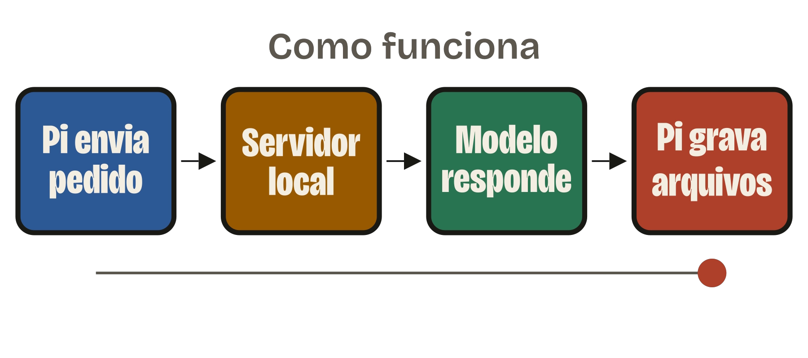
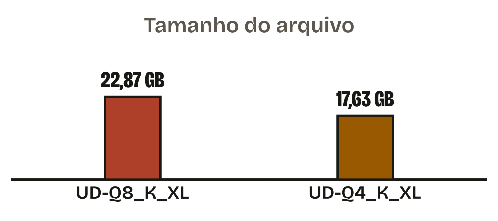

# Jogo de corrida pronto em 10 minutos com Inkling 2 Mini

_2026-11-27 · tutorial_

Esta apostila mostra como rodar o Inkling 2 Mini, um modelo de pesos abertos, no seu próprio computador, e usá-lo com o agente de código Pi para gerar um jogo de corrida jogável no navegador. Você vai instalar o Unsloth Studio, subir o servidor local, carregar a versão UD-Q4_K_XL do modelo, ligar o Pi a ele e pedir o jogo com um prompt. Também vai entender o papel de cada peça, por que a versão quantizada importa para a memória da sua placa e como testar se tudo funcionou. Ao final, você tem um fluxo que pode repetir com os seus próprios projetos, sem API paga.

## O que você terá no fim

No fim deste guia, você terá um jogo de corrida em três pistas, com pulo, deslizar e moedas, rodando no navegador. O jogo é feito só com HTML, CSS e JavaScript, então abre direto em qualquer navegador e pode ser compartilhado com outras pessoas. O código é gerado pelo modelo a partir de um texto de pedido, e você não precisa escrever nenhuma linha dele à mão.

Todo o caminho roda na sua máquina. O modelo fica no seu disco, o servidor responde pela porta 8080 do seu próprio computador e o agente de código conversa com esse servidor. O ganho prático é pedir, rodar e testar no mesmo lugar, e corrigir com um novo prompt quando algo sai errado.

## Como isso funciona



_O Pi envia o pedido ao servidor local, o modelo responde, e o Pi grava os arquivos no proj_

Três peças trabalham juntas. O Unsloth Studio é a interface que baixa, carrega e testa modelos locais, e também sobe um servidor local: um programa que fica no seu computador, recebe pedidos e responde com o modelo. O Inkling 2 Mini é o modelo em si, um conjunto de pesos que o servidor carrega na memória da placa de vídeo. O Pi é o agente de código, um assistente de terminal que envia pedidos ao servidor, recebe o código de volta e grava os arquivos no projeto.

O Inkling 2 Mini é um modelo aberto da Thinking Machines Lab, com licença Apache 2.0. Ele tem 26,2 bilhões de parâmetros, dos quais 3,4 bilhões estão ativos em cada token. Parâmetros são os números aprendidos no treinamento. Ele usa mistura de especialistas (Mixture-of-Experts): em cada camada, um token passa por apenas 8 de 128 especialistas. Além disso, a parte do meio do modelo roda três vezes com os mesmos pesos, em um laço. Por isso, o cálculo feito por token é maior do que a contagem de ativos sugere.

Na prática, isso significa que o modelo é grande demais para caber inteiro em muitas placas. Por isso, o Studio trabalha com uma versão comprimida, chamada quantizada. A seção seguinte explica o que muda nessa escolha.

Fonte: <https://huggingface.co/unsloth/Inkling-2-Mini-GGUF>

## Versões quantizadas e memória



_A versão UD-Q4_K_XL ocupa 17,63 GB, contra 22,87 GB da referência UD-Q8_K_XL._

Quantizar é reduzir a precisão dos números que formam o modelo, por exemplo de 16 bits para 4 bits. O arquivo fica bem menor e cabe em menos memória, em troca de uma diferença pequena nas respostas. Os arquivos do repositório da Unsloth estão no formato GGUF, feito para rodar localmente, e vêm em várias versões com tamanhos diferentes.

O repositório compara cada versão com a referência UD-Q8_K_XL, de 22,87 GB. A medida KLD mostra a divergência média em relação à referência: quanto menor, mais parecida com ela. A coluna de mesmo token mais provável mostra em que porcentagem dos casos a versão escolheu o mesmo próximo pedaço de texto que a referência. Esses números medem a qualidade do modelo, e não a velocidade.

- UD-Q4_K_XL: 17,63 GB, KLD de 0,0107 e mesmo token mais provável em 98,0% dos casos.
- UD-Q4_K_M: 16,61 GB, KLD de 0,0108 e mesmo token mais provável em 97,9% dos casos.
- UD-IQ3_XXS: 11,66 GB, KLD de 0,0269 e mesmo token mais provável em 94,7% dos casos.
- UD-Q8_K_XL: 22,87 GB, versão de referência usada na comparação.

Fonte: <https://huggingface.co/unsloth/Inkling-2-Mini-GGUF>

## Antes de começar

- Um terminal bash, o padrão do Linux, onde os comandos deste guia rodam.
- Uma GPU NVIDIA com memória suficiente para a versão escolhida. No teste, a máquina era uma RTX 3090 com 24 GB de VRAM, e a versão UD-Q4_K_XL coube nela.
- Espaço livre em disco para o arquivo do modelo. Na versão UD-Q4_K_XL, a documentação indica 17,63 GB.
- Uma versão menor de GPU ou a memória RAM do sistema também podem servir, conforme a versão quantizada que você escolher.
- Para outras GPUs, o cartão do modelo recomenda 32 GB de VRAM ou mais. Ele também lista o Apple silicon com 32 GB de memória ou mais entre as plataformas suportadas. Esses valores se referem ao checkpoint original, de cerca de 20 GB, que é outro arquivo.
- Um navegador para abrir a interface do Studio e o jogo.
- Conexão com a internet para o download, que pode levar alguns minutos.

Fonte: <https://unsloth.ai/docs/models/inkling-2-mini>

## Passo a passo

1. Instale o Unsloth Studio. Rode o comando do Comando 1 no terminal. O instalador detecta seu sistema e instala o que falta. Quando ele perguntar se deve iniciar o Studio agora, responda n, porque antes você precisa definir onde os modelos ficam. Resultado esperado: a instalação termina sem abrir o Studio.
2. Suba o servidor local. Rode o bloco do Comando 2: ele reabre o shell, define as pastas de cache e inicia o servidor na porta 8080. Resultado esperado: a interface do Unsloth Studio abre em http://localhost:8080 no navegador. No primeiro acesso, o Studio pode pedir uma senha: crie uma e entre com ela.
3. Carregue o Inkling 2 Mini. Na interface, abra o menu de modelos e pesquise Inkling 2 Mini. Escolha a versão UD-Q4_K_XL do repositório unsloth/Inkling-2-Mini-GGUF e confira o nome exato antes de selecionar, porque há várias versões quantizadas. Resultado esperado: o Studio baixa e carrega o modelo, e ele fica pronto para conversar no chat.
4. Ligue o Pi ao modelo local. Instale o Pi pelo site pi.dev e rode o bloco do Comando 3 no mesmo terminal, trocando YOUR_API_KEY pela chave que aparece nas configurações de API do Studio. Resultado esperado: o Pi fica conectado ao modelo local, pronto para receber o prompt.
5. Peça o jogo ao Pi. Envie ao Pi o prompt da seção Prompt pronto. Resultado esperado: o modelo começa a escrever os arquivos do jogo em HTML, CSS e JavaScript no projeto.
6. Teste no navegador. Abra o arquivo HTML que o Pi criou no projeto. Resultado esperado: a tela inicial aparece e, ao começar, a corrida roda.
7. Corrija com um novo prompt, se preciso. Se o personagem correr de lado, em vez de avançar, envie ao Pi um novo prompt pedindo o ajuste. Resultado esperado: o Pi altera os arquivos e o jogo passa a se comportar como você descreveu.

Fonte: <https://unsloth.ai/docs/new/studio/install>

## Comando 1: instalar o Unsloth Studio

Rode este comando no terminal bash. Ele instala a interface que gerencia o modelo. Ao terminar, o instalador pergunta se você quer iniciar o Studio agora. Responda n, porque as pastas dos modelos ainda precisam ser definidas.

```
curl -fsSL https://unsloth.ai/install.sh | sh
```

Fonte: <https://unsloth.ai/docs/new/studio/install>

## Comando 2: subir o servidor local

O primeiro comando reabre o shell, para que os comandos recém-instalados fiquem disponíveis. Os três export apontam o cache do Hugging Face e os arquivos de modelo para uma pasta só, dentro da sua pasta pessoal, o que facilita achar e apagar os modelos depois. Você pode trocar esses caminhos por outros, desde que haja espaço livre suficiente para o modelo.

O último comando inicia o servidor. A opção -H 127.0.0.1 faz o servidor aceitar conexões só da sua própria máquina, e -p 8080 define a porta, que aparece no endereço http://localhost:8080.

```
exec bash
export HF_HOME="$HOME/models/huggingface"
export HUGGINGFACE_HUB_CACHE="$HF_HOME/hub"
export XDG_CACHE_HOME="$HOME/.cache"
unsloth studio -H 127.0.0.1 -p 8080
```

Fonte: <https://unsloth.ai/docs/new/studio/install>

## Comando 3: ligar o Pi ao modelo local

O primeiro comando instala o Pi, e o segundo reabre o shell para que ele seja encontrado. O export informa ao comando a endereço do servidor do Studio. O comando unsloth start conecta o Pi ao modelo escolhido, usando a chave de API. Troque YOUR_API_KEY pela chave que aparece nas configurações de API do Studio. Se o comando reclamar da chave, confira se você trocou o nome de exemplo pela chave real.

Se o Studio roda em outra máquina, use no export o endereço acessível dessa máquina, no lugar de http://0.0.0.0:8080.

```
curl -fsSL https://pi.dev/install.sh | sh
exec bash -l
export UNSLOTH_STUDIO_URL="http://0.0.0.0:8080"
unsloth start pi --api-key YOUR_API_KEY --model unsloth/Inkling-2-Mini-GGUF:UD-Q4_K_XL
```

Fonte: <https://unsloth.ai/docs/integrations/unsloth-start.md>

## Exemplo completo: o jogo de corrida

Exemplo: o pedido foi um jogo de corrida no estilo Subway Surfers, com animações, obstáculos, moedas e efeitos visuais. Em cerca de dez minutos, o autor do teste tinha um jogo jogável no navegador, com uma tela inicial colorida e vários efeitos. O teste foi feito numa RTX 3090, com o Inkling 2 Mini na versão UD-Q4_K_XL.

O defeito apareceu logo: o personagem corria da esquerda para a direita, em vez de avançar pela pista. Esse tipo de erro é comum numa primeira versão. A correção é um novo prompt ao Pi, dizendo qual comportamento você espera. Você não precisa mexer no código: o agente altera os arquivos.

Repare no ciclo. O modelo escreve, você roda no navegador, observa o que está errado e manda outro pedido. Cada rodada aproxima o jogo do que você quer.

Fonte: <https://www.kdnuggets.com/how-to-run-inkling-2-mini-locally-on-an-rtx-3090-using-unsloth-studio>

## Prompt pronto

Este é o prompt usado no teste. Ele pede três pistas, pulo, deslizar, trens, obstáculos, moedas, power-ups, animações, efeitos visuais, sons, pausa, reinício e controles por teclado e por toque. Também pede HTML5 Canvas, CSS e JavaScript, o que faz o resultado abrir direto no navegador. Cole o texto inteiro no Pi, sem cortar partes, para que o modelo tenha todos os requisitos.

```
Create a fully playable, visually stunning 2D Subway Surfers-style endless runner game using HTML5 Canvas, CSS, and JavaScript, featuring three-lane movement, jumping, sliding, trains, obstacles, collectible coins, power-ups, smooth character animations, parallax scrolling city backgrounds, colorful cartoon graphics, particle explosions, glowing effects, motion blur, speed trails, dynamic lighting, screen shake, realistic shadows, sound effects, background music, increasing difficulty, collision detection, score tracking, responsive keyboard and mobile swipe controls, animated menus, pause and restart functionality, and polished arcade-style gameplay optimized for 60 FPS, using original characters and assets.
```

Fonte: <https://www.kdnuggets.com/how-to-run-inkling-2-mini-locally-on-an-rtx-3090-using-unsloth-studio>

## Teste de pronto

- [ ] Abra o arquivo HTML que o Pi criou no projeto. A tela inicial deve aparecer.
- [ ] Comece uma corrida. O cenário deve rolar e o personagem deve correr pela pista.
- [ ] Pule e confirme que o personagem sobe e volta ao chão.
- [ ] Deslize e confirme que o personagem muda de posição.
- [ ] Passe sobre moedas e confirme que a pontuação aumenta.
- [ ] Se o personagem correr de lado em vez de avançar, o jogo ainda precisa de ajuste: envie um novo prompt.

Fonte: <https://www.kdnuggets.com/how-to-run-inkling-2-mini-locally-on-an-rtx-3090-using-unsloth-studio>

## Erros comuns e cuidados

- Chave de API: se o comando unsloth start reclamar da chave, troque o nome de exemplo YOUR_API_KEY pela chave da tela de API do Studio. Confira também a senha de acesso, descrita na documentação de segurança do Studio.
- Versão do runtime: se o carregamento falhar com unknown model architecture: 'inkling2', o llama.cpp instalado é antigo. Atualize o Unsloth para a versão mais recente, porque a Unsloth publicou binários novos para este modelo.
- Velocidade: o cartão do modelo diz que o suporte a modelos em loop é novo em runtimes locais, e que a velocidade varia conforme o runtime e o hardware. O número de cerca de 52 tokens por segundo é de um teste numa RTX 3090, e não uma garantia.
- Memória: confira o tamanho do arquivo antes de baixar. Se a versão escolhida não couber na sua memória, o carregamento falha ou fica lento.
- Ações sem confirmação: o cartão do modelo avisa que ele pode apagar ou sobrescrever arquivos sem pedir confirmação e pode relatar mal o resultado do próprio trabalho. Rode o agente em uma pasta de teste ou em sandbox, e exija confirmação antes de qualquer ação destrutiva.
- Repetição: em testes internos, o modelo às vezes ficou preso em loops de raciocínio, especialmente ao depurar código. Defina limites de tokens de saída e de turnos do agente.
- Fatos: o modelo pode afirmar informações erradas com confiança. Revise o código e as respostas antes de usá-los em situações importantes. O cartão recomenda supervisão humana em contextos de alto risco.
- Dados simulados: no teste de dashboard de petróleo, os valores eram simulados e não cotações reais. Não use essa saída como dado de mercado.

Fonte: <https://huggingface.co/unsloth/Inkling-2-Mini-GGUF>

## Glossário

- Agente de código: programa que recebe pedidos em texto, escreve ou altera arquivos de código e pode rodar comandos no projeto.
- API key (chave de API): código que identifica quem pode usar o servidor. Neste guia, ela aparece na tela de API do Studio.
- GGUF: formato de arquivo de modelo feito para rodar localmente.
- Mixture-of-Experts: arquitetura em que cada token usa apenas alguns especialistas do modelo, o que reduz o cálculo por resposta.
- Modelo quantizado: versão do modelo com números de menor precisão, menor e mais leve de carregar.
- Parâmetros: os números aprendidos pelo modelo no treinamento. Quanto mais parâmetros, maior o modelo.
- Porta: número que identifica um serviço no seu computador. Neste guia, o Studio usa a porta 8080.
- Prompt: o texto de pedido que você envia ao modelo.
- Servidor local: programa que roda no seu computador e responde pedidos sem sair da sua máquina.
- Terminal bash: programa de texto onde se digitam comandos. É o padrão do Linux.
- Token: pedaço de texto que o modelo lê e gera. A velocidade costuma ser medida em tokens por segundo.
- VRAM: memória da placa de vídeo, onde o modelo fica durante a geração.

## Plano de 7 dias

- Dia 1: instale o Unsloth Studio com o Comando 1 e responda n à pergunta de início.
- Dia 2: reabra o shell, defina as pastas dos modelos e suba o servidor na porta 8080.
- Dia 3: crie a senha no primeiro acesso, se for pedida, e carregue a versão UD-Q4_K_XL do Inkling 2 Mini.
- Dia 4: copie a chave de API do Studio, instale o Pi e rode o comando unsloth start.
- Dia 5: envie o prompt do jogo ao Pi e espere os arquivos serem criados.
- Dia 6: abra o arquivo HTML no navegador e faça o teste de pronto.
- Dia 7: se algo falhar ou o personagem correr de lado, envie um novo prompt descrevendo o comportamento esperado.

## Para onde ir depois

- Leia a documentação de segurança e de senha de acesso do Unsloth Studio em https://unsloth.ai/docs/new/studio/security.
- Veja a integração com agentes na documentação do unsloth start em https://unsloth.ai/docs/integrations/unsloth-start.md.
- Consulte a página de execução do modelo em https://unsloth.ai/docs/models/inkling-2-mini.
- Veja a documentação do Pi em https://docs.pi.dev/latest.
- Repita o ciclo com um projeto seu: peça, rode, teste e corrija com um novo prompt.

## Além do vídeo

- Nos testes de programação publicados pelo fabricante, o Inkling 2 Mini marca 79,2% no SWE-bench Verified com bash apenas, e 71,6% no Terminal Bench v2.1 rodando no Pi v0.83.0. São resultados do fabricante, em condições próprias de cada teste.
- Num teste com a busca na web ativada no Studio, o modelo respondeu com fontes diversas a uma pergunta sobre comprar ações da NVIDIA. A geração teve média de cerca de 52 tokens por segundo numa RTX 3090.
- Num outro teste, o modelo gerou um painel de petróleo com indicadores e gráficos, usando valores simulados.
- Segundo o cartão do modelo, a janela de contexto chega a 1 milhão de tokens. Quanto cabe na sua máquina depende da memória disponível.
- O repositório da Unsloth mostra um exemplo do Inkling 2 Mini em versão de 4 bits rodando no Unsloth junto com Blender e MCP.
