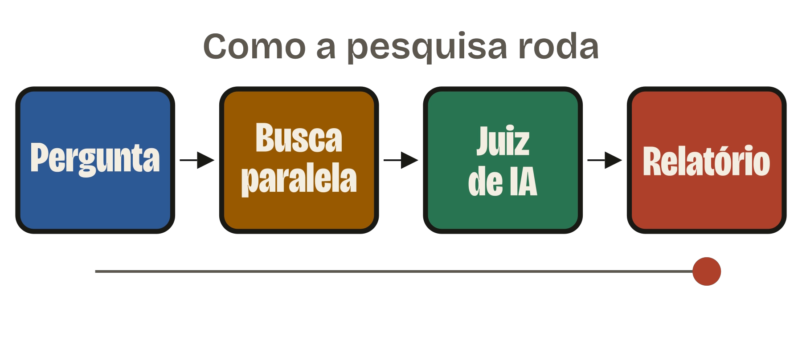
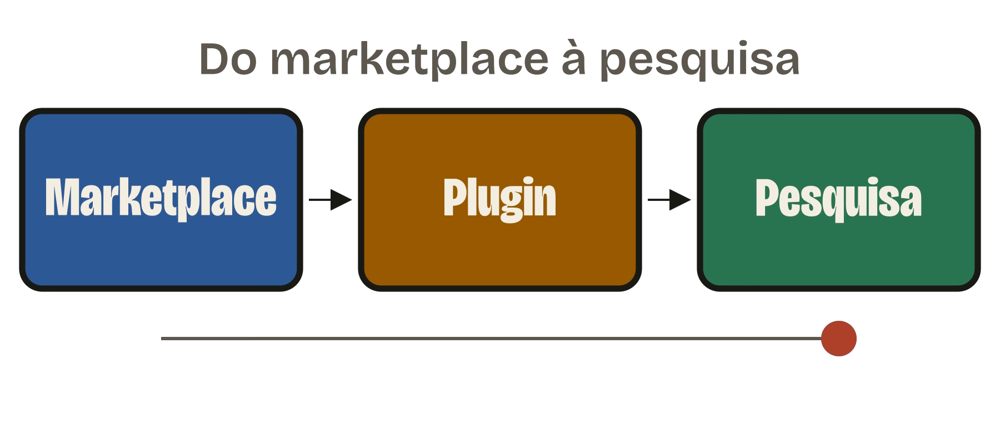
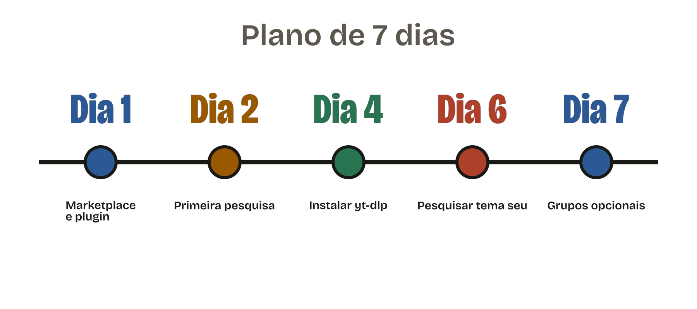

# Skill com 57.000 estrelas faz o Claude Code ler o Reddit

_2026-11-27 · tutorial_

A skill last30days faz o Claude Code pesquisar Reddit, Hacker News, Polymarket e GitHub e devolver um relatório com o que as pessoas dizem sobre um tema nos últimos 30 dias. Ela ultrapassou 57.000 estrelas no GitHub e chegou a ser o repositório número um do dia no trending. Esta apostila explica como a skill funciona, como instalá-la pelo marketplace do Claude Code, como rodar a primeira pesquisa, como pedir em linguagem natural e como ligar o YouTube sem pagar nada. Ao terminar, você saberá instalar, pesquisar e conferir se as fontes entraram de fato no relatório.

## O que você terá no fim

No fim deste tutorial, o seu Claude Code responde a uma pergunta sobre qualquer tema (uma pessoa, uma empresa, um produto, um assunto) com um relatório montado a partir de conversas reais dos últimos 30 dias. Em vez de manchete escrita por redação, você recebe o que as pessoas votaram, curtiram e apostaram.

Isso serve para quem quer saber o que a comunidade acha antes de uma reunião, de uma compra ou de construir algo. O README da skill dá um exemplo: você tem uma reunião amanhã, procura a pessoa no Google e encontra o LinkedIn de 2023. A skill traz o que ela está fazendo neste mês, espalhado em posts, threads e transcrições de vídeo que a busca comum não alcança.

O primeiro grupo de fontes funciona sem configuração e sem chave de API: Reddit, Hacker News, Polymarket e GitHub. Quando o tema é uma empresa, a skill também lê patentes e páginas de vagas. Ao final você terá esse grupo rodando e o YouTube ligado, sem gastar nada.

Fonte: <https://github.com/mvanhorn/last30days-skill>

## Como isso funciona



_A pesquisa vai da pergunta à busca paralela em várias fontes, ao juiz de IA e ao relatório_

O README define a skill como um mecanismo de busca conduzido por um agente de IA e pontuado por votos, curtidas e dinheiro de verdade, não por editores. A ideia é que nenhuma IA sozinha enxerga tudo isso. O Google não alcança comentários do Reddit nem posts do X. O ChatGPT tem acordo com o Reddit, mas não busca no X nem no TikTok. O Gemini tem o YouTube, mas não o Reddit. O Claude não tem nenhuma dessas fontes de forma nativa. A skill faz a ponte entre essas plataformas e deixa um agente buscar em todas ao mesmo tempo.

A pesquisa roda em quatro etapas. Na primeira, a skill melhora até um pedido vago. Na segunda, escolhe os melhores subreddits e perfis e dispara todas as buscas em paralelo. Na terceira, vai fundo: lê comentários, posts inteiros, carrosséis e transcrições de vídeo, sem parar no título. Na quarta, ranqueia por convergência.

A convergência protege o relatório. Um comentário solto não o contamina. Quando a mesma opinião aparece no Reddit, no YouTube e no X, ela vira destaque. Um agente juiz de IA sintetiza tudo em um resumo único.

O ranking segue o que pessoas de verdade engajaram. Uma thread do Reddit com 1.500 votos pesa mais do que um post de blog que ninguém leu, e as probabilidades do Polymarket, sustentadas por dinheiro, pesam mais do que o palpite de um comentarista. O README chama isso de relevância social, em vez de relevância de SEO.

Fonte: <https://github.com/mvanhorn/last30days-skill>

## As fontes, em três grupos

Grupo um: tudo gratuito e sem chave. O Reddit entrega os comentários mais votados, com a contagem real de votos, sem chave de API. O Hacker News mostra o consenso de quem desenvolve, e o README cita como exemplo uma discussão com 825 pontos e 899 comentários. O Polymarket não traz opinião, traz probabilidade sustentada por dinheiro. O GitHub mostra, para pessoas, a velocidade de PRs, os repositórios mais estrelados e as notas de versão, e para temas traz issues e discussões.

Grupo dois: o YouTube. Ele é gratuito, mas depende do yt-dlp, um baixador de vídeo de código aberto. A skill usa as transcrições completas para achar as poucas frases que valem citação, em vez de ficar só no título do vídeo.

Grupo três: fontes que pedem algo à parte. TikTok, Instagram e LinkedIn passam pelo Scrape Creators, que já traz 10 mil chamadas gratuitas, o bastante para meses de uso diário. No X você escolhe entre usar os cookies do navegador, que é grátis, ou a API do X, por cerca de 10 centavos de dólar.

O README lista ainda outras fontes, como arXiv, Techmeme, Bluesky e Threads. Cada uma depende de credencial, de ferramenta instalada, do tema ou de ativação explícita. Neste tutorial você fica com os grupos um e dois.

Fonte: <https://github.com/mvanhorn/last30days-skill>

## Antes de começar

O que você precisa é pouco, e quase tudo acontece dentro do próprio Claude Code.

- Claude Code já instalado e funcionando.
- Conexão com a internet, porque as buscas acontecem em tempo real.
- Nenhuma chave de API para o grupo um (Reddit, Hacker News, Polymarket e GitHub).
- Para o YouTube, a instalação do yt-dlp, que é gratuito. O Claude Code pode guiar essa instalação para o seu sistema.

Fonte: <https://github.com/mvanhorn/last30days-skill>

## Passo 1: adicione o marketplace



_Primeiro o marketplace, depois o plugin, e então a primeira pesquisa._

A skill não é um arquivo solto. Ela vem empacotada como plugin, e o marketplace é o endereço de onde o Claude Code puxa esse pacote. O comando abaixo registra o repositório da skill no GitHub como marketplace. Digite exatamente como está, porque o comando usa o caminho do repositório.

Depois de rodar, o Claude Code confirma que o marketplace foi adicionado. A skill ainda não está ativa nesse ponto, o que é normal. Instalando pelo marketplace, as atualizações chegam sozinhas pelo mesmo canal, sem você baixar nada de novo. O README recomenda esse caminho para quem usa Claude Code.

```
/plugin marketplace add mvanhorn/last30days-skill
```

Fonte: <https://github.com/mvanhorn/last30days-skill>

## Passo 2: instale o plugin

Agora instale o plugin a partir do marketplace que você acabou de adicionar. É neste momento que a skill passa a existir dentro do Claude Code, com a pesquisa em paralelo e o juiz de IA que sintetiza tudo em um resumo.

Ao terminar, o Claude Code informa que o plugin last30days foi instalado e a skill passa a responder ao comando de barra.

```
/plugin install last30days
```

Fonte: <https://github.com/mvanhorn/last30days-skill>

## Passo 3: rode a primeira pesquisa

Chame a skill com o comando de barra seguido do tema. O exemplo do README usa uma pessoa, mas o tema pode ser uma empresa, um produto ou um assunto.

Reddit, Hacker News, Polymarket e GitHub respondem de imediato, sem configuração. Na primeira execução, um assistente de configuração oferece liberar fontes extras (o README cita X, YouTube, TikTok, arXiv e Techmeme) em cerca de 30 segundos. Depois sai o relatório com o que a comunidade andou dizendo.

Se o tema for uma empresa, a skill também procura vagas na página de carreiras e pedidos de patente recentes, que podem indicar o que ela está construindo antes de lançar.

```
/last30days Peter Steinberger
```

Fonte: <https://github.com/mvanhorn/last30days-skill>

## Passo 4: peça em linguagem natural

Você pode dispensar o comando de barra e escrever o pedido como falaria com um colega. Um exemplo é: pesquise o que andam dizendo sobre Claude Code. O Claude Code reconhece o pedido, aciona a skill e entrega o relatório na própria conversa.

O README mostra também um modo de descoberta: perguntar algo como "what's exploding in AI agents?" faz a skill varrer listagens do Reddit, o Hacker News e outras fontes e devolver de 5 a 10 temas ordenados por velocidade de crescimento, cada um com um comando pronto para aprofundar.

Fonte: <https://github.com/mvanhorn/last30days-skill>

## Passo 5: ligue o YouTube de graça

O YouTube é o segundo grupo de fontes e não custa nada, mas precisa do yt-dlp. Ele é um baixador de áudio e vídeo em linha de comando, de código aberto, com suporte a milhares de sites. A skill o usa para ler as transcrições dos vídeos.

A forma mais simples é pedir ao Claude Code que instale o yt-dlp, porque ele guia a instalação para o seu sistema. Se preferir fazer por conta própria, o projeto oferece binários para Windows, macOS e Linux, instalação via pip e pacotes de gerenciadores de terceiros, com instruções detalhadas na página de instalação do repositório.

Com o yt-dlp instalado, o YouTube passa a entrar entre as fontes das próximas pesquisas.

Fonte: <https://github.com/yt-dlp/yt-dlp>

## Teste de pronto: confira as fontes

Este teste separa uma pesquisa de verdade de uma resposta tirada da memória do modelo. Rode de novo a pesquisa do exemplo e leia o relatório de olho nas fontes.

- [ ] Rode `/last30days Peter Steinberger` outra vez e compare com a primeira execução.
- [ ] Procure trechos de conversas do Reddit com a contagem de votos. Se aparecem, a fonte entrou.
- [ ] Com o YouTube ligado, procure citações tiradas de transcrições de vídeo.
- [ ] Procure opiniões que se repetem em mais de uma fonte. Elas ganham destaque no relatório, e o comentário isolado fica de fora.
- [ ] Verifique se cada ponto importante do relatório indica de onde veio.

```
/last30days Peter Steinberger
```

Fonte: <https://github.com/mvanhorn/last30days-skill>

## Exemplo completo

Imagine que você tem uma reunião amanhã com alguém que não conhece bem. Você roda a skill com o nome da pessoa, como no comando do passo 3. O README mostra o resultado que a skill gerou para esse mesmo comando: a pessoa entrou para trabalhar no Codex da OpenAI, entregou 23 PRs com taxa de aceitação de 85% e aparecia numa thread do r/ClaudeCode com 569 votos em que a comunidade debatia se ela era herói ou "insufferable". Segundo o README, nada disso estava no Google.

Cada pedaço tem origem diferente: os PRs vêm do GitHub, a thread vem do Reddit com a contagem de votos, e outros detalhes vêm de posts e transcrições. É essa mistura que torna o relatório útil para uma conversa. Você chega sabendo o que a pessoa fez neste mês, e não só o que consta no perfil profissional.

Fonte: <https://github.com/mvanhorn/last30days-skill>

## Erros comuns e cuidados

Digite o comando do marketplace exatamente como está. Qualquer mudança no caminho do repositório impede o Claude Code de encontrar a skill.

- Se a skill não responde ao comando de barra, confira se o passo 2 terminou com a confirmação de que o plugin foi instalado.
- O marketplace adicionado no passo 1 ainda não ativa a skill. Só o passo 2 faz isso.
- Sem o yt-dlp, o YouTube não entra entre as fontes. Instale-o antes de esperar citações de vídeo.
- Algumas fontes dependem de chave, de ferramenta instalada ou de ativação explícita. TikTok, Instagram e LinkedIn passam pelo Scrape Creators, e o X pede cookies do navegador ou a API paga, por cerca de 10 centavos de dólar.
- Opinião isolada é ruído. Dê mais peso ao que aparece em mais de uma fonte do que a um único comentário muito votado.
- O relatório cobre os últimos 30 dias. Não use a skill para entender a história inteira de um assunto.
- A estrutura de licença e requisitos de cada fonte opcional está descrita na documentação do repositório. Leia antes de ligar uma fonte nova.

Fonte: <https://github.com/mvanhorn/last30days-skill>

## Outros agentes além do Claude Code

O README indica que o marketplace é o caminho recomendado para o Claude Code. Para Codex, Cursor, Copilot, Gemini CLI ou qualquer um dos mais de 50 hosts de Agent Skills, o comando é outro. O parâmetro -g instala de forma global para o seu usuário, disponível em todos os projetos. Sem ele, a instalação vale só para o projeto atual.

```
npx skills add mvanhorn/last30days-skill -g
```

Fonte: <https://github.com/mvanhorn/last30days-skill>

## Glossário

- Skill: capacidade extra que se instala em um agente de IA, como o Claude Code, e que ele passa a usar quando você a chama.
- Plugin: pacote que traz a skill pronta para instalar.
- Marketplace: endereço de onde o Claude Code baixa plugins e recebe as atualizações.
- Chave de API: senha que libera o acesso de um programa a um serviço. O grupo um de fontes não precisa de nenhuma.
- yt-dlp: programa gratuito e de código aberto que baixa áudio e vídeo pela linha de comando. A skill o usa para ler vídeos do YouTube.
- Transcrição: o texto do que é falado em um vídeo.
- Polymarket: mercado de previsões em que as probabilidades são sustentadas por dinheiro de verdade.
- Convergência: quando a mesma opinião aparece em fontes diferentes. É o critério que faz a skill destacar um ponto.
- Scrape Creators: serviço usado pela skill para acessar TikTok, Instagram e LinkedIn, com 10 mil chamadas gratuitas.
- Cookies do navegador: dados de sessão que permitem à skill buscar no X sem pagar API.

## Plano de 7 dias



_Plano de 7 dias, do marketplace e plugin no dia 1 aos grupos opcionais no dia 7._

- Dia 1: adicione o marketplace e instale o plugin last30days.
- Dia 2: rode a primeira pesquisa e responda ao assistente de configuração.
- Dia 3: peça uma pesquisa em linguagem natural, sem o comando de barra.
- Dia 4: instale o yt-dlp para ligar o YouTube.
- Dia 5: refaça a pesquisa de teste e confira Reddit, votos e citações do YouTube.
- Dia 6: pesquise um tema seu, como uma empresa ou um produto, e procure opiniões que se repetem em mais de uma fonte.
- Dia 7: decida se vale ligar os grupos opcionais: TikTok, Instagram e LinkedIn pelo Scrape Creators, e o X por cookies ou API.

## Para onde ir depois

O princípio por trás da skill vale para qualquer sistema de pesquisa: opinião isolada é ruído, e o que se repete em fontes independentes é sinal. Quando montar seus próprios agentes, ranqueie por convergência e não pelo volume de uma única fonte.

- Use a skill antes da próxima reunião, compra ou projeto e compare o relatório com o que você já sabia.
- Leia o arquivo skills/last30days/SKILL.md no repositório, que o README indica como referência para comandos e configuração.
- Consulte a seção de requisitos de fontes na documentação do repositório antes de ligar qualquer fonte opcional.
- Existe uma versão do README em português do Brasil no repositório.

Fonte: <https://github.com/mvanhorn/last30days-skill>

## Além do vídeo

- O modo de descoberta, que responde a perguntas como o que está explodindo em um assunto e devolve de 5 a 10 temas ordenados por velocidade.
- A lista completa de fontes do README, com Digg, arXiv, Techmeme, Yahoo Finance, LinkedIn, Meta Ads, StockTwits, Threads, Pinterest, Bluesky, Perplexity, Trustpilot, Amazon e outras.
- A leitura de páginas de vagas e de patentes quando o tema é uma empresa, usada para antecipar o que ela está construindo.
- A opção de buscar no Reddit com a sua própria conta logada, mediante autorização, para ver mais threads e pontuações atuais.
- A instalação em Codex, Cursor, Copilot, Gemini CLI e outros hosts de Agent Skills, com o comando npx.
- O corpus local, que permite pesquisar seus próprios arquivos Markdown e de texto, e PDFs quando o pdftotext está disponível.
- Os canais de release do yt-dlp (stable, nightly e master) e o comando de atualização do projeto.
