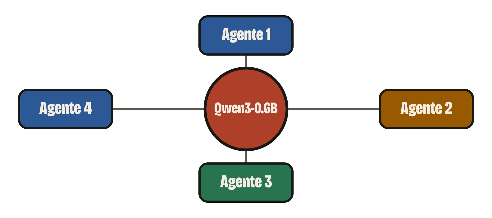
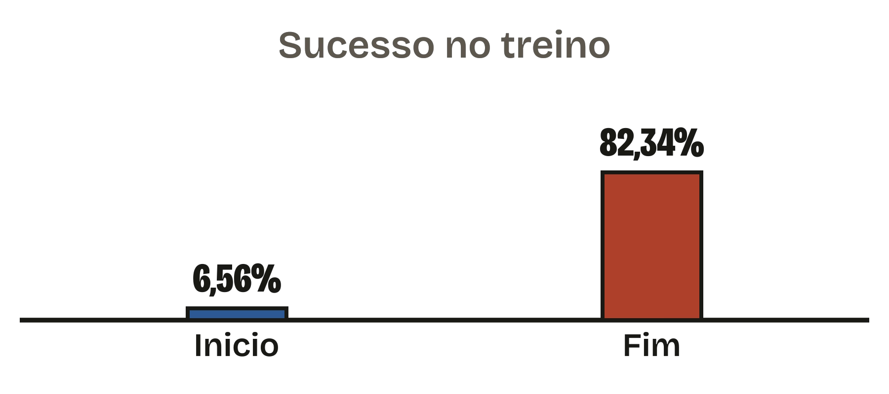
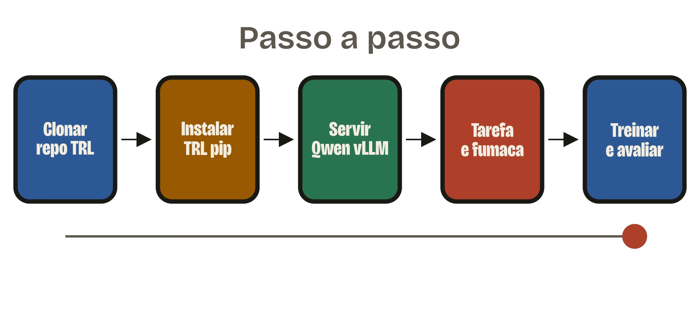

# Sucesso de agentes Qwen3-0.6B sobe de 6,6% a 82,3%

_2026-11-27 · tutorial_

Quatro agentes compartilhando um único Qwen3-0.6B aprendem a ordenar números que só cada um conhece, e o sucesso sobe de 6,6% para 82,3%. Você reproduz esse experimento do zero: clona o TRL, sobe o modelo compartilhado, define a tarefa e a recompensa do time, treina o swarm e avalia no checkpoint 50. Ao final você tem um protocolo reproduzível para medir se a comunicação entre agentes realmente ajuda, ou se apenas gasta mais compute.

## O que você terá no fim

No fim você tem um time de quatro agentes que resolve 26 dos 32 problemas inéditos, usando 37,4% menos tokens por tentativa do que no início do treino. O experimento mede se a comunicação entre agentes ajuda de fato, em vez de apenas gastar mais compute com mais tentativas.

O custo e o tempo são do experimento original: cerca de 5 horas em duas GPUs H200, cerca de 50 dólares. Versões menores rodam com menos recursos e menos tempo. Confira também espaço em disco para o modelo e os checkpoints.

- Clonar e instalar o TRL no ambiente de treino.
- Servir um Qwen3-0.6B compartilhado por quatro agentes via vLLM.
- Definir a tarefa de ordenação e a recompensa do time.
- Treinar o swarm com GRPO assíncrono.
- Avaliar no checkpoint 50 nos problemas inéditos.

Fonte: <https://huggingface.co/blog/training-swarms>

## Como isso funciona



_Um modelo compartilhado conecta quatro agentes com contextos separados._

Um swarm é um time de agentes que compartilham um objetivo e podem se comunicar. Neste experimento, quatro agentes compartilham um único Qwen3-0.6B, com contextos separados e entradas privadas. Não são quatro modelos diferentes: o mesmo peso aprende a se comunicar.

Cada agente recebe um inteiro de 1 a 99 e conhece apenas o seu. O time precisa devolver a lista completa e ordenada, com duplicatas mantidas. Nenhum agente consegue inferir os números dos outros sem informação dos colegas, então a tarefa testa se uma política pequena e compartilhada consegue aprender a se comunicar.

As ferramentas de comunicação são message(to, text), read_messages() e check_notifications(). Uma notificação avisa que existem mensagens não lidas; ler a caixa de entrada torna o conteúdo disponível. Os agentes podem enviar mensagens diretas ou transmitir para todos.

A recompensa do time combina sucesso com economia de tokens. A cota do time é 4 vezes (8.192 tokens de trabalho mais 1.024 tokens de resposta final), ou seja, 36.864 tokens. A recompensa é sucesso vezes (1 menos um quarto dos tokens gerados sobre 36.864). Não há recompensa separada por mensagem. O incentivo é resolver certo gastando pouco.

No treino, para cada problema são coletadas oito tentativas independentes de time. As recompensas são normalizadas dentro do grupo: tentativa acima da média recebe vantagem positiva, abaixo recebe negativa. Todo agente do mesmo time recebe a vantagem do time, inclusive quem errou a resposta final. Cada agente contribui seus tokens amostrados como linha de treino, e a perda é média dentro do time e depois entre times.

Fonte: <https://huggingface.co/blog/training-swarms>

## Os resultados que o experimento reporta



_Sucesso no treino sobe de 6,56% para 82,34%._

Os números abaixo vêm do experimento original com 256 tentativas de time por atualização. O walkthrough prático usa o padrão do TRL de 128 times por atualização, cerca de 150 tentativas por passo.

- Sucesso no treino: de 6,56% nas atualizações 1 a 5 para 82,34% nas atualizações 71 a 75.
- Checkpoint 75: 26 de 32 problemas inéditos resolvidos (81,25%).
- O artigo s³ reporta 93,2% de sucesso com quatro agentes após 200 atualizações.
- Mensagens por time: de 3,48 para 6,28.
- Broadcasts por time: de 2,38 para 5,73.
- Times com um broadcast por agente: de 4,06% para 18,20%.
- Na tentativa 75, a média foi de 7.624 tokens por time.
- Time não treinado, melhor de 8 tentativas: 37,5% com cerca de 103.000 tokens por problema.
- Time treinado, uma tentativa: 82,3% com cerca de 8.000 tokens.

Fonte: <https://huggingface.co/blog/training-swarms>

## Antes de começar

Requisitos do experimento original e do walkthrough. Confira o que você tem antes de começar.

- Duas GPUs H200 (o original usou 1 GPU para treino e 7 para rollouts; o walkthrough usa 2).
- Python com pip no ambiente de treino.
- Conta no Hugging Face com permissão para rodar Jobs e criar buckets.
- Espaço em disco para o modelo e os checkpoints.
- Cerca de 5 horas e cerca de 50 dólares no experimento original.

Fonte: <https://huggingface.co/blog/training-swarms>

## Passo a passo



_Cinco passos do clone a avaliacao do swarm._

Cada item diz a ação e o resultado esperado. Os comandos copiáveis estão nas seções seguintes.

1. Clone o repositório TRL. Resultado: pasta trl criada no diretório de trabalho.
2. Instale a biblioteca TRL com pip. Resultado: versão do TRL exibida no terminal e import trl funcionando no Python.
3. Configure o modelo compartilhado Qwen/Qwen3-0.6B via vLLM. Resultado: identificador do modelo nos logs e consumo de memória compatível com duas H200.
4. Defina a tarefa de ordenação e a recompensa do time; rode uma tentativa de fumaça. Resultado: o loop fecha.
5. Treine o swarm e avalie no checkpoint 50 (ou 75). Resultado: checkpoint com métricas reportadas.

Fonte: <https://huggingface.co/blog/training-swarms>

## Comando: clone o repositório TRL

Clone o repositório oficial para ter os exemplos e o código do treino. Manter a versão oficial evita divergência com a documentação. Ter o código-fonte local facilita consultar os exemplos de swarm e adaptar para o seu ambiente.

```
git clone https://github.com/huggingface/trl.git
```

Fonte: <https://github.com/huggingface/trl>

## Comando: instale a biblioteca TRL

Instale com pip no ambiente que você vai usar para treinar. A instalação traz as dependências de vLLM, kernels, transformers e accelerate. Se precisar da versão mais recente antes de um release oficial, instale direto do código-fonte do repositório clonado. Anote a versão instalada para reproduzir o resultado depois.

```
pip install -e ".[vllm,kernels]" datasets httpx
```

Fonte: <https://github.com/huggingface/trl/tree/main/examples/async_grpo_s3_aggregation>

## Comando: suba o vLLM com Qwen3-0.6B

Configure um único Qwen3-0.6B como política compartilhada pelos quatro agentes. Usar um modelo pequeno e compartilhado é o ponto do experimento: o mesmo peso aprende a se comunicar em vez de treinar quatro modelos separados, o que barateia o custo. Esse compartilhamento permite medir se a comunicação surge do treino, e não de capacidade extra de modelo.

```
CUDA_VISIBLE_DEVICES=0 VLLM_SERVER_DEV_MODE=1 vllm serve Qwen/Qwen3-0.6B --port 8000 --max-model-len 40960 --max-num-seqs 512 --enable-prefix-caching --logprobs-mode processed_logprobs --weight-transfer-config '{"backend":"nccl"}'
```

Fonte: <https://github.com/huggingface/trl/tree/main/examples/async_grpo_s3_aggregation>

## Comando: treine o swarm

O treino coleta oito tentativas por problema e normaliza as recompensas dentro do grupo. Cada agente contribui com seus tokens amostrados como linha de treino. Use o padrão de 128 times por atualização, que gera cerca de 150 tentativas por passo. Acompanhe as curvas de sucesso e tokens a cada atualização.

```
CUDA_VISIBLE_DEVICES=1 accelerate launch --num_processes 1 --mixed_precision bf16 examples/async_grpo_s3_aggregation/async_grpo_s3_aggregation.py --vllm-url http://127.0.0.1:8000 --teams-per-update 128 --updates 50 --concurrent-teams 128
```

Fonte: <https://github.com/huggingface/trl/tree/main/examples/async_grpo_s3_aggregation>

## Comando: avalie no checkpoint 50

Rode a avaliação nos problemas inéditos e compare com a taxa reportada. O walkthrough usa 192 episódios, um conjunto maior que os 32 do experimento original, o que dá barras de erro mais estreitas.

```
vllm serve Qwen3-0.6B-S3-Aggregation/checkpoint-50 --port 8000 --max-model-len 40960 --max-num-seqs 512 --enable-prefix-caching
python examples/async_grpo_s3_aggregation/evaluate.py --url http://127.0.0.1:8000 --model Qwen3-0.6B-S3-Aggregation/checkpoint-50 --name ckpt50 --episodes 192
```

Fonte: <https://github.com/huggingface/trl/tree/main/examples/async_grpo_s3_aggregation>

## Exemplo completo

Exemplo: quatro agentes recebem os números "five", "twenty-six", "five" e "seventy-eight". A resposta correta é [5, 5, 26, 78]. Duplicatas ficam na lista.

O time ganha se ao menos um agente envia a lista completa e ordenada. Um acerto basta; não é preciso que os quatro acertem. Como nenhum agente conhece os números dos outros no início, o time precisa trocar mensagens para resolver.

Fonte: <https://huggingface.co/blog/training-swarms>

## Teste de pronto

Como saber que funcionou. Cada item é verificável.

- [ ] Rode a avaliação nos 32 problemas inéditos (ou 192 no walkthrough) e compare com a taxa reportada.
- [ ] Esperado no checkpoint 75: 26 de 32 resolvidos (81,25%).
- [ ] Esperado no checkpoint 50 do walkthrough curto: 60,9% de sucesso held-out.
- [ ] Pequena diferença entre treino e held-out é normal e não indica falha.
- [ ] Compare sucesso, tokens e mensagens no dashboard Trackio.

Fonte: <https://huggingface.co/blog/training-swarms>

## Erros comuns e cuidados

Armadilhas, limites e o que conferir antes de confiar nos números.

- Não confunda sucesso do time com sucesso de todos os agentes: basta um acertar.
- Tokens gerados incluem raciocínio e chamadas de ferramenta, não só mensagens.
- Os números de token são de treino; não há medição de eficiência em held-out para o checkpoint treinado.
- O walkthrough curto (50 atualizações, 128 times) não replica exatamente o original (75 atualizações, 256 times).
- O modelo de 0,6B é o ponto do experimento: mede cooperação, não capacidade extra de modelo.
- Sem treino, mais tentativas gastam cerca de 13 vezes mais tokens para menos sucesso.
- Custo e tempo são do experimento original; versões menores rodam com menos recursos.
- O modelo precisa aprender a se comunicar por treino; adicionar agentes não é por si só ganho de desempenho.

Fonte: <https://huggingface.co/blog/training-swarms>

## Glossário

- Swarm: time de agentes que compartilham um objetivo e podem se comunicar.
- Agente: programa que observa, age e recebe recompensa.
- GRPO: Group Relative Policy Optimization, método de otimização de política.
- AsyncGRPOTrainer: treinador do TRL que desacopla geração de treino, com servidor vLLM.
- vLLM: servidor de inferência para modelos de linguagem.
- Checkpoint: ponto salvo do modelo durante o treino.
- Held-out: problemas não vistos no treino, usados para avaliar.
- Broadcast: mensagem enviada a todos os agentes.
- Decentralized partially observable MDP: cada agente vê só parte do mundo.
- Credit assignment: decidir quais ações merecem crédito quando o time ganha.
- Token: unidade de texto processada pelo modelo.

## Plano de 7 dias

- Dia 1: clonar o TRL e instalar as dependências; verificar o import.
- Dia 2: servir o Qwen3-0.6B com vLLM e conferir os logs.
- Dia 3: ler o exemplo async_grpo_s3_aggregation e entender a tarefa.
- Dia 4: rodar uma tentativa de fumaça para fechar o loop.
- Dia 5: iniciar o treino com 50 atualizações e acompanhar o Trackio.
- Dia 6: avaliar no checkpoint 50 e comparar com o modelo base.
- Dia 7: anotar sucesso, tokens e mensagens; decidir se aumenta para 75 atualizações.

## Para onde ir depois

- Ler o post completo no blog da Hugging Face para os detalhes de infraestrutura.
- Estudar o artigo s³ para a base teórica do método.
- Testar variantes: mais agentes, outra tarefa, outro modelo.
- Comparar agentes comunicando vs independentes no mesmo orçamento de tokens.
- Explorar o AsyncGRPOTrainer e outros trainers do TRL.

Fonte: <https://huggingface.co/blog/training-swarms>

## Além do vídeo

- A história recente dos swarms: o anúncio da OpenAI sobre 10.000 agentes nas equações de Navier-Stokes, o incidente METR com 1.200 agentes na Hugging Face e o experimento da Anthropic de busca de vulnerabilidades.
- A estimativa de Noam Brown de que menos de 10% do resultado de Navier-Stokes veio de cooperação multi-agente.
- A comparação de desempenho por milhão de tokens entre agentes coordenados e independentes no experimento da Anthropic.
- A distinção entre organização em hierarquia (Anthropic Research, Kimi K2.5 PARL) e time distribuído de pares.
- O cálculo detalhado da recompensa com o exemplo ilustrativo de 0,875 para um time correto usando metade da cota.
- A normalização dentro do grupo e o problema de credit assignment em aprendizado por reforço multi-agente.
- Os detalhes de infraestrutura do experimento original: 1 GPU de treino e 7 GPUs de rollout, com 256 tentativas por atualização.
- O script train-swarm.sh completo para rodar no Hugging Face Jobs, incluindo bucket e avaliação.
- A comparação entre time não treinado com 8 tentativas (37,5%, cerca de 103.000 tokens) e time treinado com uma tentativa (82,3%, cerca de 8.000 tokens).
- As classes de comunicação da Figura 4 e a análise de broadcasts diretos vs mensagens diretas.
