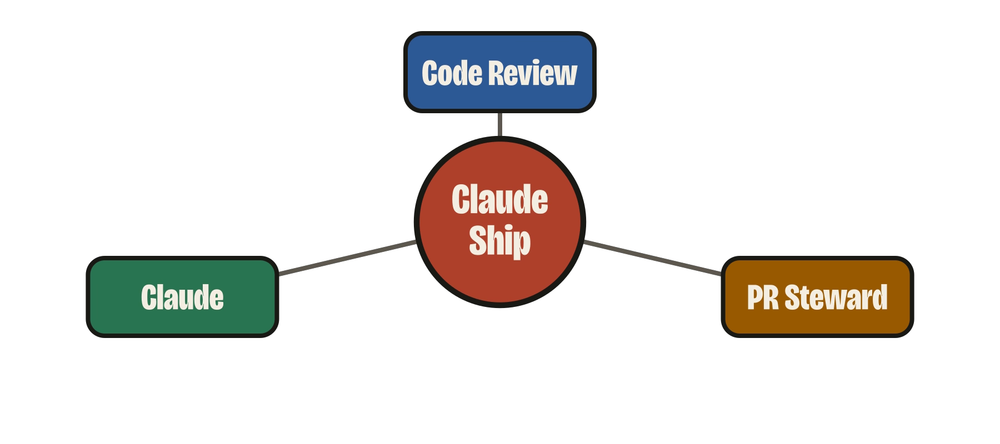
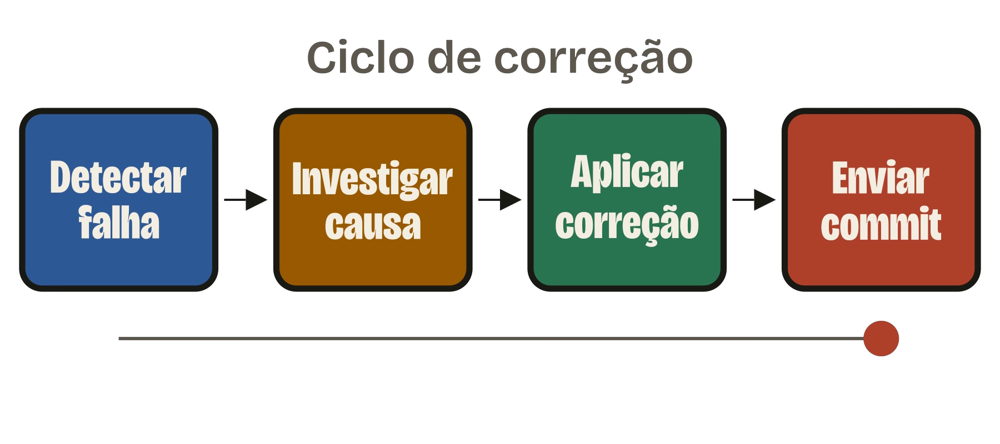
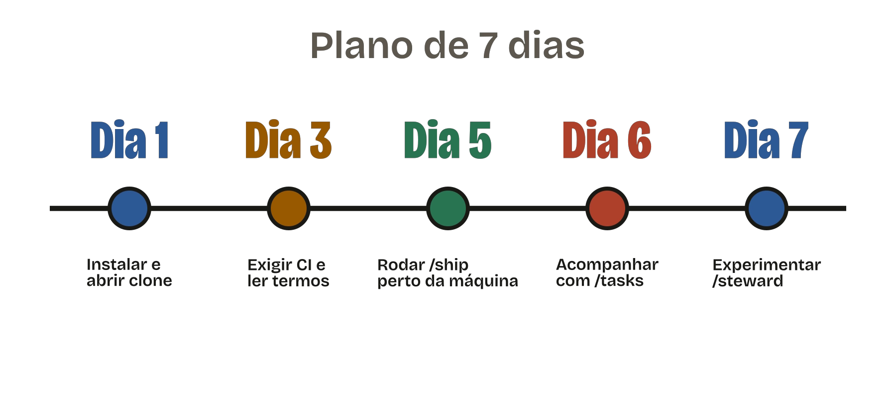

# Para manter o PR verde, o Claude Ship roda testes na sua máquina

_2026-11-28 · tutorial_

No fim, você terá um pull request seu acompanhado por um watch local no Claude Code, com correções enviadas quando checks falham, e o merge continua sendo sua decisão. O fluxo cobre instalação, abertura do clone, autenticação do GitHub CLI, preparo dos arquivos, exigência de testes na CI, leitura dos termos, início do watch, acompanhamento e encerramento. O watch roda na sua máquina com suas credenciais e sua cota ou cobrança de API. Ele não substitui a CI nem a revisão humana. Se a equipe adotar o mesmo processo, há passos de habilitação e uma política de aprovação em modo observe.

## O que você terá no fim

No fim, você terá um pull request seu acompanhado por um watch local no Claude Code. O watch trabalha em checks que falham, conflitos e comentários, envia pequenas correções e deixa o merge para sua decisão.

O percurso tem nove passos: instalar o Claude Code, abrir o clone da branch, autenticar o GitHub CLI, preparar os arquivos do PR, exigir testes na CI, ler os termos do watch, iniciar o monitoramento, acompanhar testes e correções e encerrar o watch.

O watch roda na sua máquina, com suas credenciais e sua cota ou cobrança de API. Ele economiza trocas de contexto, mas não substitui a CI, as regras da branch nem a revisão humana.

Fonte: <https://code.claude.com/docs/en/ship>

## Como isso funciona



_Claude Ship divide o pós-PR em três agentes: Code Review, PR Steward e Claude Approvals._

Depois de abrir um PR, o trabalho costuma ser pequeno e repetitivo: CI falha, a revisão traz comentários e o merge da base cria conflito. Claude Ship divide esse pós-PR em três agentes: Code Review, PR Steward (beta) e Claude Approvals (beta).

Code Review faz uma revisão aprofundada do PR contra o código, coleta achados, verifica-os de forma adversarial, categoriza e publica no PR. Está disponível de forma geral.

PR Steward (beta) mantém o PR verde, sem aprovar nem fazer merge. Age em checks que falham, conflitos e feedback de revisão. Após cada push, comenta o que mudou e como desfazer. A versão de equipe roda como claude[bot] após habilitação por admin.

Claude Approvals (beta) aplica uma política de aprovação escrita como arquivo no repositório. Pode aprovar mudanças rotineiras quando a política permite, ou exigir assinatura humana mais profunda em cenários específicos. Funciona como um CODEOWNERS mais inteligente e pode considerar achados do Code Review ou classificadores próprios.

/ship é o comando que você roda no Claude Code para usar Claude Ship em seus próprios PRs. Ele funciona mesmo antes de um admin habilitar os agentes da equipe. O watch local roda como você, na sua máquina, e usa sua cota ou cobrança de API.

A revisão local pode ser feita antes do push com /code-review. Ele revisa os commits da branch e as mudanças não commitadas em busca de bugs de correção. O esforço vai de low a max: low retorna apenas achados em que a revisão tem mais certeza, níveis mais altos trazem um conjunto mais amplo, incluindo achados menos certos. O comando lembra o último esforço usado.

A variação ultra roda na nuvem, exige login em claude.ai e pode ser cobrada separadamente do plano. Leia a documentação do ultrareview antes de tentar.

Para PRs existentes, /steward executa apenas o componente de watch do /ship, sem revisar antes. Serve para PRs com checks vermelhos ou presos em loop de conflito. Não confunda /steward com PR Steward, que é o serviço de equipe.

```
/code-review
/code-review high 1234
/code-review --fix
/code-review --comment 1234
/code-review ultra
/steward 41
```

Fonte: <https://code.claude.com/docs/en/ship>

## Antes de começar

Confirme estes requisitos antes de iniciar o watch.

- macOS ou Linux, porque o watch não começa no Windows nativo.
- Conta GitHub com acesso ao repositório.
- Git 2.38 ou superior instalado.
- GitHub CLI 2.63 ou superior instalado.
- Branch própria com mudança concluída.
- CI funcionando na branch base.
- Repositório hospedado no GitHub.
- Máquina e sessão abertas durante todo o watch.
- Repositório em que você confia em todos que podem integrar mudanças na branch base.
- Sem hook PreToolUse ou PermissionRequest em Bash no arquivo .claude/settings.json do repositório.
- Não estar em modo bypass-permissions.
- GitHub CLI autenticado com gh auth login.

Fonte: <https://code.claude.com/docs/en/ship>

## Passo a passo

Cada item traz a ação e o resultado esperado. Os comandos aparecem em seções próprias, prontos para copiar.

1. 1. Instale o Claude Code: rode o instalador nativo no terminal. Resultado esperado: o instalador conclui e o Claude Code fica disponível no terminal.
2. 2. Abra o clone da branch: no terminal, entre na pasta do repositório e execute claude. Resultado esperado: o Claude Code abre no repositório atual e reconhece o código.
3. 3. Autentique o GitHub CLI: execute gh auth login. Resultado esperado: o GitHub CLI fica autenticado na conta que pode abrir e atualizar seu PR.
4. 4. Prepare os arquivos do PR: execute git status e trate manualmente os arquivos que definem regras ou têm nomes que parecem segredos. Resultado esperado: a árvore contém apenas a mudança do PR.
5. 5. Exija testes na CI: inclua os testes obrigatórios na CI e nas regras da branch base. Resultado esperado: a branch base exige checks de CI aprovados antes do merge.
6. 6. Leia os termos do watch: execute /ship terms. Resultado esperado: a sessão mostra o que o watch pode fazer e quais limites se aplicam.
7. 7. Inicie o watch local: com a branch do seu PR aberta, execute /ship; para pular a revisão, use /steward. Resultado esperado: o PR é criado se necessário, a revisão começa e o watch acompanha checks, conflitos e comentários.
8. 8. Acompanhe testes e correções: use /tasks e abra os checks do PR no GitHub. Resultado esperado: a sessão mostra o watch como tarefa agendada e informa quando checks e comentários estão resolvidos.
9. 9. Encerre o watch local: execute /ship stop e faça o merge você mesmo. Resultado esperado: Stopped watching aparece na sessão e o PR fica aberto para seu merge.

Fonte: <https://code.claude.com/docs/en/ship>

## Instale o Claude Code

Rode o instalador nativo no macOS ou Linux. Esse executador roda no seu ambiente, então permissões, dependências e credenciais são as mesmas do trabalho diário.

```
curl -fsSL https://claude.ai/install.sh | bash
```

Fonte: <https://github.com/anthropics/claude-code>

## Abra o clone da branch

Abra o Claude Code dentro da pasta do repositório, para que ele enxergue a branch e o histórico antes de qualquer ação. Essa sessão fará commit, push, revisão e monitoramento; o watch edita os arquivos desse checkout.

Se o Git for anterior a 2.38, o Claude deixa as mesclagens para você.

```
claude
```

Fonte: <https://github.com/anthropics/claude-code>

## Autentique o GitHub CLI

Use a conta que tem acesso ao repositório e ao seu PR. O watch usa essa identidade para ler checks, responder comentários e enviar correções; por isso, a autoria das ações aparece como sua.

Essa credencial também fica disponível para programas que o watch executar localmente. Use sua conta pessoal somente em um repositório confiável.

Se o watch não começar, atualize o GitHub CLI; a versão mínima é 2.63.

```
gh auth login
```

Fonte: <https://code.claude.com/docs/en/ship>

## Prepare os arquivos do PR

Execute a checagem de estado e revise a árvore de trabalho antes de deixar o agente preparar o PR. O comando de envio pode considerar todas as mudanças pendentes, então novos arquivos também precisam passar pela sua revisão.

Arquivos que definem regras e nomes que parecem segredos ficam fora do commit automático e exigem sua ação manual. Confira também o conteúdo dos arquivos, porque a triagem por nome não garante ausência de segredos.

Em repositório público, o /ship não faz commits por você; commite a mudança antes de continuar. Se o PR já existir, as mudanças pendentes não serão incluídas.

```
git status
```

Fonte: <https://code.claude.com/docs/en/ship>

## Exija testes na CI

Coloque as verificações obrigatórias na CI e exija esses checks nas regras da branch base. Durante o watch, commits e pushes do agente não acionam os hooks Git do repositório.

Uma regra local pode passar enquanto o PR segue sem a validação que o time considera necessária. A proteção precisa sobreviver fora da sua máquina e bloquear o merge quando um check falhar.

No fim desta configuração, a branch base deve mostrar esses checks como exigidos.

Fonte: <https://code.claude.com/docs/en/ship>

## Leia os termos do watch

Abra os termos na sessão antes de liberar o primeiro watch. Eles explicam quais comandos o agente pode executar e onde as restrições deixam de valer.

O watch pode mesclar a branch base na sua branch e rodar programas, incluindo testes, com as suas credenciais. Por isso, confie em todas as pessoas que podem integrar mudanças na base.

```
/ship terms
```

Fonte: <https://code.claude.com/docs/en/ship>

## Inicie o watch local

Execute o comando de envio com a branch do seu PR aberta. Ele pode criar o PR, revisar a mudança e iniciar o monitoramento na mesma sessão.

Em modo automático, o watch age sem parar a cada prompt; em modo manual, espera sua resposta. Essa escolha define quanto da correção acontece sem supervisão. Mantenha o computador acordado e a branch selecionada durante todo o período.

Uma falha ao começar exige revisão da plataforma, da branch e do modo de permissão. O modo irrestrito bloqueia o watch. No Windows nativo, o watch não começa; use macOS ou Linux.

```
/ship
```

Fonte: <https://code.claude.com/docs/en/ship>

## Acompanhe testes e correções



_O watch detecta falha, investiga a causa, aplica correção e envia commit._

Abra a lista de tarefas para confirmar que o monitoramento continua ativo depois da revisão. Ele procura falhas de CI, conflitos e comentários, aplica pequenas correções e envia commits na sua branch.

Quando um teste falha, o watch investiga a causa e repete a verificação, sem tratar o erro como detalhe. Alterações maiores são escaladas para você. O acompanhamento usa sua cota ou cobrança de API enquanto você está longe do teclado.

A sessão deve informar quando os checks passam e os comentários foram respondidos. Se a tarefa desaparecer, verifique branch, sessão e limite de uso.

Fonte: <https://code.claude.com/docs/en/ship>

## Encerre o watch local

Encerre o monitoramento quando o PR estiver pronto para sua decisão. O comando de parada impede novas rodadas, mas uma ação já em andamento pode terminar e chegar ao PR.

O merge continua sendo seu, mesmo que as verificações estejam verdes. Checks aprovados habilitam o merge e ainda deixam a revisão final da mudança com você.

A sessão deve confirmar a parada e deixar o PR aberto. Se o agente estiver ocupado, interrompa o turno também para bloquear a entrega daquela ação.

```
/ship stop
```

Fonte: <https://code.claude.com/docs/en/ship>

## Exemplo completo

Imagine que você está em macOS ou Linux, com o Claude Code aberto no clone da branch e o GitHub CLI autenticado. Você rodou git status e tratou manualmente os arquivos de regras e nomes suspeitos. A branch base já exige checks de CI.

Você executa /ship terms e depois /ship. O PR é criado se necessário, a revisão começa e o watch passa a acompanhar checks, conflitos e comentários. Um check falha; o watch investiga a causa, aplica uma correção pequena, envia um commit e comenta o que mudou e como desfazer.

Você usa /tasks para confirmar que a tarefa agendada continua ativa e, no GitHub, acompanha os checks obrigatórios até ficarem aprovados. Se o problema persistir após três tentativas, o watch escala para você.

Ao final, você executa /ship stop, a sessão confirma Stopped watching e você faz o merge. Se o agente estiver trabalhando, o watch termina após o turno atual; pressione Esc para interromper também o turno.

Fonte: <https://code.claude.com/docs/en/ship>

## Teste de pronto

Use estes critérios para saber se o fluxo funcionou.

- [ ] A lista de tarefas mostra o watch ativo.
- [ ] Os checks obrigatórios do PR ficam aprovados no GitHub.
- [ ] A sessão informa quando checks e comentários estão resolvidos.
- [ ] Se você começou com uma checagem vermelha, a correção e o novo commit levam a verificação a passar.
- [ ] O computador permaneceu acordado e a branch selecionada durante todo o watch.
- [ ] Sem tarefa agendada, /ship pode ter feito apenas a revisão; confira sessão, branch e permissões.

Fonte: <https://code.claude.com/docs/en/ship>

## Erros comuns e cuidados

Estes pontos evitam surpresas durante o watch.

- O watch não começa no Windows nativo; use macOS ou Linux.
- Fechar o laptop para o watch; mantenha a sessão aberta e a máquina acordada.
- O watch usa sua cota ou cobrança de API; na primeira vez, fique perto da máquina.
- Só rode o watch em repositório em que você confia em todos que podem integrar mudanças na branch base.
- Qualquer pessoa com capacidade de integrar mudanças na base pode rodar comandos na sua máquina durante o watch.
- Claude é instruído a nunca fazer merge do PR e restringe comandos gh e git durante turno não supervisionado, impedindo merge direto e force-push.
- Essa restrição não cobre todos os vetores: o script de teste roda com suas credenciais; digitar uma mensagem durante o turno libera as restrições daquele turno; com auto-merge habilitado, uma correção do watch pode ser o que permite o GitHub fazer merge.
- Commits e pushes do watch não são afetados por hooks Git do repositório; coloque verificações necessárias na CI e nas regras da branch.
- O watch não roda em modo bypass-permissions e, fora do modo automático, para a cada prompt.
- Uma sessão só roda um watch por vez; iniciar outro termina o anterior.
- Se a tarefa desaparecer, a sessão pode ter mudado de branch, iniciado outro watch ou atingido limite de uso.
- Não rode o watch se houver hook PreToolUse ou PermissionRequest em Bash em .claude/settings.json.
- Em repositório público, /ship não commita mudanças; commite manualmente.
- /ship não commita arquivos com nomes que parecem segredos nem arquivos que definem regras, como CLAUDE.md, REVIEW.md, .claude/ e .github/. Trate-os manualmente.
- Confira o conteúdo dos arquivos; a triagem por nome não garante ausência de segredos.
- Git anterior a 2.38 faz o Claude deixar mesclagens para você.
- GitHub CLI anterior a 2.63 impede o monitoramento.
- Se o agente estiver trabalhando, /ship stop termina após o turno atual; pressione Esc para interromper o turno também.
- Alterações maiores são escaladas; para um mesmo problema, o watch tenta no máximo três vezes e depois relata as soluções tentadas.
- Claude Ship e comandos locais usam IA e podem perder bugs, problemas de segurança e outros. Mantenha testes, scanners e revisores existentes.
- PR Steward de equipe (beta) lê comentários de revisores e pode ser enganado por texto; use apenas em repositórios com colaboradores confiáveis e verifique mudanças de usuários não confiáveis.
- Claude Approvals conta como aprovação real no GitHub; se uma ruleset precisa de uma aprovação, a de Claude pode bastar sozinha.

Fonte: <https://code.claude.com/docs/en/ship>

## Se a equipe adotar o mesmo processo

/ship funciona em seus próprios PRs mesmo antes de um admin habilitar agentes. Para padronizar entre PRs da equipe, a conversa com admins deve cobrir um repositório, voluntários e tempo limitado, além de limites de orçamento.

Habilitação: proteja a branch padrão, exigindo aprovação na última push e mantendo o Claude GitHub App fora da lista de bypass. Um Owner da organização Claude habilita Code Review e PR Steward em modo manual. PR Steward é acionado por comentário @claude steward de usuário com acesso de escrita, ou por opt-in automático do autor; pare com @claude stop.

Crie uma política de aprovação em modo observe no arquivo .claude/approvals.yml na branch padrão. Em modo observe, a verificação imprime o resultado, mas não aprova.

seats é o número de pessoas que precisam aprovar; o autor pode ocupar um dos lugares. Depois que o watch mescla a branch base, o commit mais recente é um merge commit e ninguém ocupa o lugar do autor, então o autor do PR deve comentar @claude approve.

Quando a decisão é claude: comments, Claude não aprova. Se mais de uma regra corresponder, a mais restritiva vence. Mantenha a linha advisory: [claude/code_review]; sem ela, revisões automáticas param quando a política entra na branch padrão.

Uma política com override inicia Code Reviews cobrados a cada push, mesmo onde Code Review está desligado. Avise o responsável pelo orçamento antes de mesclar. Classificadores próprios ficam em .claude/classifiers/<nome>/def.yml na branch padrão; cada execução é cobrada, mesmo em modo observe.

Monitore por uma ou duas semanas. As decisões aparecem no check Claude Approvals e no comentário associado. Compare com o comportamento dos revisores e corrija os falsos positivos antes de relaxar regras.

Para exigir aprovação humana em caminhos sensíveis, use uma regra sem if ou override, com nested: inherit. Para enforcement, remova mode: observe e mescle; cerca de cinco minutos depois, comente @claude approvals rerun nos PRs abertos para limpar resultados antigos. Peça a um admin do repositório que torne o check Claude Approvals obrigatório e escolha o app Claude como fonte.

Claude Approvals conta como aprovação real no GitHub. Com auto-merge e políticas que só o autor pode cumprir, PRs podem ser mesclados sem ação humana. Decida explicitamente se isso é aceitável para cada caminho.

Repetição de padrões: comentários repetidos viram regras em CLAUDE.md para revisão local, ou em REVIEW.md para Code Review. Um padrão deve se repetir em pelo menos 2 PRs antes de virar regra; a pessoa aprova o PR que adiciona a regra. Exclua regras quando necessário. Code Review não lê REVIEW.md do PR em revisão e respeita algumas instruções, como excluir caminhos e limitar nits, quando a branch padrão está protegida.

Configuração repetida vira uma skill de verificação em .claude/skills/verify/SKILL.md. Manutenção repetida de PR vira regras de steward em .claude/skills/steward/SKILL.md. O watch local lê do diretório de trabalho; PR Steward em nuvem lê da branch padrão. O arquivo de steward não altera as restrições do watch. Qualquer pessoa que possa mesclar pode editá-lo, então revise mudanças como revisaria mudanças em CI.

Claude Ship e comandos locais usam IA e podem perder bugs e problemas de segurança; mantenha testes, scanners e revisores.

Fonte: <https://code.claude.com/docs/en/ship>

## Política de aprovação em modo observe

Exemplo de arquivo .claude/approvals.yml para começar em modo observe.

```
# .claude/approvals.yml
version: 1
mode: observe
rules:
 - purpose: "A change takes two people."
   paths: ["**"]
   verdict: { claude: comments, seats: 2 }
   advisory: [claude/code_review]
 - purpose: "A change to the review rules takes two people."
   paths: ["**/.claude/**", "**/REVIEW.md", "**/CLAUDE.md", "**/CODEOWNERS", ".github/**"]
   nested: inherit
   verdict: { claude: comments, seats: 2 }
```

Fonte: <https://code.claude.com/docs/en/ship>

## Override de aprovação

Exemplo de override que substitui a decisão quando a revisão do Claude passa.

```
override:
 - { if: "claude/code_review = pass", verdict: { claude: approves, seats: 1 } }
```

Fonte: <https://code.claude.com/docs/en/ship>

## Exigência de aprovação humana

Exemplo de regra para caminhos que sempre precisam de um segundo par de olhos, sem override.

```
- purpose: "Auth, billing and CI take a person who isn't an author."
  paths: ["src/auth/**", "src/billing/**", ".github/**"]
  nested: inherit
  verdict: claude: comments
  seats: [{ count: 1, from: [humans, "!pr/authors"] }]
```

Fonte: <https://code.claude.com/docs/en/ship>

## Regras de revisão repetidas

Exemplo de REVIEW.md para o Code Review.

```
# Review instructions

## What Important means here
Wrong results, leaked data or anything that blocks a rollback. Style and naming are Nit at most.

## Always check
- Database queries are scoped to the caller's tenant.
- New API routes have an integration test.

## Keep it quiet
- Report at most five Nits.
- Skip generated files and lockfiles.
- Behavior claims need a file and line.
```

Fonte: <https://code.claude.com/docs/en/ship>

## Skill de verificação

Exemplo de .claude/skills/verify/SKILL.md para registrar como subir e exercitar o aplicativo.

```
---
name: verify
description: Run the web app and exercise a change end to end. Use before committing.
---

1. Start the stack with npm run dev:stack.
2. Wait for /healthz on port 3000 to return 200.
3. Sign in with the seeded test account.
4. Exercise the changed flow in the browser and take a screenshot.
5. Report the steps you ran and what you saw. Don't report success without them.
```

Fonte: <https://code.claude.com/docs/en/ship>

## Regras de steward

Exemplo de .claude/skills/steward/SKILL.md com regras de manutenção de PR.

```
---
name: steward
description: House rules for looking after PRs in this repository
user-invocable: false
disable-model-invocation: true
---

- Regenerate the lockfile with npm install; don't edit it by hand.
- `e2e-nightly` is flaky. Re-run it once before looking for a cause.
- Run npm test and npm run lint before pushing a fix.
- Leave comments about API design to the author.
```

Fonte: <https://code.claude.com/docs/en/ship>

## Glossário

- Pull request (PR): proposta de mudança em um repositório Git, aberta para revisão antes de entrar na branch base.
- Branch base: branch de destino do PR, geralmente a principal.
- CI: integração contínua; conjunto de verificações automáticas que rodam no repositório.
- Check: uma verificação individual da CI.
- Watch: monitoramento local que acompanha checks, conflitos e comentários do PR.
- Merge: integração da branch do PR na branch base.
- Commit: registro de mudanças no histórico Git.
- Push: envio de commits para o repositório remoto.
- Hook Git: script executado automaticamente em eventos do Git.
- Worktree: cópia adicional de trabalho do mesmo repositório, usada para não trocar de branch.
- Bypass-permissions mode: modo em que o Claude Code não pede permissão para executar ferramentas.
- Modo automático: modo em que o watch age sem parar a cada prompt.
- Code Review: agente que revisa PRs em profundidade e publica achados.
- PR Steward: agente (beta) que mantém o PR verde, sem aprovar nem fazer merge.
- Claude Approvals: agente (beta) que aplica política de aprovação do repositório.
- Observe mode: modo em que a verificação imprime o resultado, mas não aprova.
- Override: regra que substitui a decisão quando uma condição é atendida.
- Classificador: regra personalizada usada na política de aprovação.
- CODEOWNERS: arquivo que define quem revisa determinados caminhos.
- CLAUDE.md: arquivo com instruções para o Claude Code no repositório.
- REVIEW.md: arquivo com regras de revisão para o Code Review.
- .claude/skills: diretório de habilidades reutilizáveis do Claude Code.
- .claude/approvals.yml: arquivo de política de aprovação na branch padrão.
- Branch protection: regras que exigem aprovações e checks antes do merge.
- Required check: check que deve passar para o merge ser permitido.
- GitHub App: aplicativo instalado no repositório, usado pelo Claude.
- Cota: limite de uso do plano.
- API bill: cobrança por uso da API.
- Tarefa agendada: entrada mostrada por /tasks representando o watch.
- Conflict loop: repetição de conflitos de merge.
- Escalação: envio de decisão maior para o autor.

Fonte: <https://code.claude.com/docs/en/ship>

## Plano de 7 dias



_Plano de sete dias para instalar, autenticar, revisar e rodar o watch._

- Dia 1: instale o Claude Code e abra o clone da branch.
- Dia 2: autentique o GitHub CLI e execute git status.
- Dia 3: exija testes na CI e leia os termos com /ship terms.
- Dia 4: revise a branch com /code-review e anote acertos e erros.
- Dia 5: em um repositório confiável, rode /ship e permaneça perto da máquina.
- Dia 6: use /tasks para acompanhar checks e correções; encerre com /ship stop.
- Dia 7: experimente /steward em um PR existente e, se um padrão se repetir, registre-o em CLAUDE.md, REVIEW.md ou skill.

Fonte: <https://code.claude.com/docs/en/ship>

## Para onde ir depois

- Rodar /code-review na branch atual e anotar o que acertou e o que errou.
- Em um repositório confiável, experimentar /ship e permanecer perto da máquina.
- Experimentar /steward em um PR existente, em outro terminal e checkout.
- Criar um PR pequeno com a regra mais repetida, em CLAUDE.md, REVIEW.md ou skill, fazendo o commit manualmente.
- Compartilhar o exemplo de política em modo observe com a equipe.
- Se a equipe adotar, pedir aos admins proteção da branch padrão, habilitação do Code Review e do PR Steward em modo manual, e uma política inicial em .claude/approvals.yml.
- Ler os termos com /ship terms antes do primeiro watch.

Fonte: <https://code.claude.com/docs/en/ship>
